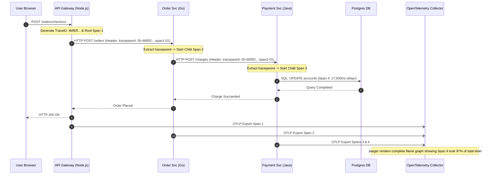

## Fast Revision (10-Second Recall)
- **Core Concepts:** A **Trace** represents the complete end-to-end transaction journey. A **Span** represents a single unit of contiguous work (e.g., HTTP handler, SQL query, Kafka publish) with a start time, duration, tags, and parent-child hierarchy.
- **W3C Trace Context Standard:** The universal HTTP header standard:
  - `traceparent: 00-4bf92f3577b34da6a3ce929d0e0e4736-00f067aa0ba902b7-01`
  - Version (00) - TraceID (32 hex) - ParentSpanID (16 hex) - TraceFlags (01 = sampled).
- **Context Propagation:** When Service A calls Service B via HTTP or Kafka, it must inject the trace context into outgoing headers; Service B must extract it to create child spans.
- **Auto-Instrumentation vs Manual Spans:** Use OpenTelemetry auto-instrumentation for standard libraries (Express, PostgreSQL, Redis, gRPC, Kafka) and manual spans only for unique business logic blocks.
- **OpenTelemetry Collector:** Run the OTel Collector as a sidecar or DaemonSet to batch, compress, filter, and export traces to backends (Jaeger, Tempo, Datadog) out-of-process.

## The 30-Second Spoken Script
> "Implementing distributed tracing requires standardizing on **OpenTelemetry** and the **W3C Trace Context** specification to ensure seamless context propagation across diverse services and runtimes.
>
> The architecture relies on three primary components:
> First, **Context Propagation**: When a user request enters through the API Gateway, the gateway generates a unique 128-bit `trace_id` and root `span_id`. When that service invokes downstream services over HTTP, gRPC, or asynchronous message queues (like Kafka), it injects the W3C `traceparent` header into the outgoing request metadata. The receiving service extracts the header, making its internal operations child spans of the upstream call.
> Second, **Automated SDK Instrumentation**: We leverage OpenTelemetry auto-instrumentation packages. These automatically monkey-patch standard network and storage libraries—such as Express, Axios, PostgreSQL, and Redis—capturing latency spans, SQL queries, and error statuses without polluting our application business logic.
> Third, **The OpenTelemetry Collector**: Application pods export spans via OTLP over gRPC to a local OpenTelemetry Collector DaemonSet. The Collector handles batching, tail-based sampling, and PII redaction before forwarding spans to storage backends like Grafana Tempo or Jaeger, ensuring zero performance impact on the application request path."

## Scenario / Problem Context
An e-commerce architecture consists of 14 microservices written in Node.js, Go, and Java. 

When a user clicks "Place Order", the request traverses:
`API Gateway -> Order Service -> Inventory Service -> Payment Service -> Notification Service`

A customer reported that their checkout took 18 seconds to complete. The logs across all 14 services showed thousands of entries around the same timestamp. Because each microservice had its own local logger with independent formats, the engineering team spent 4 days trying to correlate log timestamps across timezones to figure out which microservice was responsible for the 18-second delay.

The organization needs a distributed tracing solution that visualizes the entire request lifecycle across all 14 services in a single interactive flame graph.

## Architectural Workflow / Sequence


## Deep-Dive Analysis & Root Causes

### 1. W3C Trace Context Anatomy
The universal standard for distributed tracing context is `traceparent`:
`00-4bf92f3577b34da6a3ce929d0e0e4736-00f067aa0ba902b7-01`
- `00`: Protocol version.
- `4bf92f3577b34da6a3ce929d0e0e4736`: 16-byte (32-character hex) **Trace ID**. Globally unique across the entire distributed system.
- `00f067aa0ba902b7`: 8-byte (16-character hex) **Parent Span ID**. Identifies the immediate calling operation.
- `01`: **Trace Flags**. Bit 1 (`01`) indicates the trace was sampled (recorded); `00` indicates not sampled.

### 2. Context Propagation Across Asynchronous Queues
While HTTP uses headers, message brokers require injecting trace context into message metadata:
- **Kafka:** Injected into `record.headers`.
- **RabbitMQ:** Injected into message `properties.headers`.
- **AWS SQS:** Injected into `MessageAttributes`.
When a worker picks up a message, it extracts the `traceparent` from the attributes and starts a consumer span linked to the producer span.

### 3. Trace Sampling: Head vs Tail
- **Head Sampling (Gateway):** Decides whether to trace at request arrival (e.g. 10% random sampling). Problem: You might randomly discard the 1% of requests that ended up crashing with an error!
- **Tail Sampling (Collector):** The OpenTelemetry Collector buffers all spans in memory until the request completes. If the trace contains any span with `status.code == ERROR` or `duration > 1500ms`, it keeps 100% of the trace. If it was a normal fast request, it keeps only 1%.

## Practical Debugging Commands & Code

### Step 1: Complete OpenTelemetry Node.js SDK Setup
```typescript
// src/tracer.ts
import { NodeSDK } from '@opentelemetry/sdk-node';
import { getNodeAutoInstrumentations } from '@opentelemetry/auto-instrumentations-node';
import { OTLPTraceExporter } from '@opentelemetry/exporter-trace-otlp-grpc';
import { Resource } from '@opentelemetry/resources';
import { SemanticResourceAttributes } from '@opentelemetry/semantic-conventions';

const exporter = new OTLPTraceExporter({
  url: process.env.OTEL_EXPORTER_OTLP_ENDPOINT || 'http://localhost:4317',
});

export const otelSDK = new NodeSDK({
  resource: new Resource({
    [SemanticResourceAttributes.SERVICE_NAME]: 'order-service',
    [SemanticResourceAttributes.SERVICE_VERSION]: '1.2.0',
    [SemanticResourceAttributes.DEPLOYMENT_ENVIRONMENT]: 'production',
  }),
  traceExporter: exporter,
  instrumentations: [
    getNodeAutoInstrumentations({
      // Auto-instruments: http, express, pg, redis, winston, etc.
      '@opentelemetry/instrumentation-fs': { enabled: false }, // Disable verbose filesystem spans
    }),
  ],
});

otelSDK.start();

process.on('SIGTERM', () => {
  otelSDK.shutdown().finally(() => process.exit(0));
});
```

### Step 2: Manual Span Creation for Critical Business Operations
```typescript
// src/services/OrderProcessor.ts
import { trace, SpanStatusCode } from '@opentelemetry/api';

const tracer = trace.getTracer('order-service', '1.2.0');

export async function processOrderPayment(orderId: string, amountCents: number) {
  // Create an explicit business span
  return tracer.startActiveSpan('processOrderPayment', async (span) => {
    try {
      span.setAttribute('order.id', orderId);
      span.setAttribute('payment.amount_cents', amountCents);

      // Perform business operation...
      const result = await chargePaymentGateway(orderId, amountCents);

      span.setStatus({ code: SpanStatusCode.OK });
      return result;
    } catch (error: any) {
      // Record exception directly into the span attributes
      span.recordException(error);
      span.setStatus({
        code: SpanStatusCode.ERROR,
        message: error.message,
      });
      throw error;
    } finally {
      span.end(); // Always end span in finally block
    }
  });
}
```

### Step 3: OpenTelemetry Collector Configuration with Tail Sampling
```yaml
# otel-collector-config.yaml
receivers:
  otlp:
    protocols:
      grpc:
        endpoint: 0.0.0.0:4317
      http:
        endpoint: 0.0.0.0:4318

processors:
  batch:
    timeout: 1s
    send_batch_size: 256

  # Tail Sampling: Keep 100% of errors, 100% of slow requests, sample 5% of normal
  tail_sampling:
    decision_wait: 5s
    expected_new_traces_per_sec: 2000
    policies:
      - name: errors-policy
        type: status_code
        status_code: { status_codes: [ ERROR ] }
      - name: latency-policy
        type: numeric_attribute
        numeric_attribute: { key: "http.status_code", value_condition: { greater_than: 499 } }
      - name: slow-requests-policy
        type: latency
        latency: { threshold_ms: 1000 }
      - name: probabilistic-sample
        type: probabilistic
        probabilistic: { sampling_percentage: 5 }

exporters:
  otlp:
    endpoint: tempo.monitoring:4317
    tls:
      insecure: true

service:
  pipelines:
    traces:
      receivers: [otlp]
      processors: [tail_sampling, batch]
      exporters: [otlp]
```

## Prevention & Senior Best Practices
1. **Always Use W3C Trace Context:** Avoid proprietary trace headers (like B3 or X-Amzn-Trace-Id). OpenTelemetry supports automatic translation to W3C `traceparent`.
2. **Never Miss the Asynchronous Boundary:** Ensure message queue producers inject the trace context into Kafka/RabbitMQ headers, and consumers extract it before creating processing spans.
3. **Always End Spans in `finally` Blocks:** Unfinished spans leak memory in the tracer buffer and will never be exported to the collector.
4. **Implement Tail-Based Sampling at the Collector:** Collect 100% of spans during errors or latency spikes, while probabilistically sampling normal 200 OK traffic down to 5% to prevent storage bloat.
5. **Redact Sensitive Data from Span Attributes:** Never attach passwords, credit card numbers, or PII (Personally Identifiable Information) as span attributes; configure the OTel Collector processor to scrub sensitive keys.

