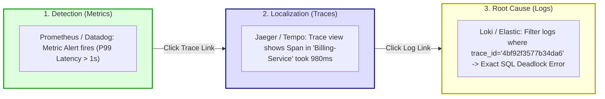

## Fast Revision (10-Second Recall)
- **The 3 Pillars:**
  - *Metrics:* Numeric aggregations over time (e.g. CPU %, request count, P95 duration). Cheap to store, highly compressible, retention in months/years, optimal for **detection & alerting**.
  - *Logs:* Discrete, timestamped event records (JSON text, stack traces). High fidelity, expensive to store and index, retention in days/weeks, optimal for **deep root cause debugging**.
  - *Traces:* End-to-end request journeys across distributed services with causality (spans, parent-child relationships). High context, high network overhead, optimal for **isolating distributed bottlenecks and service dependency failures**.
- **The Observability Triage Workflow:**
  1. *Metrics:* Detect *that* something is broken (e.g., P99 latency breached).
  2. *Traces:* Pinpoint *where* in the distributed call graph the delay occurred (e.g., Service B called unindexed query).
  3. *Logs:* Reveal *why* the failure happened (e.g., exact NullPointerException and payload).

## The 30-Second Spoken Script
> "Logs, metrics, and traces represent complementary dimensions of observability, each optimized for different stages of incident response and operational cost.
>
> **Metrics** are numeric values aggregated over time intervals. Because they require minimal storage—often just a few bytes per timestamp—they can be retained for months or years. Metrics are our primary tool for **alerting and detection**: they tell us *that* something is broken, such as a surge in HTTP 500 errors or a dip in request throughput.
>
> **Traces** record the journey of a single request as it cascades across distributed microservices. A trace links individual operations through parent-child spans and correlation IDs. Traces tell us **where** the failure or latency bottleneck lives in the distributed architecture—for example, showing that 95% of total request duration was spent in a payment service database lock.
>
> **Logs** are detailed, timestamped text or JSON records containing contextual state, variable values, and stack traces. While logs are the most expensive pillar to ingest and index, they are essential for understanding **why** the error occurred—providing the exact exception message and customer payload.
>
> In high-performance engineering, we integrate all three using OpenTelemetry, ensuring every log record includes the `trace_id`, allowing engineers to jump from a metric alert to a distributed trace, and down to the exact log line in seconds."

## Scenario / Problem Context
A high-volume fintech platform handling 40,000 requests per second suffered severe cost overruns and poor incident response times. 

The organization relied almost exclusively on logs: every microservice logged every incoming request, SQL query, and response body in raw text format.
1. The company's Elasticsearch and Datadog logging bill exceeded $180,000 per month.
2. The logging agent itself consumed 35% of total cluster CPU and saturated node network interfaces.
3. Despite logging petabytes of data, during an outage where checkouts were failing, searching logs took 15 minutes to return results due to index size. Furthermore, because log messages lacked trace correlation IDs, engineers could not trace which downstream microservice originated the failure.

The CTO mandated an observability overhaul: rebalance the architecture across Metrics, Logs, and Traces to cut observability costs by 60% while reducing Mean Time to Resolution (MTTR) from 45 minutes to 5 minutes.

## Architectural Workflow / Sequence


## Deep-Dive Analysis & Root Causes

### 1. Architectural Comparison Matrix

| Dimension | Metrics | Traces | Logs |
| :--- | :--- | :--- | :--- |
| **Data Format** | Numeric (Float64 + timestamp + tags) | Spans (TraceID, SpanID, Start, End, Tags) | Unstructured or Structured JSON text |
| **Storage Cost** | Extremely low (~1-2 bytes per sample) | Moderate (Head/Tail sampling mitigates cost) | Very high (Kilobytes per log event) |
| **Retention Period** | 1 to 2 years (Downsampled) | 7 to 14 days | 7 to 30 days |
| **Primary Value** | Detection, Trend Analysis, Alerting | Distributed context, Latency breakdown | Deep diagnostics, Stack traces, Payloads |
| **Cardinality Limit** | Strict (Low cardinality required) | High (Supports high cardinality Trace IDs) | High (Searchable text indexes) |
| **Core Question** | *"Is the system healthy right now?"* | *"Where in the call graph did it slow down?"*| *"Why did this specific line of code fail?"* |

### 2. The OpenTelemetry Unified Model
Historically, companies deployed three separate agents: Prometheus client for metrics, Zipkin/Jaeger client for traces, and Fluentd/Logstash for logs.
Modern standard: **OpenTelemetry (OTel)**. OpenTelemetry provides a unified API and SDK. When a request enters the API:
1. OTel starts a trace and generates a `trace_id`.
2. It injects the `trace_id` into the logging context.
3. It emits RED metrics tagged with the service name.
4. If an exception occurs, the log contains the exact `trace_id`, enabling seamless correlation across all three pillars.

### 3. Sampling Strategies for Tracing & Logging
At 40,000 RPS, storing 100% of traces and debug logs is financially unviable.
- **Head Sampling:** Sample a fixed percentage (e.g. 5% of all incoming requests) at the API gateway.
- **Tail-Based Sampling:** Collect traces in a buffer and inspect the result: keep 100% of traces that had errors (`status >= 500`) or high latency (`duration > 1s`), while discarding 99% of normal fast 200 OK traces.

## Practical Debugging Commands & Code

### Step 1: OpenTelemetry Unified Instrumentation in Node.js
Correlate metrics, traces, and structured JSON logs with trace IDs:

```typescript
// src/telemetry/tracer.ts
import { NodeSDK } from '@opentelemetry/sdk-node';
import { getNodeAutoInstrumentations } from '@opentelemetry/auto-instrumentations-node';
import { OTLPTraceExporter } from '@opentelemetry/exporter-trace-otlp-http';
import { trace, context } from '@opentelemetry/api';
import winston from 'winston';

// 1. Initialize OpenTelemetry SDK
export const otelSdk = new NodeSDK({
  traceExporter: new OTLPTraceExporter({
    url: 'http://otel-collector.monitoring:4318/v1/traces',
  }),
  instrumentations: [getNodeAutoInstrumentations()],
});

otelSdk.start();

// 2. Structured Logger that automatically attaches current TraceID to every log
export const logger = winston.createLogger({
  level: 'info',
  format: winston.format.combine(
    winston.format.timestamp(),
    winston.format.printf((info) => {
      // Extract active trace ID from OpenTelemetry context
      const activeSpan = trace.getSpan(context.active());
      const traceId = activeSpan ? activeSpan.spanContext().traceId : 'none';
      const spanId = activeSpan ? activeSpan.spanContext().spanId : 'none';

      return JSON.stringify({
        timestamp: info.timestamp,
        level: info.level,
        message: info.message,
        trace_id: traceId,
        span_id: spanId,
        ...info.metadata,
      });
    })
  ),
  transports: [new winston.transports.Console()],
});
```

### Step 2: Correlating Metrics to Traces and Logs in Production
When an alert fires in Grafana, jump directly to the trace and logs using Grafana Data Links:

```json
// Grafana Panel Data Link Configuration:
// Link from Prometheus Latency Panel to Jaeger Trace Search
{
  "title": "View Exemplar Traces",
  "url": "/explore?left=%5B%22now-1h%22,%22now%22,%22Tempo%22,%7B%22query%22:%22${__data.fields.trace_id}%22%7D%5D"
}
```

### Step 3: Fast CLI Diagnostic: Grepping Logs by Trace ID
```bash
# Locate all logs across all microservices for a specific failed user trace ID
kubectl logs -l app.kubernetes.io/part-of=ecommerce --tail=10000 --all-containers=true | \
  grep '4bf92f3577b34da6' | jq .
```

## Prevention & Senior Best Practices
1. **Never Use Logs for Alerting:** Avoid querying logs every minute to generate alerts (e.g. `count(grep "ERROR") > 10`). Log aggregation queries are slow, resource-heavy, and easily throttled. Always alert on Prometheus metrics.
2. **Inject Trace IDs into Every Log Line:** Mandate that all application log formatters automatically inject `trace_id` and `span_id` from the active context into JSON logs.
3. **Implement Tail-Based Trace Sampling:** Sample 100% of errors and slow requests, but only 1% to 5% of healthy 200 OK traffic to keep storage costs predictable.
4. **Use Structured JSON Logging Exclusively:** Eliminate unparsed, multi-line string logs. Structured JSON ensures log forwarders (FluentBit, Vector) parse fields without expensive regular expressions.
5. **Strict Log Level Hygiene:** Enforce log level policies in CI: `DEBUG` logs must be disabled in production; `INFO` logs should only record major lifecycle events; `ERROR` logs must strictly represent actionable failures.

