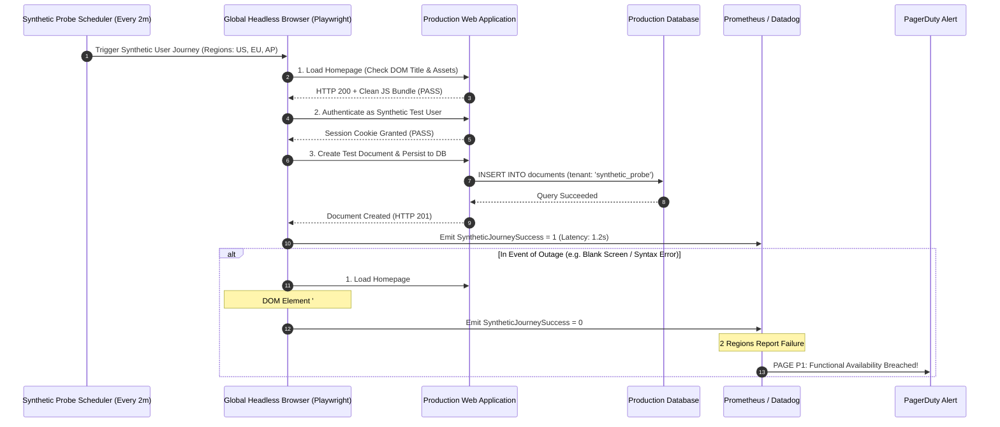

## Fast Revision (10-Second Recall)
- **Availability Definition:** The percentage of time a service is operational and successfully delivering its primary business function to real end-users:
  $$\text{Availability} = \frac{\text{Successful Requests}}{\text{Total Valid Requests}} \times 100$$
- **The "Ping" Fallacy:** Checking `GET /healthz` returning 200 does NOT mean your app is available! If checkout is broken because the Stripe API key expired, the application is functionally unavailable despite `/healthz` returning green.
- **Synthetic Monitoring (Canaries):** Headless automated browser scripts (Playwright / Puppeteer) that run real end-user workflows (Login $\rightarrow$ Search $\rightarrow$ Add to Cart $\rightarrow$ Verify Checkout) from multiple global regions every 60 seconds.
- **Multi-Region Consensus:** Trigger downtime alerts only when synthetic canaries fail across at least 2 distinct global locations to prevent false alarms from localized ISP peering failures.
- **The Nines of Availability:**
  - 99.9% ("Three Nines"): 43.8 minutes of downtime per month.
  - 99.99% ("Four Nines"): 4.38 minutes of downtime per month.

## The 30-Second Spoken Script
> "Monitoring application availability requires evaluating functional end-user viability rather than simple container ping checks. A service can report 100% pod uptime while being completely unavailable to paying customers due to a broken frontend bundle or third-party OAuth outage.
>
> In production architectures, we measure availability through two complementary lenses:
> First, **Real User Traffic SLIs (Service Level Indicators)**: We calculate availability continuously using Prometheus RED metrics: dividing the rate of successful HTTP requests by the total incoming valid requests over rolling 30-day windows.
> Second, **Synthetic User Journeys (Global Canaries)**: Real users do not click endpoints in isolation; they follow workflows. We run automated headless Playwright scripts from five global cloud regions (US-East, US-West, Europe, Asia, Australia) every 2 minutes. The canary logs in with a dedicated synthetic test account, adds an item to cart, and navigates to the payment review screen.
>
> If the synthetic journey fails or times out in two or more regions consecutively, our alerting system triggers a P1 availability incident immediately—even during off-peak hours when real user traffic is too low to produce statistical error surges."

## Scenario / Problem Context
A SaaS document collaboration platform claimed a "99.99% Availability SLA" in its enterprise contracts. The engineering team monitored availability using an internal health check endpoint:
`GET https://app.example.com/healthz`
Every 30 seconds, a CloudWatch synthetic pinged this URL. If it returned 200 OK, the month was recorded as 100% available.

One Saturday evening, a frontend deployment introduced a JavaScript syntax error in the React production bundle:
`Uncaught SyntaxError: Unexpected token '?'` (a broken optional chaining polyfill on older Safari and iOS browsers).

The backend `/healthz` endpoint continued returning HTTP 200 OK all weekend. However, for 48 hours, every customer attempting to load the web app saw a completely white, blank screen. 

When enterprise customers demanded SLA refunds on Monday, management pointed to their internal dashboard showing "100% Uptime." Customers responded with browser console screenshots proving total unavailability. The company was forced to pay $120,000 in SLA contractual penalties.

The leadership team mandates an end-to-end availability monitoring framework using multi-region synthetic browser journeys.

## Architectural Workflow / Sequence


## Deep-Dive Analysis & Root Causes

### 1. The Uptime Fallacy
- **Process Uptime:** The Docker container is running and didn't crash. (Meaningless to users).
- **Network Uptime:** TCP port 443 accepts connections. (Meaningless if the HTTP server returns 500).
- **API Uptime:** `/healthz` returns 200. (Meaningless if business logic controllers are locked).
- **Functional Availability:** Real users can successfully execute core revenue workflows without errors. This is the only availability metric that matters.

### 2. Designing Synthetic Test Accounts
To run automated end-to-end synthetic journeys against production without corrupting real business metrics:
- Create dedicated tenant accounts: `synthetic-probe-runner@company.internal`.
- Flag test records in the database with `is_synthetic: true`.
- Filter out synthetic transactions from revenue reporting and marketing analytics dashboards.
- Automatically clean up synthetic documents/records created during probe runs using automated TTL sweeps.

### 3. The Mathematics of High Availability (The Nines)

| SLA Percentage | Allowed Downtime per Year | Allowed Downtime per Month | Allowed Downtime per Week |
| :--- | :--- | :--- | :--- |
| **99% ("Two Nines")** | 3.65 days | 7.31 hours | 1.68 hours |
| **99.9% ("Three Nines")** | 8.77 hours | 43.83 minutes | 10.08 minutes |
| **99.95%** | 4.38 hours | 21.92 minutes | 5.04 minutes |
| **99.99% ("Four Nines")** | 52.60 minutes | 4.38 minutes | 1.01 minutes |

## Practical Debugging Commands & Code

### Step 1: Headless Playwright Synthetic Availability Canary
Create a script that executes the complete user workflow:

```typescript
// synthetics/userJourneyCanary.ts
import { chromium } from 'playwright';

export async function runSyntheticAvailabilityProbe(targetUrl: string) {
  const browser = await chromium.launch({ headless: true });
  const context = await browser.newContext();
  const page = await context.newPage();

  const startTime = Date.now();

  try {
    // 1. Visit landing page
    await page.goto(targetUrl, { waitUntil: 'networkidle', timeout: 10000 });
    
    // Assert page rendered without JavaScript fatal errors
    const title = await page.title();
    if (!title.includes('Workspace')) {
      throw new Error(`Unexpected page title: ${title}`);
    }

    // 2. Perform synthetic login
    await page.fill('[data-testid="email-input"]', 'synthetic-canary@company.internal');
    await page.fill('[data-testid="password-input"]', process.env.SYNTHETIC_USER_PWD || '');
    await page.click('[data-testid="login-submit-button"]');

    // 3. Verify authenticated dashboard DOM renders
    await page.waitForSelector('[data-testid="user-profile-badge"]', { timeout: 8000 });

    // 4. Critical Business Action: Create a temporary test document
    await page.click('[data-testid="create-doc-button"]');
    await page.waitForSelector('[data-testid="doc-editor-canvas"]', { timeout: 8000 });

    const totalDurationMs = Date.now() - startTime;
    console.log(`SUCCESS: Synthetic journey completed in ${totalDurationMs}ms`);
    return { success: true, durationMs: totalDurationMs };

  } catch (error: any) {
    // Capture screenshot for automated incident triage!
    await page.screenshot({ path: `/tmp/synthetic-failure-${Date.now()}.png` });
    console.error(`FAILURE: Synthetic availability check failed: ${error.message}`);
    return { success: false, error: error.message };

  } finally {
    await browser.close();
  }
}
```

### Step 2: Prometheus Availability SLI Calculation Query
Calculate trailing 30-day availability percentage:

```promql
(
  sum(rate(http_requests_total{status_code!~"5..|429"}[30d]))
  /
  sum(rate(http_requests_total[30d]))
) * 100
```

### Step 3: Alertmanager Rule for Synthetic Canary Failure
```yaml
# prometheus-rules/synthetic-alerts.yaml
groups:
  - name: synthetic_availability_alerts
    rules:
      - alert: SyntheticUserJourneyFailing
        expr: sum(synthetic_journey_success{job="playwright-canary"}) by (region) < 1
        for: 4m
        labels:
          severity: page
          priority: P1
        annotations:
          summary: "Core User Journey Failing: Application Functionally Unavailable"
          description: "Synthetic end-to-end canary failed in region {{ $labels.region }} for 4 consecutive minutes."
```

### Step 4: Fast Manual Production Canary Run via CLI
```bash
# Execute synthetic canary locally against production in 5 seconds
TARGET_URL="https://app.company.com" npx tsx synthetics/userJourneyCanary.ts
```

## Prevention & Senior Best Practices
1. **Never Rely Solely on `/healthz`:** Implement multi-step headless browser synthetic canaries that execute genuine user journeys (login, search, checkout) every 1-2 minutes.
2. **Require Multi-Region Consensus:** Trigger P1 downtime pages only when probes fail from at least two distinct geographic regions simultaneously to avoid local network routing false alarms.
3. **Capture Screenshots and DOM on Failure:** Ensure synthetic probe runners save full-page screenshots and browser console logs upon failure to give on-call engineers immediate visual proof of UI crashes.
4. **Tag Synthetic Traffic in Analytics:** Ensure synthetic probe test accounts pass headers (`X-Synthetic-Probe: true`) so BI tools and revenue dashboards filter out test transactions.
5. **Publish Out-of-Band Status Pages:** Keep customer-facing status dashboards on an independent third-party provider (e.g. Statuspage.io) so availability metrics remain viewable even if your primary cloud region collapses.

