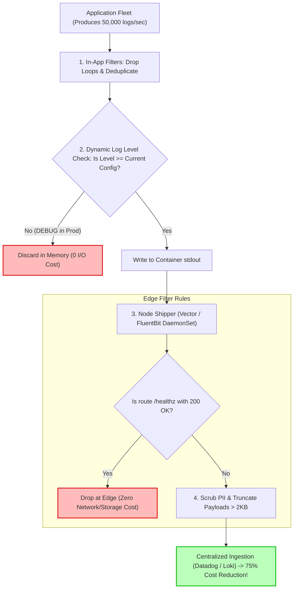

## Fast Revision (10-Second Recall)
- **The Logging Cost Crisis:** Storing and indexing terabytes of logs in Datadog, Splunk, or Elasticsearch is often the single most expensive line item on a cloud bill—routinely exceeding the compute cost to run the actual applications.
- **Top 4 Culprits of Excessive Logging:**
  1. *DEBUG/TRACE Logs in Production:* Left enabled after an incident or local testing.
  2. *High-Frequency Health Checks:* Logging every single `/healthz` or `/readyz` probe every 5 seconds across 200 pods (Millions of useless lines per day).
  3. *Logging Inside Tight Loops:* Logging inside loops processing 50,000 array elements.
  4. *Massive Payloads:* Dumping full base64 images or multi-megabyte JSON responses into log messages.
- **Immediate Solutions:** Drop logs at the edge (FluentBit / Vector filtering), implement dynamic log-level toggling via API/etcd, and enforce log rate-limiting.

## The 30-Second Spoken Script
> "Reducing excessive logging without sacrificing incident debugging capability requires shifting from unconstrained static logging to **adaptive, multi-tiered log filtering**.
>
> In high-scale engineering organizations, we reduce log costs by 60% to 80% using four key strategies:
> First, **Drop Useless Edge Traffic at the Collector**: In our node collectors (FluentBit or Vector), we drop 100% of HTTP 200 health check logs (`/healthz`, `/metrics`) and Kubernetes readiness probe logs before they ever leave the node.
> Second, **Dynamic Runtime Log Levels**: We decouple log levels from application deployments. Instead of redeploying code to switch from `INFO` to `DEBUG`, we expose an authenticated management endpoint or feature flag (via Redis or Consul). We can turn on `DEBUG` logging for a single pod or tenant for 10 minutes to troubleshoot a bug, and have it automatically revert to `WARN` or `ERROR`.
> Third, **Sample Repetitive Success Logs**: For high-throughput services (like 50,000 RPS recommendation engines), logging every successful 200 OK request is wasteful. We sample success logs down to 1%, while preserving 100% of all warning and error logs.
> Finally, **Deduplication and Rate Limiting**: We use log deduplication filters so that if an external dependency goes down and an error logs 10,000 times in 10 seconds, the logger outputs the error once followed by: `Previous message repeated 9,999 times`."

## Scenario / Problem Context
A mobility tech company experienced a sudden 400% surge in its monthly Datadog logging invoice—jumping from $22,000 to $115,000 in a single billing cycle. 

Upon investigation:
1. A developer debugging a geospatial location bug on a GPS microservice had committed `logger.level = 'debug'`. The service received 80,000 location pings per second, resulting in 4.8 million log events per minute dumping raw latitude/longitude coordinates to stdout.
2. The company's 40 Kubernetes microservices each had Kubernetes liveness and readiness probes firing every 2 seconds. The ingress proxies logged every single health check probe, generating over 1.2 billion useless lines of `GET /healthz 200 OK` every month.
3. A third-party SMS provider suffered an outage, and an asynchronous worker logged a 15-line stack trace for every failed SMS attempt inside an un-throttled retry loop.

The CTO gave the engineering team 48 hours to slash log volume by 75% or face hiring freezes.

## Architectural Workflow / Sequence


## Deep-Dive Analysis & Root Causes

### 1. The Cost of Logging
Log pricing is driven by two factors:
- **Ingestion Volume (Gigabytes/month):** Ingesting uncompressed text across network boundaries.
- **Indexing & Retention (Days retained):** Creating inverted full-text search indexes on every string field.
- **Math:** 10,000 RPS logging 1KB per request = 10MB/sec = 600MB/min = 864 GB per day = 25 Terabytes per month. At standard enterprise APM prices ($0.10 to $0.25 per GB), that single service costs $6,000/month just for logs!

### 2. Dropping Health Checks at the Shipper
Health check probes provide zero forensic value during post-mortems if they return 200 OK. Dropping `GET /healthz 200` and `GET /readyz 200` at the FluentBit/Vector layer immediately slashes 30% to 50% of total log volume across a Kubernetes cluster without modifying a single line of application code.

### 3. Log Deduplication & Rate-Limiting
When a database drops connection, logging 5,000 identical `ConnectionRefusedError` stack traces per second offers zero additional diagnostic insight beyond the first log. A token-bucket rate limiter should emit the first error immediately, and then suppress subsequent identical errors for 10 seconds.

## Practical Debugging Commands & Code

### Step 1: Dynamic Log Level Toggling via HTTP / Feature Flag (Node.js)
Allow on-call engineers to switch log levels dynamically without pod restarts:

```typescript
// src/logger.ts
import winston from 'winston';

export const logger = winston.createLogger({
  level: process.env.LOG_LEVEL || 'info', // Default: info
  format: winston.format.json(),
  transports: [new winston.transports.Console()],
});

// Admin endpoint to adjust log level at runtime
// curl -X POST http://service/admin/log-level -d '{"level": "debug"}'
export function setRuntimeLogLevel(newLevel: string, durationMinutes = 15) {
  const validLevels = ['error', 'warn', 'info', 'debug'];
  if (!validLevels.includes(newLevel)) {
    throw new Error(`Invalid level: ${newLevel}`);
  }

  const previousLevel = logger.level;
  logger.level = newLevel;
  logger.warn({ message: `Log level changed to ${newLevel} for ${durationMinutes} minutes` });

  // Automatically revert back to previous level after timeout to prevent forgetting!
  setTimeout(() => {
    logger.level = previousLevel;
    logger.warn({ message: `Log level automatically reverted back to ${previousLevel}` });
  }, durationMinutes * 60 * 1000);
}
```

### Step 2: Dropping Health Check Logs in FluentBit Configuration
Add a filter to discard healthy probe logs before they are shipped over the network:

```yaml
# fluent-bit-config.yaml
[FILTER]
    Name    grep
    Match   kube.*
    # Exclude any log containing GET /healthz or GET /readyz with status 200
    Exclude log .*GET \/(healthz|readyz|metrics) 200.*

[FILTER]
    Name    throttle
    Match   kube.*
    Rate    500
    Window  5
    Print_Status true
```

### Step 3: Vector Edge Log Pipeline Scrubbing and Deduplication
Using Vector (blazing fast Rust log forwarder) to sanitize and truncate massive payloads:

```toml
# vector.toml
[transforms.filter_noisy_logs]
type = "filter"
inputs = ["kubernetes_logs"]
# Drop health checks
condition = '!match(string!(.message), r''GET /(healthz|readyz) 200'')'

[transforms.truncate_large_messages]
type = "remap"
inputs = ["filter_noisy_logs"]
source = '''
# Truncate any single log message exceeding 4096 bytes to prevent buffer bloat
if length(string!(.message)) > 4096 {
    .message = slice!(string!(.message), 0, 4096) + " ... [TRUNCATED]"
}
'''
```

### Step 4: CLI Diagnostic to Find the Top "Chattiest" Pods in Real Time
```bash
# Measure which Kubernetes pod is producing the most log bytes per minute
kubectl logs -l app.kubernetes.io/part-of=ecommerce -n production --since=1m --all-containers=true | \
  awk '{print length}' | paste -sd+ - | bc | awk '{print $1/1024/1024 " MB/minute"}'

# Identify top 5 recurring log messages in a service
kubectl logs deployment/order-service -n production --tail=5000 | \
  jq -r '.message' | sort | uniq -c | sort -nr | head -n 5
```

## Prevention & Senior Best Practices
1. **Drop Health Checks at the Node Shipper:** Configure FluentBit or Vector to drop all 200 OK health and readiness probe logs before they leave the node.
2. **Implement Auto-Reverting Log Levels:** When enabling `DEBUG` mode to troubleshoot a production issue, always enforce a maximum 15-30 minute timer that automatically reverts back to `INFO`.
3. **Truncate Oversized Payloads:** Enforce an edge limit (e.g., maximum 4KB per log message). Strip raw binary blobs, base64 data, and full PDF/image byte streams from logs.
4. **Never Log Inside High-Frequency Loops:** Move logging outside iterative loops. Log a single summary message (`"Processed 5,000 records in 120ms"`) instead of 5,000 individual lines.
5. **Enforce Log Quotas per Namespace:** Configure log forwarders or APM platforms with daily volume quotas per namespace to prevent an un-throttled rogue pod from bankrupting your cloud budget.

