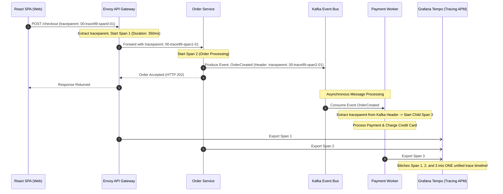

## Fast Revision (10-Second Recall)
- **The Core Challenge:** An ingress HTTP request branches into dozens of synchronous HTTP/gRPC calls, background Redis tasks, and asynchronous Kafka events across polyglot microservices.
- **Trace Stitching:** Maintaining a single continuous `trace_id` while generating unique child `span_id` values at every network and process hop.
- **Trace Context vs Baggage:**
  - `traceparent`: Propagates tracing IDs (`trace_id`, `parent_span_id`).
  - `baggage`: Propagates cross-cutting business key-values across the entire distributed graph (e.g., `user_id`, `tenant_id`, `is_beta_tester`) without modifying database schemas.
- **Async Thread Loss:** In languages with thread pools (Java, Go, Node.js event loops), developers must ensure async callbacks or coroutines maintain the active OpenTelemetry context across thread boundaries.
- **Visualization:** APM tools (Grafana Tempo, Jaeger, Datadog) stitch child spans into a unified flame graph and dependency topology map.

## The 30-Second Spoken Script
> "To trace a single user request across multiple microservices from the browser down to the database, we implement **end-to-end distributed context propagation** using the OpenTelemetry standard.
>
> The journey begins at the edge:
> When the user makes an action in the frontend SPA, our OpenTelemetry web instrumentation starts a root span and generates a 32-character hex `trace_id`. It injects this into the HTTP `traceparent` header.
>
> As the request flows through our API Gateway, authentication proxy, and internal microservices, each service extracts the `traceparent` header, creates a child span linked to the parent span ID, and automatically injects the updated context into any outgoing HTTP, gRPC, or Kafka messages.
>
> To propagate user identity across services without altering every API parameter, we use **W3C Baggage**. Baggage carries user metadata—such as `tenant_id` and `user_tier`—transparently across the entire distributed call chain.
>
> When an engineer pastes the `trace_id` into Jaeger or Tempo, the system visualizes the complete call tree: showing exact execution durations, inter-service network transit latency, database queries, and any exceptions thrown along the path."

## Scenario / Problem Context
A banking platform launched a feature allowing users to transfer funds to external international accounts. A customer initiated a $5,000 transfer:
`POST /api/v1/transfers/international`

The web application displayed a spinner for 30 seconds before crashing with a generic:
`HTTP 500: Internal Server Error`

The customer checked their balance: $5,000 had been deducted from their checking account, but the recipient never received the funds.

Customer support escalated the ticket:
- The Gateway logs showed the request timed out.
- The Transfer Service logs had no record of the failure.
- The FX Currency Service had 500,000 logs around that minute.
- The Compliance AML microservice was hosted in a different AWS region and logged to a separate CloudWatch group.

Because there was no unified distributed trace ID propagating through the HTTP headers and Kafka topics, four senior engineers spent 14 hours manually matching timestamps across four different log databases to reconstruct what happened to the user's $5,000.

The platform requires an automated distributed tracing architecture that tracks every request across all synchronous and asynchronous microservice hops.

## Architectural Workflow / Sequence


## Deep-Dive Analysis & Root Causes

### 1. The Asynchronous Context Loss Bug
In Node.js or Java, when an asynchronous operation branches into `setTimeout()`, worker pools, or event emitters, the active execution context can be lost if not explicitly bound.
- OpenTelemetry in Node.js uses `AsyncLocalStorage` to store the active span in Node's V8 execution context.
- If a custom library uses native C++ threads or unbound worker queues, `trace.getActiveSpan()` returns `undefined`, breaking the trace chain.

### 2. Using Baggage for Distributed Business Context
Tracing IDs tell you the structural execution path. **W3C Baggage** allows you to attach business context that travels alongside the trace across all microservices:
`baggage: tenant_id=org_acme,user_tier=enterprise`
- Service 1 sets the baggage.
- Service 5 (which has no access to the user database) can read `tenant_id` directly from baggage to enforce tenant-specific rate limiting or routing.

### 3. Measuring Network Transit Latency
By comparing:
- Span A (Caller) end time vs Span B (Receiver) start time:
Distributed tracing reveals hidden network transit delays, such as cross-Availability Zone latency, edge load balancer proxy queues, or DNS resolution stalls between services.

## Practical Debugging Commands & Code

### Step 1: Frontend SPA Trace Context Injection (Axios / Fetch)
Ensure the browser SPA initiates the trace and passes the `traceparent` header to the backend:

```typescript
// frontend/src/apiClient.ts
import axios from 'axios';
import { trace, context, propagation } from '@opentelemetry/api';

export const apiClient = axios.create({
  baseURL: 'https://api.company.com',
});

// Interceptor: Injects active OpenTelemetry trace context into outgoing HTTP headers
apiClient.interceptors.request.use((config) => {
  const currentContext = context.active();
  const carrier: Record<string, string> = {};

  // Injects W3C traceparent and baggage into carrier object
  propagation.inject(currentContext, carrier);

  config.headers = {
    ...config.headers,
    ...carrier,
  };

  return config;
});
```

### Step 2: Propagating Traces Through Kafka Message Headers in Node.js
```typescript
// src/messaging/kafkaProducer.ts
import { Kafka } from 'kafkajs';
import { trace, context, propagation } from '@opentelemetry/api';

const kafka = new Kafka({ clientId: 'order-service', brokers: ['kafka:9092'] });
const producer = kafka.producer();

export async function publishOrderEvent(topic: string, messagePayload: object) {
  const carrier: Record<string, string> = {};
  
  // Inject current span context into carrier
  propagation.inject(context.active(), carrier);

  // Convert carrier headers to Kafka header format (Buffer)
  const kafkaHeaders: Record<string, Buffer> = {};
  for (const [key, value] of Object.entries(carrier)) {
    kafkaHeaders[key] = Buffer.from(value);
  }

  await producer.send({
    topic,
    messages: [
      {
        value: JSON.stringify(messagePayload),
        headers: kafkaHeaders, // W3C traceparent travels inside Kafka message!
      },
    ],
  });
}
```

### Step 3: Extracting Trace Context in Kafka Consumer
```typescript
// src/messaging/kafkaConsumer.ts
import { EachMessagePayload } from 'kafkajs';
import { trace, propagation, context, SpanStatusCode } from '@opentelemetry/api';

const tracer = trace.getTracer('payment-worker');

export async function handleKafkaMessage({ message }: EachMessagePayload) {
  // Convert Kafka Buffer headers back to string carrier
  const carrier: Record<string, string> = {};
  if (message.headers) {
    for (const [key, value] of Object.entries(message.headers)) {
      if (value) carrier[key] = value.toString();
    }
  }

  // Extract upstream context from Kafka headers
  const extractedContext = propagation.extract(context.active(), carrier);

  // Start consumer span linked to the producer's parent span!
  const span = tracer.startSpan(
    'kafka.consume: ProcessPayment',
    { attributes: { 'messaging.system': 'kafka' } },
    extractedContext
  );

  await context.with(trace.setSpan(extractedContext, span), async () => {
    try {
      // Process business transaction...
      span.setStatus({ code: SpanStatusCode.OK });
    } catch (err: any) {
      span.recordException(err);
      span.setStatus({ code: SpanStatusCode.ERROR, message: err.message });
      throw err;
    } finally {
      span.end();
    }
  });
}
```

### Step 4: CLI Querying Traces in Jaeger API
```bash
# Fetch trace details directly via Jaeger HTTP API
curl -s "http://jaeger-query.monitoring:16686/api/traces/4bf92f3577b34da6a3ce929d0e0e4736" | jq '.data[0].spans[] | {spanID, operationName, duration, tags}'
```

## Prevention & Senior Best Practices
1. **Standardize on W3C Trace Context:** Ban ad-hoc custom headers like `X-Request-ID` for distributed tracing. Mandate W3C `traceparent` across all services.
2. **Propagate Through Asynchronous Queues:** Ensure every Kafka, RabbitMQ, and SQS producer and consumer instruments header propagation so traces do not terminate at queue boundaries.
3. **Use Baggage Conservatively:** W3C Baggage is transmitted across every single network hop. Never put large objects or sensitive secrets into baggage; restrict it to 2-3 small identifiers (`tenant_id`, `client_version`).
4. **Propagate Trace ID in Error Responses:** When an API returns HTTP 500, include the `trace_id` in the response envelope (`{ "error": { "code": "INTERNAL_ERROR", "trace_id": "4bf9..." } }`) so customers can quote it to support.
5. **Enable Topology Dependency Graphs:** Configure APM tools to generate automatic service architecture dependency maps from live trace data, highlighting slow microservice dependencies dynamically.

