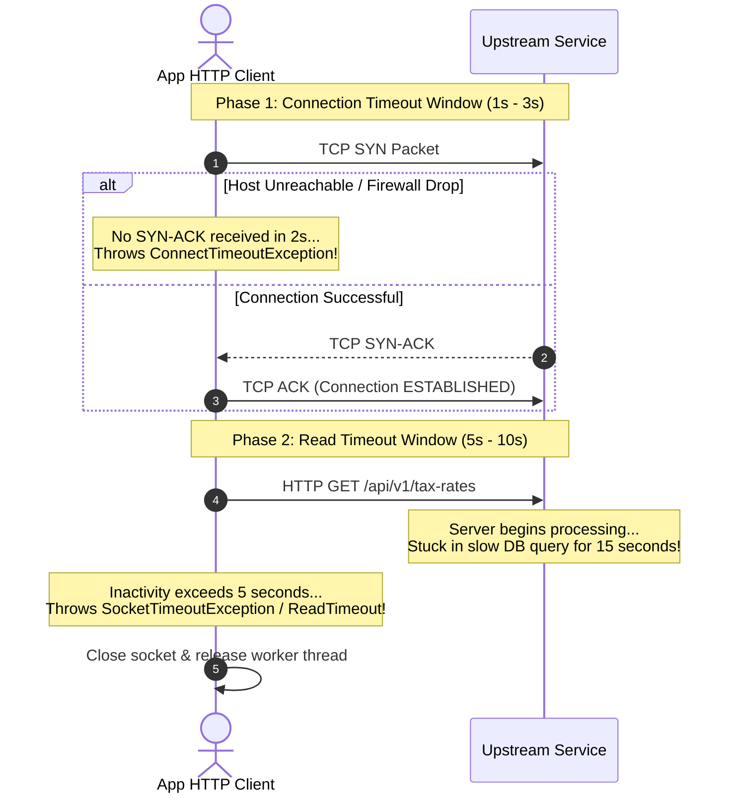

## Fast Revision (10-Second Recall)
- Connection Timeout (Connect Timeout): Maximum time allowed to complete the TCP 3-Way Handshake (SYN -> SYN-ACK -> ACK). Typically set short (1 to 3 seconds).
- Read Timeout (Socket Timeout): Maximum time allowed between receiving consecutive data packets after the connection is established. Typically set to anticipated p99 processing duration (e.g., 5 to 10 seconds).
- The Danger of Default Settings: Many HTTP client libraries (default Java, Python `requests`, Go without explicit transport) default to INFINITE timeout!
- Symptoms: High Connect Timeout = Network partition, firewall drop, or host down; High Read Timeout = Slow database query, deadlock, or downstream CPU saturation.
- Circuit Breaker Trigger: Repeated read timeouts should trip circuit breakers quickly to avoid thread pool starvation.

## The 30-Second Spoken Script
"Understanding the difference between a Connection Timeout and a Read Timeout is critical for building resilient distributed systems.

A Connection Timeout measures the maximum duration an application will wait to establish the initial network socket. This covers DNS resolution and the TCP 3-way handshake. If the remote host is powered off, an intermediate firewall silently drops the SYN packet, or the host's SYN queue is completely full, the connection timeout fires. Because establishing a TCP socket over modern networks takes less than 50 milliseconds, Connection Timeouts should be set aggressively short?typically between 1 and 3 seconds.

A Read Timeout?also called a Socket Timeout?begins AFTER the connection is successfully established. It measures the maximum period of inactivity between incoming data packets. If the remote server accepted the connection, but its backend thread is stuck in an unindexed database query or deadlocked, the read timeout fires.

The single most dangerous production anti-pattern is leaving these timeouts at their default values. In libraries like standard Python requests or unconfigured Java HTTP clients, the default timeout is infinite?meaning a single hung third-party API call will hold an application worker thread captive forever, rapidly exhausting thread pools."

## Scenario / Problem Context
An internal billing microservice crashes with thread exhaustion during peak hours. Thread dumps reveal that 180 out of 200 worker threads are in `SOCKET_READ` state waiting on an unconfigured third-party tax calculation API.

## Architectural Workflow / Sequence


## Deep-Dive Analysis & Root Causes
### Why Silent Firewall Drops Cause 120-Second TCP Hangs
When an endpoint is down, an active host sends a TCP RST packet immediately, causing a fast `Connection Refused` error in 2ms. However, if a cloud firewall or security group drops the SYN packet silently without sending RST, the client OS default TCP retransmission timer retries at 1s, 2s, 4s, 8s, 16s... hanging for up to 120 seconds before giving up unless an explicit application-level Connect Timeout is enforced.

### Read Timeout Measures Inactivity, Not Total Request Duration
A common misconception is that Read Timeout limits the total time of the HTTP transaction. In socket programming, Read Timeout measures the maximum elapsed time between consecutive network packets. If a server streams a 1GB file over 10 minutes, but transmits packets every 200 milliseconds, a 5-second Read Timeout will never trigger.

### Thread Pool Starvation Mechanics
If an application has 200 worker threads and an incoming rate of 50 requests/second: if an external partner hangs and the client has no read timeout, all 200 threads will be blocked in socket read within 4 seconds. The application stops serving all other endpoints, including health checks.

## Practical Debugging Commands & Code
### Configuring Explicit Timeouts in Node.js & Java
```typescript
// 1. Explicit Timeouts in Axios / Node.js
import axios from 'axios';
import http from 'http';
import https from 'https';

const apiClient = axios.create({
  timeout: 5000, // Read Timeout: Aborts request if response takes > 5s
  httpAgent: new http.Agent({ keepAlive: true, timeout: 2000 }), // Connect Timeout
  httpsAgent: new https.Agent({ keepAlive: true, timeout: 2000 })
});

// 2. Explicit Timeouts in Java (OkHttpClient)
OkHttpClient client = new OkHttpClient.Builder()
    .connectTimeout(2, TimeUnit.SECONDS) // Maximum time to complete TCP handshake
    .readTimeout(5, TimeUnit.SECONDS)    // Maximum time between incoming packets
    .writeTimeout(5, TimeUnit.SECONDS)   // Maximum time to transmit outbound bytes
    .build();
```

## Prevention & Senior Best Practices
- Ban Default Unbounded Timeouts: Add static analysis or linter rules that reject any HTTP client instantiation lacking explicit connect and read timeouts.
- Keep Connect Timeouts Aggressive: Never set Connect Timeout higher than 3 seconds; network handshakes over healthy backbones take under 50ms.
- Wrap Remote Calls in Circuit Breakers: Ensure that repeated Read Timeouts trip circuit breakers within 5 failures to fail fast in 1ms.
- Distinguish Error Types in Metrics: Emit separate metrics for `connection_timeout` vs `read_timeout` to isolate infrastructure drops from slow database queries.
