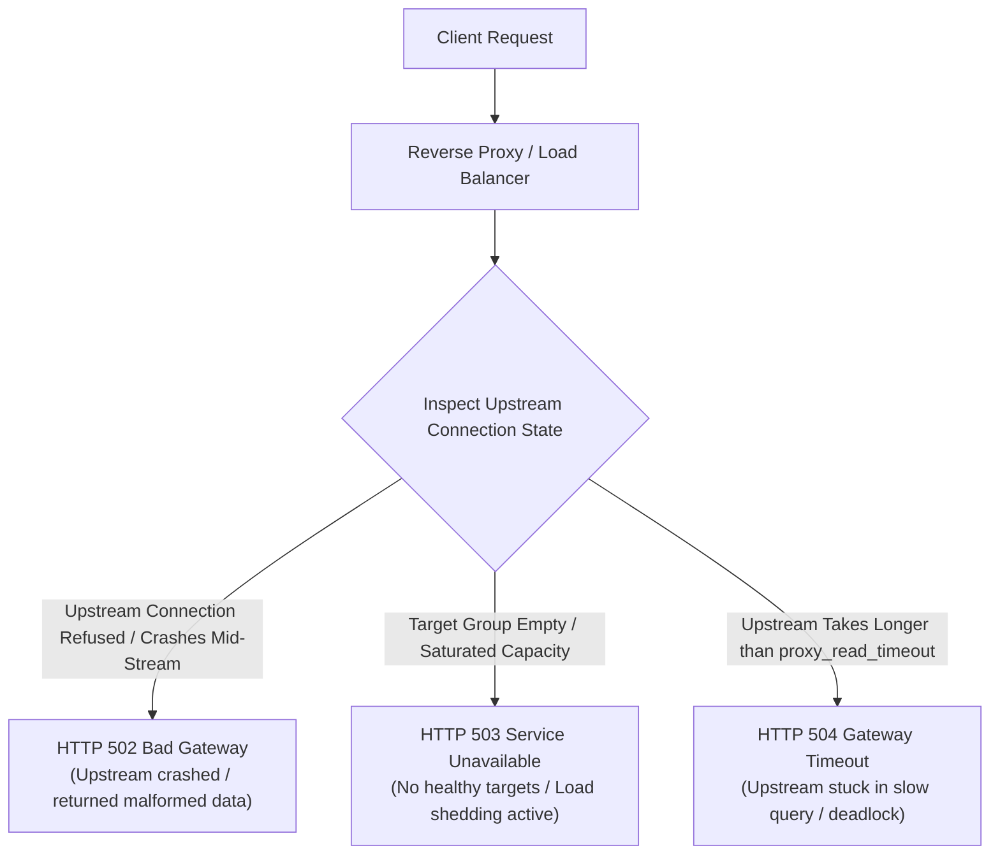

## Fast Revision (10-Second Recall)
- HTTP 502 Bad Gateway: The reverse proxy received an invalid, malformed, or dropped response from upstream (e.g., container crashed, connection refused, TCP RST).
- HTTP 503 Service Unavailable: The server or proxy is temporarily unable to handle the request (e.g., target group has 0 healthy pods, capacity exhausted, rate limit tripped, server rebooting).
- HTTP 504 Gateway Timeout: The reverse proxy waited for the upstream server to respond, but the upstream failed to return data within the configured timeout window.
- Mental Model: 502 = Invalid/Refused Connection; 503 = Intentionally Rejected / Capacity Saturated; 504 = Ran Out of Time Waiting.
- First Step Triage: Look at the response `Server` header to identify which layer generated the error (Cloudflare, ALB, Nginx, or Application).

## The 30-Second Spoken Script
"Differentiating between HTTP 502, 503, and 504 errors is fundamental to diagnosing production outages across edge proxies and microservices:

A 502 Bad Gateway means the reverse proxy or load balancer contacted the upstream server, but received an invalid or aborted response. This typically happens when the upstream container crashed mid-request due to an out-of-memory error, an unhandled panic, or when the upstream refused the TCP connection because its listen backlog was full.

A 503 Service Unavailable indicates that the proxy or server intentionally rejected the request because it cannot currently fulfill it. The most common cause is that the load balancer target group has zero healthy instances passing health checks, or the service is deliberately shedding load under CPU saturation.

A 504 Gateway Timeout means the reverse proxy successfully established a connection to the upstream service, but the upstream failed to complete its work and return an HTTP response before the proxy's read timeout expired?typically caused by a slow database query, thread deadlock, or an external partner timing out.

By checking the response headers, I can instantly identify whether the error was emitted by our edge CDN, our cloud load balancer, or our internal ingress proxy."

## Scenario / Problem Context
During a release, customer support reports sporadic 5xx errors. The frontend team claims the API is completely down, but backend engineers claim their pod logs show zero errors. The lead engineer must isolate whether the issue is 502, 503, or 504.

## Architectural Workflow / Sequence


## Deep-Dive Analysis & Root Causes
### The Silent 502: Upstream Connection Drops During Deploys
When a Kubernetes pod terminates during a rolling deployment, if the container shuts down before the load balancer removes the pod IP from its target group, the load balancer forwards new requests to the closed socket. The Linux kernel responds with a TCP RST packet. The load balancer receives the unexpected reset and immediately returns HTTP 502 Bad Gateway to the user.

### 503: The Zero Healthy Hosts Phenomenon
In AWS ALB or Kubernetes Ingress, if a faulty configuration causes the health check path (`/healthz`) to return 500, the load balancer marks every replica as unhealthy. When a client request arrives, the load balancer has no targets to forward to, returning HTTP 503 Service Unavailable directly to the client with zero origin traffic.

### 504 Timeout Mismatch Cascade
If an edge load balancer has an idle timeout of 60 seconds, but an intermediate Nginx ingress has a `proxy_read_timeout` of 30 seconds, a query taking 45 seconds will result in Nginx sending a 504 Gateway Timeout to the load balancer, which relays it to the user. Identifying timeout discrepancies requires tracing timestamps across proxy logs.

## Practical Debugging Commands & Code
### Fast 5xx Triage Commands
```bash
# 1. Inspect exact response code and server header using curl
curl -Iv https://api.example.com/api/v1/orders

# 2. Check Nginx error logs for 502 upstream connection errors
grep -E "recv\(\) failed|connect\(\) failed" /var/log/nginx/error.log

# 3. Check Kubernetes target health state to rule out 503 empty endpoints
kubectl get endpoints order-service -n prod

# 4. Check AWS ALB target group health via AWS CLI
aws elbv2 describe-target-health --target-group-arn <TARGET_GROUP_ARN>
```

## Prevention & Senior Best Practices
- Synchronize Timeout Hierarchies: Ensure timeout values decrease as you move deeper into the stack (CDN: 60s -> ALB: 30s -> Ingress: 15s -> App: 5s -> DB: 3s).
- PreStop Hooks to Prevent 502s: Add `preStop: exec: command: ["sleep", "10"]` to pods to ensure graceful deregistration before container SIGTERM.
- Minimum Healthy Host Thresholds: Configure Kubernetes PodDisruptionBudgets (`minAvailable: 50%`) to prevent deployments from terminating all healthy pods simultaneously.
- Include Retry-After Headers on 503s: When returning 503 due to load shedding, supply a `Retry-After: 30` header to instruct automated clients when to retry.
