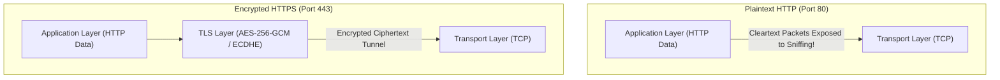

## Fast Revision (10-Second Recall)
- The Core Difference: HTTP sends plaintext over TCP port 80; HTTPS encapsulates HTTP within an encrypted TLS tunnel over TCP port 443.
- The 3 Security Guarantees: 1) Confidentiality (encryption prevents eavesdropping); 2) Integrity (HMAC checksums prevent packet tampering); 3) Authentication (X.509 certs prove server identity).
- Hybrid Encryption: Asymmetric cryptography (RSA/ECDHE) negotiates keys during handshake; Symmetric cryptography (AES-GCM/ChaCha20) encrypts high-volume bulk data.
- TLS 1.2 vs TLS 1.3: TLS 1.2 requires 2 Round-Trip Times (2-RTT); TLS 1.3 completes handshake in 1-RTT (or 0-RTT session resumption).
- Performance Cost: Modern CPUs have hardware acceleration (AES-NI instructions); TLS encryption overhead is negligible (under 1% CPU).

## The 30-Second Spoken Script
"The fundamental difference between HTTP and HTTPS is that HTTPS layers the Transport Layer Security (TLS) protocol between the TCP transport layer and the application layer.

HTTP transmits data as cleartext over TCP port 80. Any intermediate proxy, ISP, or attacker on a shared Wi-Fi network can perform Man-In-The-Middle attacks: inspecting credentials, reading sensitive tokens, or injecting malicious JavaScript payloads.

HTTPS resolves this on port 443 by providing three security pillars: Confidentiality, Integrity, and Authentication.

To balance security and high throughput, HTTPS uses Hybrid Encryption. Establishing the connection uses Asymmetric cryptography: the client verifies the server's X.509 Certificate against trusted root Certificate Authorities (CAs) and performs an ECDHE key exchange.

Once the handshake completes, both parties compute an identical Symmetric Session Key. Symmetric ciphers like AES-256-GCM are orders of magnitude faster than asymmetric math and are accelerated directly by modern CPU hardware, meaning HTTPS delivers near-zero perceptible latency overhead after the initial handshake."

## Scenario / Problem Context
An engineering team is modernizing legacy internal microservices and debating whether internal service-to-service communication requires HTTPS/mTLS or if plaintext HTTP is acceptable within a private VPC network.

## Architectural Workflow / Sequence


## Deep-Dive Analysis & Root Causes
### Why Hybrid Encryption is Mandatory
Asymmetric encryption (like RSA 2048-bit or ECC) requires complex modular exponentiation and large numbers. Encrypting a 50MB video file with RSA would consume 100% of CPU for seconds. Symmetric encryption (AES) uses fast bitwise substitution and permutation operations. Modern CPUs execute AES hardware instructions (AES-NI) at over 5 gigabytes/second per core.

### Certificate Authority (CA) Chain of Trust
How does your browser know `google.com` is legitimate? The server sends its Leaf Certificate signed by an Intermediate CA, which is signed by a Root CA. The browser or operating system ships with pre-installed Root CA public keys (Mozilla/Apple/Microsoft root stores). The browser verifies the cryptographic signature up the chain to the trusted root.

### Zero-Trust Architecture: Why Internal HTTPS Matters
Relying on "VPC perimeter security" assumes an attacker can never breach internal network boundaries. Modern Zero-Trust models require mutual TLS (mTLS) between internal microservices. If an attacker breaches one container, mTLS prevents them from packet-sniffing database passwords or spoofing internal RPC calls.

## Practical Debugging Commands & Code
### Inspect SSL/TLS Protocol & Cipher Negotiation CLI
```bash
# 1. Test supported TLS versions and negotiated cipher suite
curl -Iv https://www.example.com --tlsv1.3

# 2. Inspect certificate expiration date and issuer details
echo | openssl s_client -servername www.example.com -connect www.example.com:443 2>/dev/null | \
  openssl x509 -noout -issuer -subject -dates

# 3. Check hardware AES-NI CPU acceleration support on Linux
grep -m1 -o 'aes' /proc/cpuinfo
```

## Prevention & Senior Best Practices
- Deprecate TLS 1.0 and 1.1: Configure servers to strictly mandate TLS 1.2 and TLS 1.3 with secure forward secrecy cipher suites.
- Automated Certificate Renewal: Use Certbot or Kubernetes `cert-manager` with Let's Encrypt to renew certificates 30 days before expiration.
- Enable OCSP Stapling: Configure Nginx/Envoy with OCSP stapling to avoid client-side revocation lookup latency.
- Enforce mTLS for Service Meshes: Implement Istio or Linkerd to automatically inject mTLS encryption between internal Kubernetes pods.
