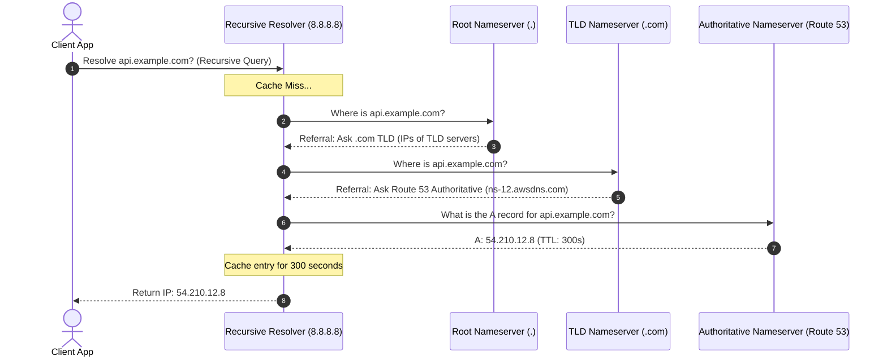

## Fast Revision (10-Second Recall)
- DNS Hierarchy: Root Servers (`.`) -> Top-Level Domain (TLD) Servers (`.com`, `.org`) -> Authoritative Nameservers (Cloudflare, Route 53) -> Resource Records.
- Record Types: A (IPv4), AAAA (IPv6), CNAME (canonical alias), MX (mail), TXT (SPF/DKIM verification), NS (delegation), PTR (reverse DNS).
- Recursive vs Iterative: Recursive Resolver (e.g., 8.8.8.8) does all the legwork on behalf of the client; Nameservers answer iteratively with referrals.
- DNS Caching & TTL: Time-To-Live (TTL) controls how many seconds resolvers cache answers before re-querying authoritative servers.
- Anycast Routing: The 13 root server IP addresses are distributed across hundreds of physical locations worldwide using BGP Anycast routing.

## The 30-Second Spoken Script
"The Domain Name System (DNS) is the distributed hierarchical database that translates human-readable hostnames into IP addresses.

When an application queries a domain like api.example.com, the resolution process moves through five distinct tiers:

First, Local Caches: The operating system checks its local DNS cache and hosts file.

Second, the Recursive Resolver: If uncached, the query is dispatched via UDP port 53 to the configured recursive resolver (such as your ISP or Google 8.8.8.8).

Third, the Root Server: If the resolver lacks the record, it queries one of the 13 logical Root Nameservers. The root server returns a referral pointing to the Top-Level Domain (TLD) nameservers for .com.

Fourth, the TLD Nameserver: The resolver queries the .com TLD server, which inspects the domain's NS records and refers the resolver to the domain's Authoritative Nameservers (such as AWS Route 53 or Cloudflare).

Fifth, the Authoritative Nameserver: The authoritative server holds the actual zone file. It returns the A record containing the target IP address along with a Time-To-Live (TTL) value.

The resolver caches this answer for the duration of the TTL and delivers the IP to the client."

## Scenario / Problem Context
A company changes its primary database endpoint DNS record from an old IP to a new IP with a 300-second TTL. Half of the application servers switch immediately, while the other half continue sending queries to the decommissioned IP for hours.

## Architectural Workflow / Sequence


## Deep-Dive Analysis & Root Causes
### The 13 Logical Root Nameservers Myth
People often wonder how 13 root servers handle global internet traffic. There are 13 logical root server identities (A through M, e.g., `a.root-servers.net`), because the original 512-byte UDP DNS packet limit could only fit 13 addresses. However, through BGP Anycast routing, each of those 13 addresses is announced by hundreds of redundant physical servers across thousands of global data centers.

### JVM and Application-Level DNS Caching Traps
A classic production trap occurs when Java Virtual Machines (JVM) cache DNS lookups forever (`networkaddress.cache.ttl = -1` by default in older Java versions). When an AWS RDS database fails over to a new IP, the JVM continues attempting to connect to the dead IP indefinitely until the application container is restarted. Setting JVM TTL to 30 seconds (`networkaddress.cache.ttl=30`) is mandatory in cloud environments.

### DNS Over UDP vs TCP (EDNS0)
Standard DNS queries travel over UDP port 53 for speed. However, if the response exceeds 512 bytes (or 4096 bytes with EDNS0 extensions)?such as large DNSSEC responses?the nameserver sets the Truncated bit (`TC=1`). The client immediately re-establishes the connection over TCP port 53 to pull the complete payload.

## Practical Debugging Commands & Code
### DNS Diagnostic & Propagation CLI
```bash
# 1. Perform a complete iterative trace from root servers to authoritative
dig +trace api.example.com

# 2. Query authoritative nameserver directly, bypassing local caches
dig @ns-12.awsdns.com api.example.com A

# 3. Check SOA record and TTL values
dig api.example.com SOA

# 4. Flush local DNS cache across operating systems
# Linux (systemd-resolved):
resolvectl flush-caches
# macOS:
sudo dscacheutil -flushcache; sudo killall -HUP mDNSResponder
```

## Prevention & Senior Best Practices
- Configure JVM DNS TTL: Explicitly set `networkaddress.cache.ttl=30` in `java.security` to prevent permanent DNS stale IP caching.
- Lower TTLs Before Migrations: Reduce DNS TTL from 86400 (24h) to 300 seconds (5m) at least 48 hours prior to planned IP migrations.
- Deploy NodeLocal DNSCache in Kubernetes: Run local DNS cache DaemonSets to avoid dropping CoreDNS UDP packets under high cluster concurrency.
- Dual Authoritative Providers: Use secondary DNS providers (e.g., Route 53 + NS1) to guarantee DNS uptime if a major provider suffers a DDoS outage.
