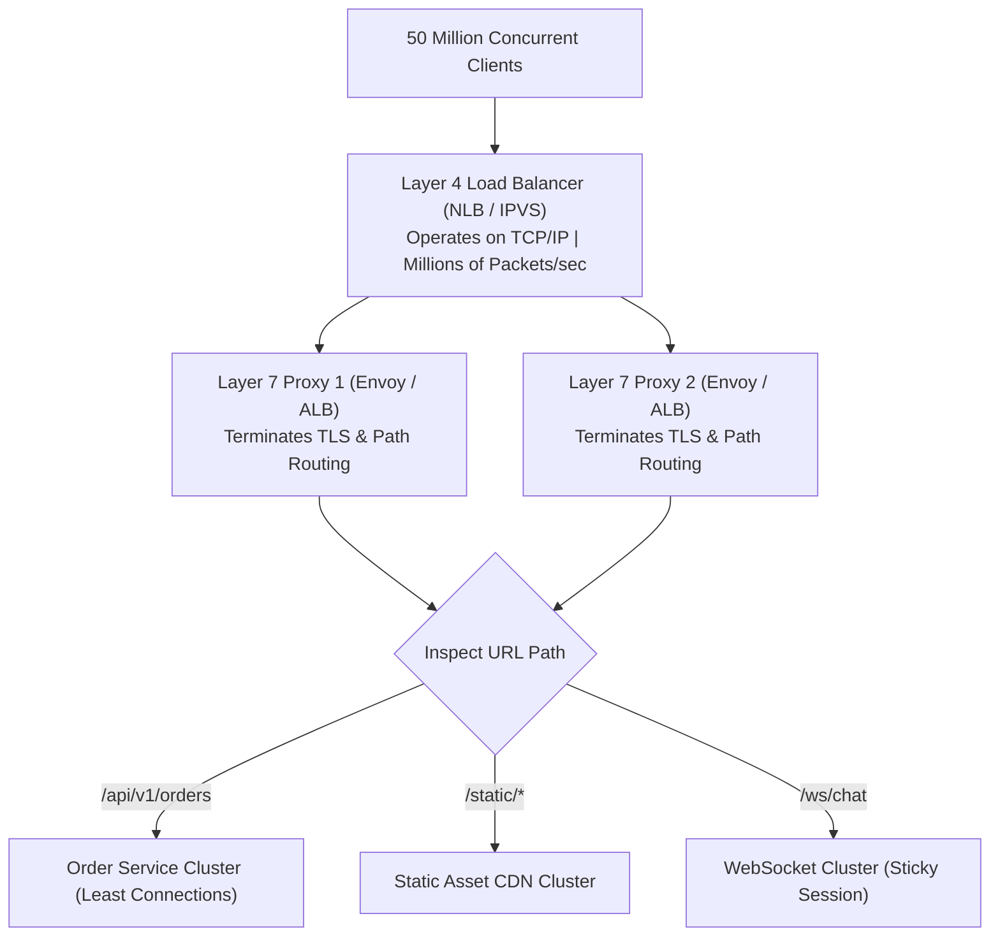

## Fast Revision (10-Second Recall)
- Layer 4 (L4 / NLB): Operates at Transport Layer (TCP/UDP); routes based on IP & Port; unaware of HTTP headers or paths; ultra-high throughput (millions of RPS), sub-millisecond latency.
- Layer 7 (L7 / ALB): Operates at Application Layer (HTTP/HTTPS); inspects URLs, cookies, headers, and query params; enables path routing (`/api` vs `/static`), SSL termination, and sticky sessions.
- Balancing Algorithms: Round Robin, Weighted Round Robin, Least Connections, Least Response Time, IP Hash (sticky sessions), Consistent Hashing.
- Health Checks: Active health checks probe `/healthz` periodically (every 5-10s); removes failing targets automatically.
- Direct Server Return (DSR): L4 optimization where requests traverse the load balancer, but response packets travel directly from server to client, bypassing the LB bottleneck.

## The 30-Second Spoken Script
"When designing load balancing infrastructure, the fundamental architectural decision is choosing between Layer 4 Transport-Level and Layer 7 Application-Level load balancing.

Layer 4 load balancers?like AWS Network Load Balancer (NLB) or Linux IPVS?operate purely at the TCP and UDP layer. An L4 load balancer does not decrypt TLS or inspect HTTP headers; it routes raw packets based solely on IP addresses and TCP port numbers. Because it requires negligible CPU processing per packet, an L4 balancer sustains millions of connections per second with microsecond latency.

Layer 7 load balancers?like AWS ALB, Nginx, or Envoy?operate at the Application Layer. An L7 balancer terminates TLS and reconstructs full HTTP requests. This enables intelligent routing: directing /api/v1/checkout to high-memory pods and /static to caching clusters, evaluating cookie-based sticky sessions, and injecting security headers.

For routing algorithms, Least Connections is standard for long-running transactional API requests to prevent uneven queue piling, whereas Consistent Hashing or IP Hash is used when caching or stateful sessions must stick to specific nodes.

In enterprise architectures, we use a Two-Tier Load Balancing design: an L4 NLB sits at the public boundary absorbing massive traffic volume and distributing it across a fleet of internal L7 Envoy proxies."

## Scenario / Problem Context
You are designing the load balancing architecture for a streaming service with 50 million concurrent connected clients. The team must decide whether to route traffic via Layer 4 or Layer 7 load balancers.

## Architectural Workflow / Sequence


## Deep-Dive Analysis & Root Causes
### Layer 4 vs Layer 7 Performance Trade-Off
Because an L7 load balancer must perform TLS handshakes, decrypt packets, buffer headers, and re-encrypt traffic to the backend, it consumes substantial CPU and memory. An L4 balancer merely modifies the IP packet headers (DNAT / SNAT) or forwards the frame at Layer 2 (MAC routing), allowing a modest hardware appliance or Linux kernel to route 40Gbps of traffic.

### Direct Server Return (DSR)
In typical web traffic, incoming request packets are tiny (1KB), but outgoing responses (images, videos, HTML) are huge (10MB+). In standard load balancing, all outgoing response traffic must flow back through the load balancer, saturating its egress bandwidth. With DSR, the load balancer modifies the destination MAC address. The backend server processes the request and transmits the response directly back to the client over its own internet gateway, bypassing the load balancer completely.

### The Sticky Session Pitfall
Using Cookie-based sticky sessions pins all requests from a user to a specific backend server. If a large corporate proxy or university campus uses the same IP or session, all thousands of students are pinned to a single backend pod, completely unbalancing the cluster while other pods sit idle.

## Practical Debugging Commands & Code
### Linux IPVS Layer 4 Load Balancer CLI
```bash
# 1. Install and view active IPVS Layer 4 virtual servers
ipvsadm -L -n

# 2. Add an L4 virtual service on port 443 with Round Robin
ipvsadm -A -t 198.51.100.1:443 -s rr

# 3. Add real backend server nodes to the virtual service
ipvsadm -a -t 198.51.100.1:443 -r 10.0.1.10:443 -m
ipvsadm -a -t 198.51.100.1:443 -r 10.0.1.11:443 -m

# 4. Monitor active connection distribution across real servers
ipvsadm -L -n --stats
```

## Prevention & Senior Best Practices
- Two-Tier Load Balancing: Pair an L4 load balancer (for raw DDoS absorption and high throughput) with an L7 fleet (for routing flexibility).
- Prefer Least Connections over Round Robin: Use Least Connections algorithm for APIs with variable request execution durations to prevent pod starvation.
- Decouple Liveness from Deep Health Checks: Ensure load balancer health checks verify local proxy readiness rather than executing expensive database queries on every ping.
- Enable Connection Draining: Configure a 30-to-60 second connection draining (deregistration delay) on load balancers to allow in-flight requests to complete during autoscaling.
