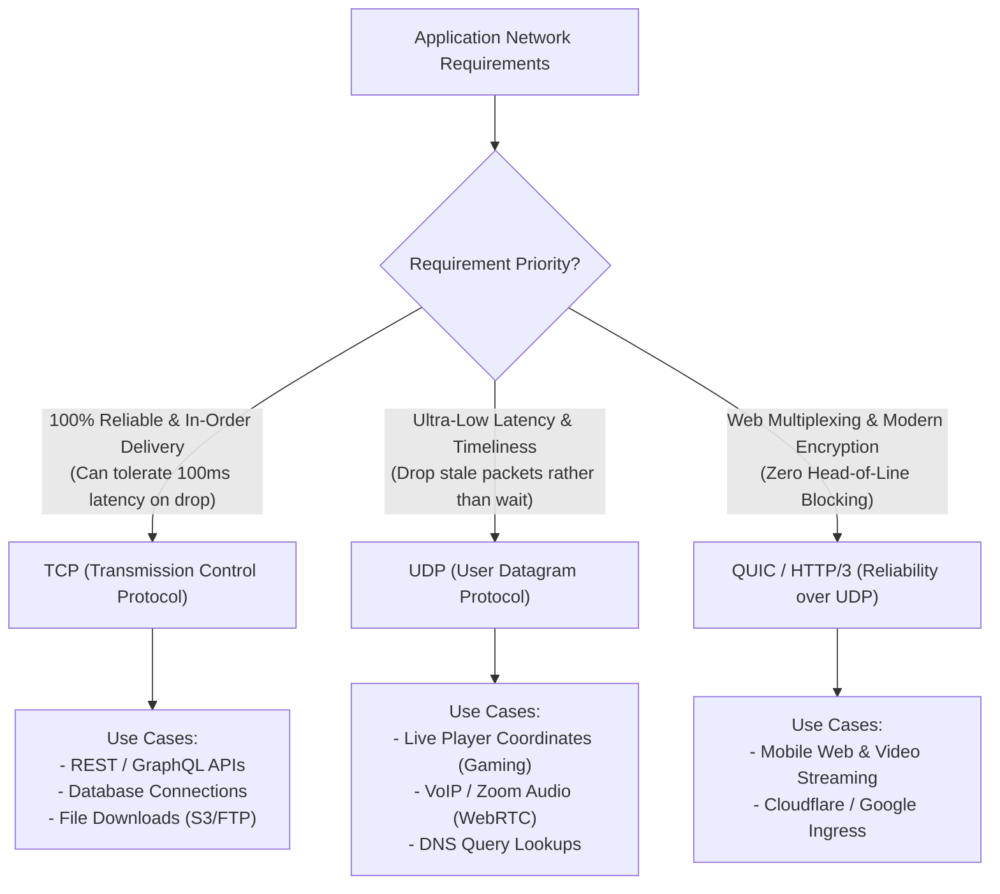

## Fast Revision (10-Second Recall)
- TCP: Connection-oriented, reliable (ACKs + retransmission), in-order delivery, flow control, congestion control, higher overhead (20-byte header).
- UDP: Connectionless, unreliable (fire-and-forget), out-of-order allowed, no flow/congestion control, minimal overhead (8-byte header), sub-millisecond latency.
- TCP Use Cases: Web (HTTP/1.1 & HTTP/2), File Transfer (FTP/SFTP), Databases (PostgreSQL, MySQL), Remote Shell (SSH).
- UDP Use Cases: Real-time Voice/Video (WebRTC/VoIP), Online Gaming, DNS queries (UDP 53), Video live streaming.
- The Modern Shift (QUIC / HTTP/3): Builds reliability, encryption, and stream multiplexing on top of UDP in userspace, bypassing kernel TCP head-of-line blocking.

## The 30-Second Spoken Script
"The fundamental trade-off between TCP and UDP is a choice between guaranteed reliability and minimal transmission latency.

TCP is a connection-oriented protocol. It guarantees that every byte sent is received in the exact order transmitted without duplicates or gaps, accomplished through sequence numbers, acknowledgments, and retransmissions. Furthermore, TCP protects the network through flow control and congestion avoidance algorithms. However, this reliability comes at the cost of latency: establishing a connection requires a 3-way handshake, and a single dropped packet causes Head-of-Line blocking.

UDP is a connectionless, lightweight datagram protocol. It has an 8-byte header compared to TCP's 20 bytes, maintains zero connection state, and performs no retransmissions. If a packet is lost, UDP does not care. This makes UDP ideal for real-time systems where timeliness matters more than perfection?such as live gaming, VoIP, and WebRTC?where re-sending a dropped audio packet 200ms late is useless.

In modern systems, this binary distinction has evolved with QUIC (HTTP/3). QUIC uses UDP as a raw datagram carrier, but implements encryption, reliability, and stream multiplexing in userspace, achieving the reliability of TCP without TCP head-of-line blocking."

## Scenario / Problem Context
You are designing the networking architecture for a multiplayer competitive battle royale game. The engineering team is debating whether to transmit player positional coordinates and bullet shots over TCP or UDP.

## Architectural Workflow / Sequence


## Deep-Dive Analysis & Root Causes
### Head-of-Line (HoL) Blocking at the Transport Layer
When an application sends 10 packets over TCP and packet #3 is dropped by a router, the receiver's TCP stack cannot deliver packets #4 through #10 to the application, even though they arrived safely. They must sit in the kernel buffer until packet #3 is retransmitted. In video games or multiplexed web streams, this freezes the entire pipeline.

### Why Online Games Combine TCP and UDP
Multiplayer games use both protocols simultaneously: Player chat messages, inventory purchases, and login authentication travel over TCP because losing an item purchase is unacceptable. Player movement coordinates, weapon aiming, and physics updates travel over UDP 60 times a second; if packet 42 is dropped, packet 43 arrives 16ms later with fresher coordinates, rendering packet 42 obsolete.

### QUIC: Userspace Innovation Over Osified Kernels
Modifying the TCP protocol requires updating the operating system kernel on billions of devices and middleboxes (routers, firewalls), a process that takes decades (TCP ossification). By building QUIC on top of raw UDP, Google and the IETF bypassed kernel constraints, allowing application-level updates to congestion control algorithms via simple browser updates.

## Practical Debugging Commands & Code
### Inspect TCP vs UDP Socket Statistics CLI
```bash
# 1. Display summary of active TCP and UDP sockets
ss -s

# 2. View listening UDP sockets with process names
ss -u -a -p

# 3. Test UDP throughput and packet loss with iperf3
# Server:
iperf3 -s
# Client (test 50Mbps UDP stream):
iperf3 -c <server_ip> -u -b 50M
```

## Prevention & Senior Best Practices
- Choose Protocols by Failure Tolerance: Use TCP for transactions where data loss means financial or state corruption; use UDP where stale data is useless.
- Implement Application-Level ACKs in UDP: If specific events over UDP require confirmation, implement lightweight sequence numbers and ACKs in application code.
- Upgrade Ingress to HTTP/3: Enable HTTP/3 (QUIC) on Cloudflare or Nginx to accelerate mobile client connections over unstable cellular networks.
- Avoid Oversized UDP Datagrams: Keep UDP payload sizes under the Path MTU (typically 1472 bytes for standard Ethernet) to prevent IP-layer fragmentation.
