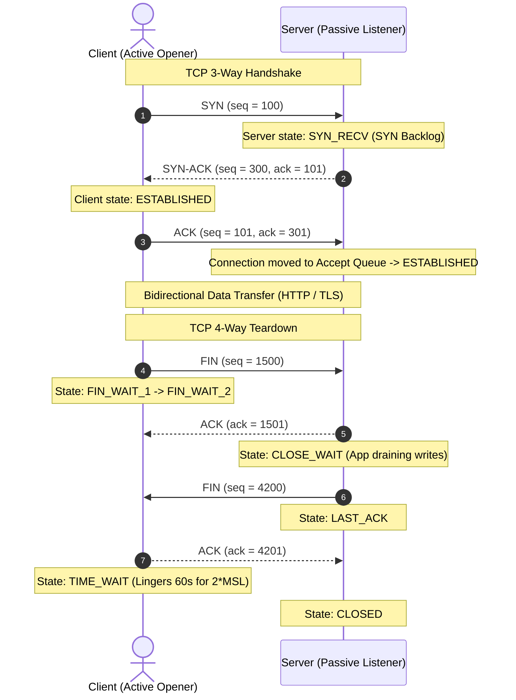

## Fast Revision (10-Second Recall)
- The 3-Way Handshake: 1) Client sends `SYN` (ISN_c); 2) Server responds `SYN-ACK` (ISN_s, ACK = ISN_c + 1); 3) Client sends `ACK` (ACK = ISN_s + 1). Connection is now `ESTABLISHED`.
- The 4-Way Teardown: 1) Client sends `FIN`; 2) Server sends `ACK` (Client in `FIN_WAIT_2`, Server in `CLOSE_WAIT`); 3) Server sends `FIN`; 4) Client sends `ACK` (Client enters `TIME_WAIT`).
- The `TIME_WAIT` State: Client socket remains in `TIME_WAIT` for 2 * MSL (Maximum Segment Lifetime, typically 60s) to absorb lingering duplicate packets.
- SYN Flood Attack: Attacker sends millions of SYN packets with spoofed IPs, filling the server's `SYN Backlog` queue; defended via SYN Cookies (`tcp_syncookies = 1`).
- TCP Reset (RST): Sent when a packet arrives for an unopened port, or to terminate an unrecoverable corrupted connection immediately.

## The 30-Second Spoken Script
"The TCP 3-Way Handshake establishes a reliable, bidirectional, in-order byte stream over an unreliable IP network.

The client initiates the handshake by sending a SYN packet containing its Initial Sequence Number (ISN).

The server receives the SYN, allocates socket memory buffers in its SYN Queue, and responds with a SYN-ACK packet containing its own sequence number and an acknowledgment of the client's sequence number.

The client replies with an ACK packet. At this instant, the connection transitions to the ESTABLISHED state and is moved from the SYN Queue to the Accept Queue, ready for the application to accept() it.

During connection termination, a graceful 4-Way Teardown occurs: either party sends a FIN packet. Because TCP is full-duplex, each direction closes independently: the receiver ACKs the FIN and can continue sending data until it sends its own FIN.

The active closer enters the TIME_WAIT state for 60 seconds (2 MSL). This guarantees that any delayed in-flight packets expire in the network before a new socket can reuse that port combination, preventing data corruption."

## Scenario / Problem Context
An application under heavy load begins throwing `Connection refused` and socket allocation errors. The operations team discovers 40,000 sockets stuck in `TIME_WAIT` and `SYN_RECV` states.

## Architectural Workflow / Sequence


## Deep-Dive Analysis & Root Causes
### SYN Backlog vs Accept Queue (Listen Overflow)
The Linux kernel maintains two distinct queues for every listening socket: 1) SYN Queue (tracks connections in SYN-ACK state); 2) Accept Queue (tracks fully established connections waiting for the application to call `accept()`). If the application thread pool is saturated, the Accept Queue overflows, causing the kernel to drop incoming ACKs and forcing clients to retry.

### SYN Cookies: Defeating SYN Flood Attacks
In a SYN Flood DDoS attack, attackers send millions of SYN requests without sending the final ACK. Traditional servers exhaust kernel RAM allocating state. When `tcp_syncookies = 1`, the server does NOT allocate memory on receiving a SYN; instead, it encodes the connection state cryptographically into the server's ISN. When the client sends the final ACK, the server reconstructs the connection parameters on the fly.

### Tuning TIME_WAIT Socket Exhaustion
When an application makes thousands of outgoing HTTP calls without connection pooling, it rapidly exhausts ephemeral ports because closed sockets remain in `TIME_WAIT` for 60 seconds. Enabling `net.ipv4.tcp_tw_reuse = 1` allows the kernel to safely recycle `TIME_WAIT` sockets for outgoing connections when timestamps confirm the socket is fresh.

## Practical Debugging Commands & Code
### TCP Socket State & Queue Inspection CLI
```bash
# 1. Check socket counts by TCP state (SYN_RECV, ESTABLISHED, TIME_WAIT)
ss -ant | awk '{print $1}' | sort | uniq -c

# 2. Check for TCP listen queue overflows (Accept Queue drops)
netstat -s | grep -i "listen"

# 3. Enable TCP SYN Cookies protection in Linux
sysctl -w net.ipv4.tcp_syncookies=1

# 4. Enable TIME_WAIT socket reuse for outbound connections
sysctl -w net.ipv4.tcp_tw_reuse=1
```

## Prevention & Senior Best Practices
- Enable HTTP Keep-Alive & Connection Pooling: Reuse persistent connections to eliminate continuous TCP handshake and teardown cycles.
- Enable TCP Fast Open (TFO): Set `tcp_fastopen = 3` to allow clients to send data in the initial SYN packet after the first handshake.
- Tune Listen Backlog: Increase `net.core.somaxconn = 65535` and application listen backlog to survive sudden traffic bursts.
- Monitor CLOSE_WAIT Sockets: Sockets lingering in `CLOSE_WAIT` indicate an application bug failing to call `close()` on remote disconnections.
