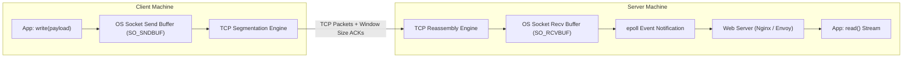

## Fast Revision (10-Second Recall)
- HTTP Evolution: HTTP/1.1 (ASCII text, Keep-Alive, head-of-line blocking); HTTP/2 (Binary framing, Multiplexing streams over single TCP, HPACK); HTTP/3 (QUIC over UDP, zero head-of-line blocking).
- The 3 Parts of an HTTP Message: Start Line (Method, URI, Version / Status code), Headers (key-value metadata), Body (payload).
- Socket Buffering: OS assigns send (`SO_SNDBUF`) and receive buffers (`SO_RCVBUF`). If receiver buffer fills, TCP window scales to 0 (backpressure).
- Chunked Transfer Encoding: `Transfer-Encoding: chunked` allows streaming dynamically generated content without pre-declaring `Content-Length`.
- Keep-Alive vs Connection Close: Reusing persistent TCP connections saves 100-300ms of TCP/TLS handshake latency on subsequent requests.

## The 30-Second Spoken Script
"Understanding the lifecycle of an HTTP request requires looking beyond high-level application frameworks down to the transport socket buffers and binary framing layer.

Once a TCP connection is established, the client formats an HTTP request.

In HTTP/1.1, this is an ASCII text stream: a Request Line specifying the method, path, and version, followed by headers delimited by CRLF, an empty line, and an optional body.

In HTTP/2 and HTTP/3, the message is converted into binary frames: HEADERS frames compressed using HPACK, and DATA frames sliced into discrete chunks. Multiple logical streams are multiplexed simultaneously over a single underlying connection, eliminating HTTP/1.1 head-of-line blocking.

The serialized bytes are written to the operating system's socket send buffer. The TCP stack encapsulates the data into IP packets and dispatches them across the network.

On the server host, packets arrive in the socket receive buffer. The kernel notifies the web server (e.g., Nginx or Envoy) via epoll. The server parses the headers, executes middleware pipelines, dispatches the request to application controllers, and streams the response back down the socket stream."

## Scenario / Problem Context
An API client makes a 50MB file upload request. The interviewer asks you to describe how the operating system, web server buffers, and TCP window flow control manage this data transfer without crashing server memory.

## Architectural Workflow / Sequence


## Deep-Dive Analysis & Root Causes
### TCP Flow Control and TCP Window Scale
If a client transmits data faster than the server application can process it (`read()`), the server's `SO_RCVBUF` fills up. The server's TCP stack automatically decreases the `Window Size` advertised in TCP ACK packets. When the buffer is full, the server sends a Zero Window Probe (`TCP ZeroWindow`), ordering the client to stop transmitting until the application drains the buffer.

### HTTP/1.1 vs HTTP/2 Head-of-Line (HoL) Blocking
In HTTP/1.1, a single TCP connection can only process one request-response cycle at a time. If Request 1 is slow, Request 2 must wait behind it. HTTP/2 introduces Binary Framing: breaking messages into interleaved frames with Stream IDs, allowing 100 concurrent requests on a single TCP connection. However, if a single TCP packet is dropped, TCP blocks all HTTP/2 streams until retransmission. HTTP/3 solves this by switching to QUIC over UDP.

### HPACK and QPACK Header Compression
In HTTP/1.1, every request transmits redundant plaintext headers (cookies, user-agents) consuming up to 2KB per request. HTTP/2 uses HPACK: maintaining a shared stateful compression table between client and server. If the `User-Agent` was sent previously, subsequent requests transmit only a 1-byte index reference.

## Practical Debugging Commands & Code
### Socket Buffer & Network Flow Inspection CLI
```bash
# 1. View TCP socket memory allocations and buffers on Linux
ss -t -i

# 2. Inspect socket buffer parameters in sysctl
sysctl net.ipv4.tcp_rmem
sysctl net.ipv4.tcp_wmem

# 3. Capture raw HTTP headers using tcpdump
tcpdump -A -s 0 'tcp port 80 and (((ip[2:2] - ((ip[0]&0xf)<<2)) - ((tcp[12:2]&0xf0)>>2)) != 0)'
```

## Prevention & Senior Best Practices
- Enable HTTP Keep-Alive: Configure `keepalive_timeout 65` in Nginx to ensure clients reuse warm TCP sockets across API requests.
- Stream Large Payloads: Never buffer large uploads or downloads into in-memory byte arrays; always use streaming pipes (`stream.pipe()` in Node.js, `InputStream` in Java).
- Set Aggressive Idle Timeouts: Terminate idle persistent sockets after 60-120 seconds to prevent file descriptor exhaustion from abandoned mobile clients.
- Deploy HTTP/2 on Edge: Terminate HTTP/2 or HTTP/3 at edge reverse proxies to take advantage of multiplexing and header compression.
