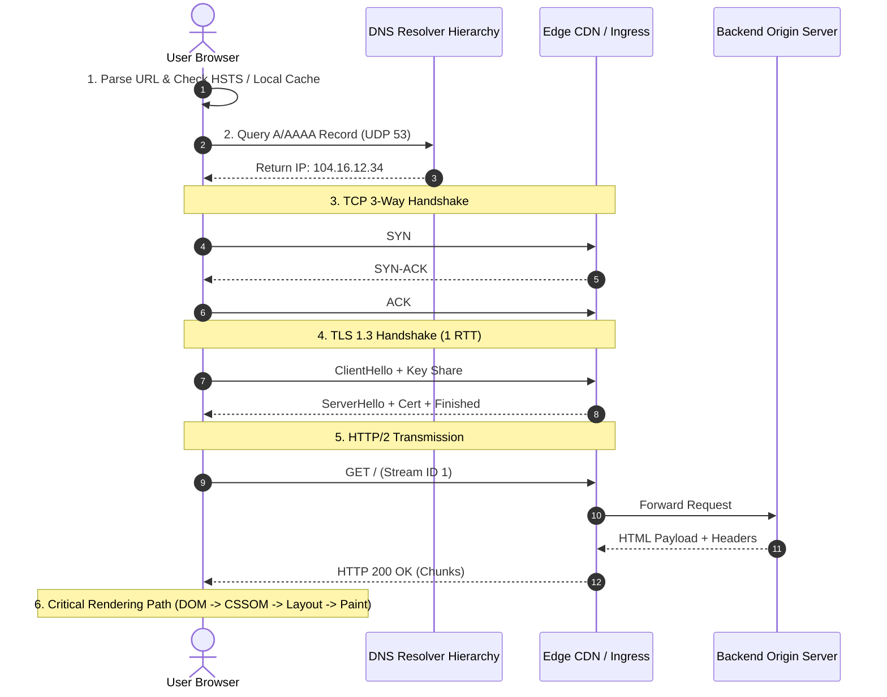

## Fast Revision (10-Second Recall)
- The 7 Core Phases: 1) URL Parsing & HSTS; 2) Recursive DNS Lookup; 3) TCP 3-Way Handshake (SYN -> SYN-ACK -> ACK); 4) TLS 1.3 Handshake (1-RTT Key Exchange); 5) HTTP Request/Response; 6) Browser Rendering Pipeline (DOM -> CSSOM -> Render Tree -> Layout -> Paint -> Composite); 7) TCP Teardown / Keep-Alive.
- HSTS Preload: Browser forces HTTPS before any network packet is dispatched, preventing SSL stripping attacks.
- DNS Cache Hierarchy: Browser Cache -> OS Cache -> Local Hosts File -> Router DNS -> ISP Recursive Resolver -> Root Server -> TLD Server -> Authoritative Nameserver.
- TLS 1.3 Optimization: Reduced handshake from 2 round trips (TLS 1.2) to 1 RTT (or 0-RTT with Pre-Shared Keys).
- Critical Rendering Path: HTML parser streams bytes; pauses on synchronous `<script>` tags unless marked `async` or `defer`.

## The 30-Second Spoken Script
"When a candidate is asked 'What happens when you enter a URL into the browser?', a senior engineer demonstrates full-stack depth across networking, operating systems, and browser internals:

First, URL parsing and security: The browser inspects the protocol, domain, and port. It checks its HSTS preload list; if present, it upgrades http:// to https:// instantly.

Second, DNS resolution: To convert the hostname to an IP, the browser checks its local cache, OS cache, and then queries the local recursive resolver. If uncached, the resolver traverses the DNS hierarchy: Root servers (.), TLD servers (.com), and Authoritative nameservers, resolving the A or AAAA record.

Third, Transport Connection: The browser initiates a TCP 3-Way Handshake (SYN, SYN-ACK, ACK) with the IP, negotiating initial sequence numbers and MSS.

Fourth, TLS 1.3 Negotiation: The client and server execute ECDHE key exchange and verify the X.509 certificate chain, establishing an encrypted session in just 1 RTT.

Fifth, HTTP Transmission: The browser dispatches an HTTP GET request over HTTP/2 multiplexed streams. An edge reverse proxy or load balancer routes it to application pods, which return HTML with cache headers.

Sixth, Browser Rendering: The browser engine parses HTML into the DOM and CSS into the CSSOM, combines them into a Render Tree, calculates geometry in the Layout phase, and paints pixels to the GPU compositor."

## Scenario / Problem Context
A user types `https://www.example.com` into Chrome and presses Enter. The interviewer asks you to detail every layer traversed?from the physical keyboard input down to socket buffers, internet transit backbones, edge proxies, and browser rendering engines.

## Architectural Workflow / Sequence


## Deep-Dive Analysis & Root Causes
### DNS Recursion vs Iterative Resolution
The client makes a Recursive DNS query to its configured ISP or resolver (e.g., 8.8.8.8): "Give me the final IP or an error." The resolver makes Iterative queries on the client's behalf: querying the Root nameserver for `.com`, querying the `.com` TLD nameserver for `example.com`, and finally querying the Authoritative nameserver (e.g., Cloudflare) to retrieve the final IP.

### TCP Initial Congestion Window (initcwnd)
When a TCP connection establishes, it does not send at maximum speed immediately. The Linux kernel uses TCP Slow Start with an initial congestion window (typically `initcwnd = 10` MSS, or ~14KB). If the critical HTML fits within the initial 14KB packet burst, the browser can begin parsing before waiting for an ACK round-trip.

### Critical Rendering Path and Parser-Blocking Scripts
As HTML tokens are emitted into the DOM tree, encountering `<link rel="stylesheet">` halts rendering (CSS is render-blocking) while downloading. Encountering a raw `<script>` tag halts both DOM parsing and rendering because JavaScript can mutate the DOM via `document.write`. Using `async` or `defer` unblocks the parser.

## Practical Debugging Commands & Code
### Network Packet & Timing Inspection CLI
```bash
# 1. Inspect complete curl HTTP request timings (DNS, Connect, TLS, TTFB)
curl -w "\nDNS: %{time_namelookup}s\nTCP: %{time_connect}s\nTLS: %{time_appconnect}s\nTTFB: %{time_starttransfer}s\nTotal: %{time_total}s\n" \
  -o /dev/null -s https://www.google.com

# 2. Trace DNS iterative resolution hops
dig +trace www.example.com

# 3. Inspect TLS 1.3 handshake ciphers and certificate chain
openssl s_client -connect www.example.com:443 -tls1_3
```

## Prevention & Senior Best Practices
- Submit to HSTS Preload: Ensure your domain is listed on `hstspreload.org` to eliminate initial insecure HTTP redirects for all users.
- Optimize TTFB Under 100ms: Keep initial HTML server rendering under 100ms and deliver HTML payloads within the first 14KB TCP window.
- Adopt HTTP/2 or HTTP/3: Leverage multiplexing, header compression (HPACK/QPACK), and single-connection resource streaming.
- Pre-Connect to Critical Domains: Use `<link rel="preconnect" href="https://cdn.example.com">` to warm up DNS and TLS handshakes in parallel.
