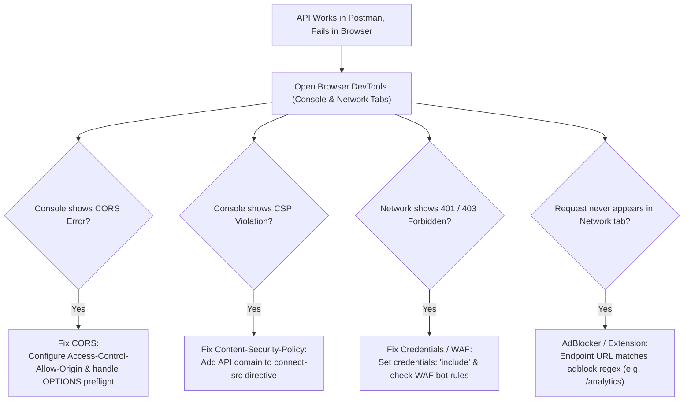

## Fast Revision (10-Second Recall)
- The Core Reason: Postman is a raw HTTP client with NO security sandbox; Web Browsers run inside a strict security sandbox enforcing web standards.
- Top 4 Culprits: 1) CORS (Missing Access-Control headers); 2) Cookies / Credentials (`credentials: "include"` vs default `omit`); 3) Missing User-Agent / WAF blocking; 4) Content-Security-Policy (CSP) blocking external domain fetch.
- The Cookie Trap: Postman sends stored cookies automatically; browser fetch requires `credentials: "include"` and matching `SameSite` / `Secure` attributes.
- WAF False Positives: Cloudflare / AWS WAF blocks browser requests due to missing or suspicious browser headers (e.g., bot detection fingerprint).
- Quick Check: Inspect the browser DevTools Network tab for preflight OPTIONS failures or red CORS banners.

## The 30-Second Spoken Script
"When an API works in Postman or cURL but fails from a web browser, the root cause is never backend business logic?it is almost always browser-enforced security boundaries or header discrepancies.

I check four specific vectors in browser DevTools:

First, CORS and Preflight: Postman never sends an OPTIONS preflight request and ignores CORS headers. In the browser, check if an OPTIONS request was rejected with 403/404, or if the console displays: 'No Access-Control-Allow-Origin header is present'.

Second, Cookie and Credential Transmission: Postman automatically attaches session cookies. In modern browser fetch API, credentials are not sent cross-origin unless credentials: 'include' is explicitly passed, and the server returns Access-Control-Allow-Credentials: true.

Third, Content Security Policy (CSP): Check the browser console for CSP violations: 'Refused to connect to api.example.com because it violates the connect-src directive'. The API call is blocked before leaving the browser.

Fourth, WAF and User-Agent Fingerprinting: Edge firewalls (like Cloudflare or Akamai) inspect browser TLS fingerprints and headers. If the browser lacks required custom headers or is flagged by a CAPTCHA challenge, the WAF returns 403 Forbidden to the browser while Postman passes."

## Scenario / Problem Context
A developer builds a new dashboard widget. In Postman, `GET https://api.partner.com/v1/metrics` returns 200 OK with perfect JSON. When called inside Chrome via `fetch()`, the request fails with a red status in DevTools.

## Architectural Workflow / Sequence


## Deep-Dive Analysis & Root Causes
### The AdBlocker Interception Trap
If an API route is named `/api/v1/analytics`, `/ads/track`, or `/events/pixel`, browser extensions like uBlock Origin or Brave Shields block the network request locally before it ever touches the network card. The request never appears in server logs. Renaming the endpoint to `/api/v1/telemetry` bypasses adblock heuristics.

### Content Security Policy (CSP) `connect-src`
CSP is an HTTP response header that restricts which domains the browser is allowed to contact via `fetch()` or `XMLHttpRequest`. If the host HTML page specifies `Content-Security-Policy: default-src 'self'`, any API call to an external subdomain or partner API is blocked at the browser sandbox level.

### Browser Cookie `SameSite` Attribute Rules
Modern browsers enforce `SameSite=Lax` by default. If an API is hosted on a different site and requires session cookies, cross-origin fetch requests will strip cookies unless the cookie is configured with `SameSite=None; Secure`, and the frontend fetch specifies `credentials: "include"`.

## Practical Debugging Commands & Code
### cURL Command to Accurately Replicate Browser Headers
```bash
# Replicate exact browser fetch request including Origin and Cookies
curl -v https://api.partner.com/v1/metrics \
  -H "Origin: https://app.example.com" \
  -H "User-Agent: Mozilla/5.0 (Macintosh; Intel Mac OS X 10_15_7) AppleWebKit/537.36" \
  -H "Cookie: session_id=abc123xyz" \
  -H "Sec-Fetch-Mode: cors" \
  -H "Sec-Fetch-Site: cross-site"
```

## Prevention & Senior Best Practices
- Export cURL from Browser DevTools: Right-click the failing network request in DevTools -> "Copy as cURL" to inspect the exact headers being transmitted.
- Configure CSP Connect-Src: Maintain a centralized list of authorized backend API domains in your website's CSP header.
- Standardize API Route Naming: Avoid route words like `/track`, `/pixel`, `/advertising`, and `/analytics` that trigger ad-blocker rules.
- Enforce Proper CORS Handling: Implement unified CORS middleware at the API Gateway rather than scattering ad-hoc headers across controllers.
