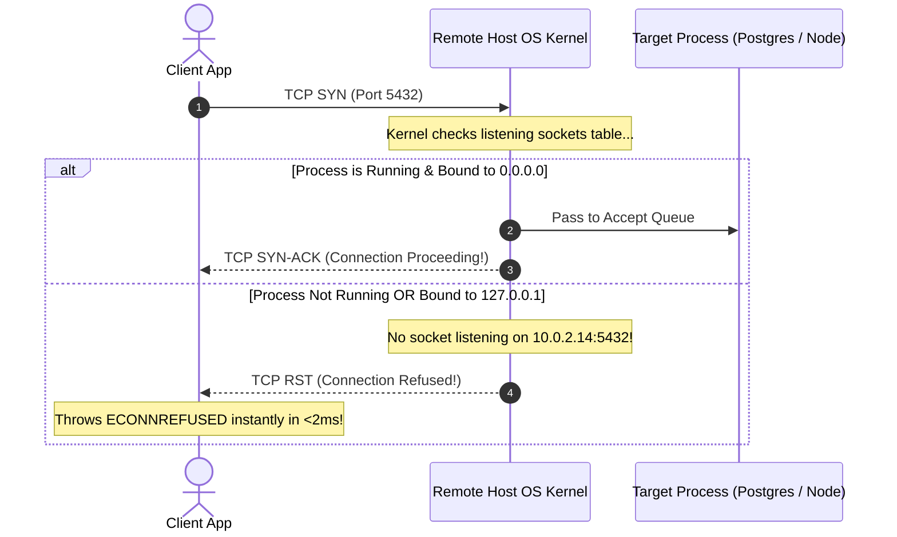

## Fast Revision (10-Second Recall)
- The TCP Mechanism: Connection Refused means a TCP RST packet was returned by the destination OS kernel (port is reachable, but no process is listening).
- Top 4 Causes: 1) Target service is not running or crashed; 2) Process listening on `127.0.0.1` (localhost) instead of `0.0.0.0` inside container; 3) Wrong destination port number; 4) TCP Accept Queue (`somaxconn`) is overflowing under load.
- Refused vs Timeout: Connection Refused = Instant RST packet received (network works, port dead); Connection Timeout = SYN packet dropped silently (firewall drop, host dead).
- Container Port Mapping Trap: Docker container listening on 8080, but `docker run` omitted `-p 8080:8080` port publishing.
- First CLI Triage: `ss -tulpn | grep <port>` on target host; `nc -zv <host> <port>` from client.

## The 30-Second Spoken Script
"When a client receives a 'Connection Refused' error?such as ECONNREFUSED?I know immediately that this is not a general network routing failure. A TCP RST packet was actively sent back by the destination operating system.

I follow a 4-step diagnostic sequence from client to server:

First, verify host reachability vs port state: Connection Refused proves the host is online and network firewalls are open. If a firewall had blocked the packet, the client would hang and throw a Connection Timeout. An active RST means the kernel reached the host, but nothing accepted the socket.

Second, check if the process is running and bound to the right interface: On the target server, I run ss -tulpn. In over 50% of containerized incidents, the service process is bound to 127.0.0.1 (loopback) rather than 0.0.0.0. A container bound to localhost cannot receive traffic routed from outside the container.

Third, check container and Kubernetes port forwarding: In Docker or Kubernetes, I check if the Service targetPort matches the container's containerPort.

Fourth, under heavy traffic, check for Listen Queue overflows: If the application is saturated and its accept queue overflows, the kernel responds to new SYN packets with RST when tcp_abort_on_overflow is enabled."

## Scenario / Problem Context
An API gateway begins logging thousands of `ECONNREFUSED 10.0.2.14:5432` errors when connecting to a newly deployed database read replica. The database host is responding to ping, but all database connection pools fail instantly.

## Architectural Workflow / Sequence


## Deep-Dive Analysis & Root Causes
### The "Bound to Localhost" Container Trap
When developing locally, frameworks default to binding to `127.0.0.1` (e.g., `app.listen(3000, "localhost")`). When deployed inside a Docker container or Kubernetes pod, `localhost` refers exclusively to that container's network namespace. External requests arriving at the container's virtual eth0 interface are rejected by the Linux kernel with TCP RST. Production applications must always bind to `0.0.0.0` (all interfaces).

### Listen Backlog Overflows and `tcp_abort_on_overflow`
When an application is hit with a traffic burst, its accept queue (configured by `somaxconn` and `listen(backlog)`) fills to capacity. By default, Linux silently drops incoming ACKs to let the client retry. However, if `sysctl net.ipv4.tcp_abort_on_overflow = 1`, the kernel immediately resets new connections with TCP RST, causing sudden Connection Refused bursts under peak load.

### Differentiating Host-Down vs Port-Down
If the host machine is completely down or an AWS Security Group drops the port, the client sends SYN, receives no reply, retransmits, and eventually times out after 60-120s with `ETIMEDOUT`. If the client receives `ECONNREFUSED` within 2 milliseconds, the host is 100% healthy, but the port is inactive.

## Practical Debugging Commands & Code
### Connection Refused Diagnostic Commands
```bash
# 1. Test port connectivity from client with netcat (fast check)
nc -zv -w 2 10.0.2.14 5432

# 2. On destination host: check if process is listening and bound interface
ss -tulpn | grep 5432
# Output check: "0.0.0.0:5432" (Good) vs "127.0.0.1:5432" (Bad for remote traffic!)

# 3. Check if service process is alive and active
systemctl status postgresql

# 4. Check for TCP listen queue drops and overflows
netstat -s | grep -E "listen|overflow"
```

## Prevention & Senior Best Practices
- Bind to 0.0.0.0 in Containers: Always configure web servers and backend processes to bind to `0.0.0.0` or `::` in containerized environments.
- Kubernetes Readiness Probes: Configure readiness probes so traffic is never routed to a pod before its listening port is fully bound and accepting sockets.
- Validate Docker Port Mappings: Use automated integration tests in CI to verify container port mappings (`docker ps` shows `0.0.0.0:8080->8080/tcp`).
- Tune OS somaxconn: Increase `net.core.somaxconn = 65535` and application backlog limits to prevent listen queue overflows during traffic surges.
