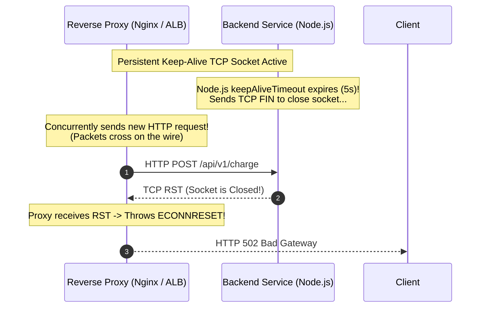

## Fast Revision (10-Second Recall)
- The TCP Mechanism: `ECONNRESET` / `Connection reset by peer` occurs when the remote side abruptly terminates an established TCP connection by sending a TCP RST packet.
- Top 4 Causes: 1) Intermediate firewall / NAT drops idle TCP socket without RST; 2) Server process crashes or is killed (OOMKilled) while socket is open; 3) Keep-Alive timeout mismatch between proxy and backend; 4) Client sends data to a socket the server has already closed.
- Refused vs Reset: Refused = Failed during initial handshake (SYN -> RST); Reset = Abruptly killed AFTER handshake was established.
- The Keep-Alive Race Condition: Nginx keepalive timeout is 60s, Node.js is 5s. Nginx sends a request right as Node.js closes the socket, causing a reset.
- Remediation: Set application keep-alive timeout strictly longer than upstream load balancer / reverse proxy timeouts.

## The 30-Second Spoken Script
"When troubleshooting an 'ECONNRESET' or 'Connection Reset by Peer' error, the first insight is understanding that the connection was already established, but was abruptly torn down via a TCP RST packet before the transaction finished.

I isolate the failure into three common production patterns:

First, the Keep-Alive Timeout Race Condition: This is the number one cause in microservice architectures. If an upstream load balancer (like AWS ALB or Nginx) has a keep-alive timeout of 60 seconds, but your backend application server (like Node.js, Spring Boot, or Go) has an idle timeout of 5 seconds, the backend closes the socket while the load balancer is concurrently transmitting a new request down that same socket. The backend kernel replies with a TCP RST. The fix is setting backend keep-alive timeouts at least 5 seconds LONGER than proxy timeouts.

Second, Upstream Container Crashes: If a worker process throws a fatal Segmentation Fault, uncaught exception, or is terminated by the Linux OOM-killer while processing a request, the operating system kernel instantly sends RST packets to all active client sockets.

Third, Stateful Firewall / Cloud NAT Drops: Cloud firewalls silently drop idle connections after 350 seconds. When the application later attempts to reuse the socket, the firewall rejects the packet with RST."

## Scenario / Problem Context
An API gateway logs sporadic `ECONNRESET` errors on 0.5% of requests to an internal payment service. The errors occur during periods of low traffic, and retrying the request immediately succeeds.

## Architectural Workflow / Sequence


## Deep-Dive Analysis & Root Causes
### The Keep-Alive Timeout Hierarchy Rule
In any multi-tier architecture, the timeout rule must be strictly enforced: `Backend Idle Timeout > Proxy Idle Timeout > Client Idle Timeout`. For example, if AWS ALB has an idle timeout of 60 seconds, your Node.js server must configure `server.keepAliveTimeout = 65000` (65s) and `server.headersTimeout = 66000` (66s). This guarantees the proxy closes idle connections first, completely preventing the race condition.

### Writing to a Closed Socket (EPIPE and ECONNRESET)
When an endpoint closes its socket (sending FIN), the connection enters a half-closed state. If the other end continues writing data to that socket, the closed side responds with TCP RST. In Linux, reading from a reset socket throws `ECONNRESET`; writing to a reset socket throws `EPIPE` (Broken Pipe) and triggers SIGPIPE.

### Capturing the Exact RST Source with Wireshark / tcpdump
To prove which intermediate device sent the RST packet, capture packets using `tcpdump -nn -i any "tcp[tcpflags] & tcp-rst != 0"`. Inspect the IP Time-To-Live (TTL) field on the RST packet: if the standard server TTL is 64, but the RST arrives with TTL 54, the RST was generated by an intermediate network firewall or router 10 hops away.

## Practical Debugging Commands & Code
### TCP Reset Packet Capture & Node.js Keep-Alive Fix
```bash
# 1. Capture TCP RST packets on eth0 with tcpdump
tcpdump -nn -i eth0 'tcp[tcpflags] & tcp-rst != 0' -c 10

// 2. Node.js HTTP Server Keep-Alive Timeout Configuration
const server = app.listen(3000);
// Ensure backend timeout is strictly longer than ALB (60s)
server.keepAliveTimeout = 65000; // 65 seconds
server.headersTimeout = 66000;   // Must be > keepAliveTimeout

# 3. Check system TCP retransmissions and aborts
netstat -s | grep -E "resets sent|resets received"
```

## Prevention & Senior Best Practices
- Synchronize Keep-Alive Timeouts: Set backend application idle timeouts 5-10 seconds longer than intermediate load balancer timeouts.
- Enable TCP Keep-Alive Probes: Configure TCP socket keep-alive probes (`SO_KEEPALIVE`) with a 60-second probe interval to prevent stateful firewalls from silently purging idle sockets.
- Graceful Process Shutdown: Ensure application SIGTERM handlers stop accepting new requests, finish in-flight transactions, and close sockets gracefully.
- Proxy Auto-Retry on Idempotent Resets: Configure Nginx with `proxy_next_upstream error timeout invalid_header http_502` to automatically retry idempotent requests on connection reset.
