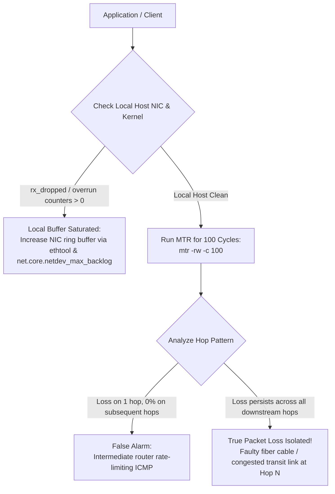

## Fast Revision (10-Second Recall)
- Symptoms: Random API request timeouts, high latency jitter (p99 spikes), degraded TCP throughput, packet retransmissions.
- Primary Diagnostic Tool: `mtr` (My Traceroute) combines `traceroute` and `ping` across 100+ cycles to isolate the exact hop dropping packets.
- Local vs Remote Loss: If hop 4 shows 10% loss but hops 5-10 show 0% loss, hop 4 is merely rate-limiting ICMP (not real packet loss). True packet loss persists across all subsequent hops.
- Linux Kernel Ring Buffer Overruns: Saturated network cards drop packets at the driver layer before reaching the OS kernel (`ethtool -S`).
- Path MTU Issues (Black Hole): Packets with `DF` (Don't Fragment) flag exceeding intermediate MTU are dropped silently.

## The 30-Second Spoken Script
"Intermittent packet loss is one of the most insidious network issues because standard ping tests rarely catch sporadic drops.

My diagnostic methodology moves from the local host network interface out to intermediate transit backbones:

First, I rule out local host packet drops: On Linux servers, high traffic can overflow the Network Interface Card (NIC) rx/tx ring buffers or the kernel backlog. I check netstat -s and ethtool -S for rx_dropped or buffer overrun counters. If the local interface is dropping packets, expanding ring buffer sizes with ethtool resolves it immediately.

Second, I isolate the network hop using MTR (My Traceroute): Running `mtr -rw -c 100 <destination>` sends 100 probe cycles across every router in the path.

When analyzing MTR results, the key senior rule is: Real packet loss is persistent across all downstream hops. If Hop 5 shows 8% loss, but Hops 6, 7, and 8 show 0% loss, Hop 5 is simply rate-limiting ICMP diagnostic packets and there is zero actual loss. If Hop 5 shows 8% loss and Hops 6 through 8 also show 8% loss, Hop 5 is physically dropping transit packets.

Third, if drops correlate with large payloads, I test for Path MTU discovery issues using ping with the Don't Fragment flag set."

## Scenario / Problem Context
A distributed database cluster begins reporting sporadic replication lag and node election timeouts. Average ping latency is 12ms, but 0.8% of database network packets are intermittently dropped, crippling TCP throughput.

## Architectural Workflow / Sequence


## Deep-Dive Analysis & Root Causes
### The ICMP Rate-Limiting Fallacy in Traceroute
Routers prioritize data plane packet forwarding using dedicated hardware ASICs. ICMP "Time Exceeded" generation is handled by the router's slow CPU control plane. Many core transit routers explicitly rate-limit ICMP responses to protect their management CPU. Seeing 20% packet loss on a single intermediate hop is completely benign if the destination hop reports 0% loss.

### NIC Ring Buffer Overruns (SoftIRQ Saturation)
When 100,000 packets per second arrive at a physical 10Gbps NIC, the card writes packets into a hardware Ring Buffer. If the CPU core assigned to process SoftIRQs (`ksoftirqd`) is busy, the ring buffer overflows and the network card physically discards packets before the Linux kernel ever sees them. Increasing `rx` ring buffers from 256 to 4096 and enabling Receive Side Scaling (RSS) distributes interrupts across all CPU cores.

### Path MTU Discovery (PMTUD) Black Holes
Standard Ethernet MTU is 1500 bytes. If a VPN or GRE tunnel reduces MTU to 1420 bytes, and an intermediate firewall blocks ICMP Type 3 Code 4 ("Fragmentation Needed"), the sender transmits a 1500-byte packet with the Don't Fragment (DF) bit set. The router silently discards the packet, creating a TCP black hole where small HTTP headers pass, but large bodies hang forever.

## Practical Debugging Commands & Code
### Network Packet Loss & Ring Buffer Diagnostic CLI
```bash
# 1. Run MTR for 100 probe cycles with raw report output
mtr -rw -c 100 db-prod.internal

# 2. Check for local NIC ring buffer drops and overruns
ethtool -S eth0 | grep -E "drop|overrun|error"

# 3. View current and max allowed NIC ring buffer sizes
ethtool -g eth0

# 4. Expand NIC RX ring buffer to maximum capacity
ethtool -G eth0 rx 4096

# 5. Test Path MTU without fragmentation (test 1472 byte payload + 28 byte header = 1500 MTU)
ping -M do -s 1472 -c 5 db-prod.internal
```

## Prevention & Senior Best Practices
- Enable Receive Side Scaling (RSS): Ensure multi-queue network cards distribute network interrupts across all available CPU cores.
- Tune Linux Network Backlog: Increase `net.core.netdev_max_backlog = 10000` to prevent socket buffer drops during traffic bursts.
- Clamp TCP MSS to Prevent MTU Black Holes: Configure `iptables -A FORWARD -p tcp --tcp-flags SYN,RST SYN -j TCPMSS --clamp-mss-to-pmtu` on VPN gateways.
- Continuous Blackbox Network Monitoring: Deploy Prometheus Blackbox Exporter probes pinging critical infrastructure nodes every 5 seconds to alert on packet loss trends.
