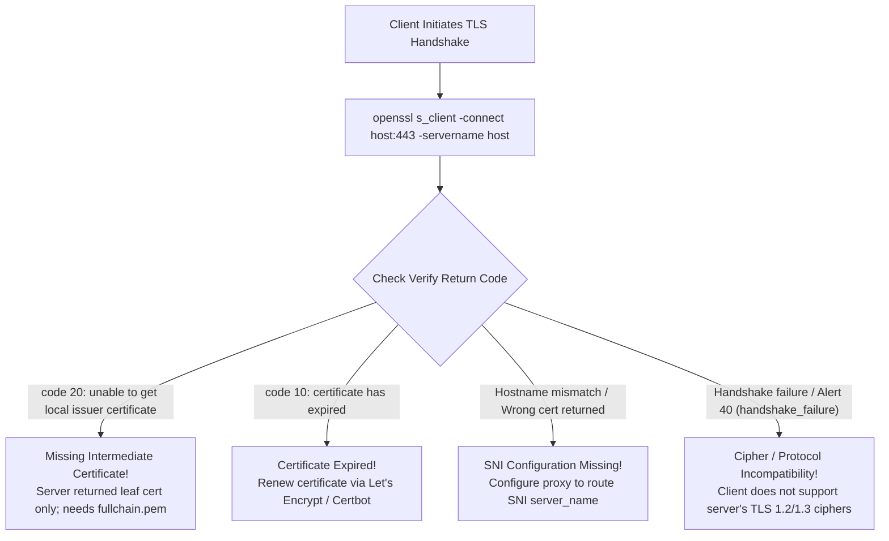

## Fast Revision (10-Second Recall)
- Top 5 Handshake Failure Causes: 1) Expired SSL/TLS certificate; 2) Incomplete certificate chain (missing intermediate CA cert); 3) Server Name Indication (SNI) mismatch; 4) Incompatible TLS protocol or cipher suites; 5) Client system clock skew.
- Incomplete Chain ("Works on Desktop, Fails on Mobile"): Desktop browsers cache intermediate CAs; mobile devices and Java/Node runtimes fail with `UNABLE_TO_VERIFY_LEAF_SIGNATURE`.
- The Primary Tool: `openssl s_client -connect <host>:443 -servername <host>` exposes the raw TLS negotiation, certificate chain, and failure reason.
- SNI (Server Name Indication): Client sends domain name inside the initial ClientHello; missing SNI causes reverse proxies to serve the default fallback cert.
- Clock Drift Impact: If the client machine's clock is set to 2024, a certificate valid from 2026 is rejected as `Certificate not yet valid`.

## The 30-Second Spoken Script
"When diagnosing an SSL/TLS handshake failure, I use OpenSSL to isolate whether the failure is an invalid certificate, an incomplete intermediate chain, an SNI mismatch, or a cipher suite negotiation incompatibility.

I execute `openssl s_client -connect <host>:443 -servername <host>` to inspect the live handshake output.

The most frequent production cause is an Incomplete Certificate Chain: When installing a certificate, engineers often upload only the leaf certificate rather than the full chain containing the intermediate CA certificates. While desktop Chrome may mask this bug by downloading intermediate CAs automatically, mobile apps and backend runtimes will immediately abort with 'unable to verify leaf signature'.

The second common cause is missing Server Name Indication (SNI): If a reverse proxy hosts multiple domains on a single IP, the client must transmit the hostname in the ClientHello. Without SNI, the proxy serves the default fallback certificate, causing a hostname mismatch.

Third, I verify system time: If a server's NTP sync fails and its clock drifts outside the certificate's NotBefore or NotAfter validity window, handshakes fail deterministically.

Finally, I verify TLS version compatibility?such as legacy clients attempting to connect with TLS 1.0 to modern servers that enforce TLS 1.2 or 1.3."

## Scenario / Problem Context
Following an SSL certificate renewal on an internal API, mobile app users report they can no longer log in, receiving: "SSLHandshakeException: PKIX path building failed". Meanwhile, desktop web users connect with zero issues.

## Architectural Workflow / Sequence


## Deep-Dive Analysis & Root Causes
### The Incomplete Certificate Chain Phenomenon
A Certificate Authority (CA) signs certificates hierarchically: Root CA -> Intermediate CA -> Leaf Certificate (your domain). When configuring Nginx or Apache, providing `cert.pem` (leaf only) instead of `fullchain.pem` breaks verification on strict clients. Desktop Chrome caches intermediate CAs across the web (AIA fetching), masking the bug. Mobile devices (iOS/Android), Java apps, and curl reject the connection because they cannot build the trust path to the root.

### Server Name Indication (SNI) and Virtual Hosting
Before SNI, the TLS handshake occurred before HTTP headers were sent, meaning a web server had no idea which domain the user was requesting on a shared IP address. SNI adds the requested hostname into the plaintext `ClientHello` message, allowing Nginx or HAProxy to select and present the exact certificate matching `api.example.com`.

### Java PKIX Path Building Failed
Java runtimes do not use operating system certificate stores; they maintain an internal `cacerts` truststore (`$JAVA_HOME/lib/security/cacerts`). If a corporate internal CA or new root CA is not imported into Java's keystore, Java applications fail with `SunCertPathBuilderException: unable to find valid certification path`.

## Practical Debugging Commands & Code
### OpenSSL Diagnostic & Chain Verification Commands
```bash
# 1. Test full TLS handshake with SNI and verify certificate chain
openssl s_client -connect api.example.com:443 -servername api.example.com

# 2. Check certificate expiration date directly from terminal
echo | openssl s_client -connect api.example.com:443 -servername api.example.com 2>/dev/null | \
  openssl x509 -noout -dates -subject -issuer

# 3. Test if server supports specific TLS version (e.g., TLS 1.2 vs 1.3)
openssl s_client -connect api.example.com:443 -tls1_2
openssl s_client -connect api.example.com:443 -tls1_3

# 4. Concatenate leaf and intermediate certificates to form fullchain
cat domain_cert.pem intermediate_ca.pem > fullchain.pem
```

## Prevention & Senior Best Practices
- Always Deploy Fullchain Bundles: Ensure reverse proxy configurations reference `fullchain.pem` (leaf + intermediate) rather than standalone leaf certificates.
- Automated SSL Expiration Alerting: Configure Blackbox Exporter or Datadog alerts to notify engineers at 30, 14, and 7 days prior to certificate expiration.
- Synchronize Host Time with NTP: Run `chrony` or `systemd-timesyncd` across all server nodes to prevent clock drift TLS verification failures.
- Run Automated SSL Labs Audits: Use `ssllabs-scan` in CI/CD staging environments to guarantee an "A+" SSL rating before production promotion.
