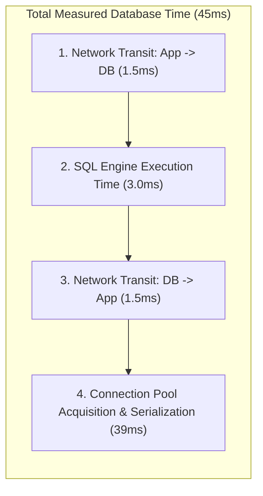

## Fast Revision (10-Second Recall)
- Differentiating Network vs Query: Total DB Time = Network Round Trip Time (RTT) + Query Execution Time on DB Engine.
- The "N+1 Query" Network Multiplier: 100 queries with 2ms network latency = 200ms wasted purely on network packet flight time!
- Cross-AZ Latency Tax: Communication within the same AWS Availability Zone is ~0.3ms; cross-AZ communication jumps to 1.5ms - 2.5ms.
- Tools: `ping` (ICMP RTT), `tcping` / `nc` (TCP handshake latency), `traceroute`, OpenTelemetry span waterfalls.
- Nagle's Algorithm (`TCP_NODELAY`): Ensures tiny query packets are transmitted immediately without 40ms buffering delays.

## The 30-Second Spoken Script
"When investigating slow database performance, developers frequently assume the database engine is slow. However, in distributed cloud architectures, network latency between the application and database is often the real culprit.

To isolate network transit time from query execution time, I compare client-side APM spans against database internal execution stats.

If an OpenTelemetry span reports that a query took 45 milliseconds, but PostgreSQL's pg_stat_statements reports the query execution time was only 3 milliseconds, then 42 milliseconds were spent on network packet transit, connection acquisition, and serialization.

To diagnose the network path:
First, I measure raw network RTT using tcping or ping from the application container to the database host.

Second, I check cross-availability zone placement: In AWS or GCP, if application pods run in Availability Zone A while the database primary runs in Availability Zone B, every database round-trip incurs a 1.5 to 2.5 millisecond penalty. If an endpoint executes 50 sequential queries (the classic N+1 anti-pattern), network transit alone adds over 100 milliseconds of latency.

Third, I verify that database drivers enable TCP_NODELAY to disable Nagle's algorithm and eliminate 40-millisecond delayed ACK buffering."

## Scenario / Problem Context
An API endpoint takes 450ms to respond. Developers optimize SQL indexes until database query execution takes only 1ms, yet the overall endpoint response time remains unchanged at 440ms.

## Architectural Workflow / Sequence


## Deep-Dive Analysis & Root Causes
### The N+1 Network Latency Multiplier
Consider an ORM that executes 1 query for a user and 100 separate queries for their order items. If the application and database are on the same machine (localhost), network latency is 0.05ms (total network time = 5ms). In cloud environments across availability zones, network latency is 2ms per query. The exact same code now spends 200ms purely on network transit, regardless of how fast the database queries are. Batching into a single `IN (...)` query drops network latency from 200ms to 2ms.

### Nagle's Algorithm and Delayed ACKs (40ms Hiccup)
Nagle's algorithm buffers small outgoing packets until an ACK arrives to conserve bandwidth. TCP Delayed ACKs wait up to 40ms before acknowledging packets. When combined, an application sending a small query packet waits 40ms for the database ACK before transmitting data. Database connection drivers MUST configure `TCP_NODELAY = true` to disable Nagle's algorithm.

### Availability Zone Affinity and Multi-AZ Latency
Cloud providers bill for cross-AZ data transfer because packets travel across physical metropolitan fiber loops. Running compute in `us-east-1a` and database in `us-east-1b` adds ~1.5ms of latency per round-trip. Using Kubernetes topology-aware routing or co-locating primary workloads within the same AZ minimizes transit latency.

## Practical Debugging Commands & Code
### Network Latency & RTT Diagnostic Commands
```bash
# 1. Measure TCP connection latency to database port (bypasses ICMP blocks)
nc -zv -w 1 db-prod.internal 5432

# 2. Check ICMP latency and jitter (100 packets)
ping -c 100 db-prod.internal

# 3. Check PostgreSQL pg_stat_statements mean query execution time
SELECT query, calls, mean_exec_time, total_exec_time 
FROM pg_stat_statements 
WHERE query LIKE '%orders%' 
ORDER BY calls DESC LIMIT 5;

# 4. Check if TCP_NODELAY is active on established database sockets
ss -t -i 'sport = :5432 or dport = :5432'
```

## Prevention & Senior Best Practices
- Eliminate N+1 Queries: Use eager loading, `JOIN` queries, or dataloaders to execute bulk fetches in a single network round-trip.
- Enforce TCP_NODELAY: Verify that database connection pool settings (HikariCP, pgpool) explicitly set `tcpNoDelay = true`.
- Co-Locate Compute and Data (AZ Affinity): Place high-throughput backend services in the same Availability Zone as the database primary.
- Deploy In-Memory Cache (Redis): Cache hot entities to avoid traversing the network to the database for repetitive queries.
