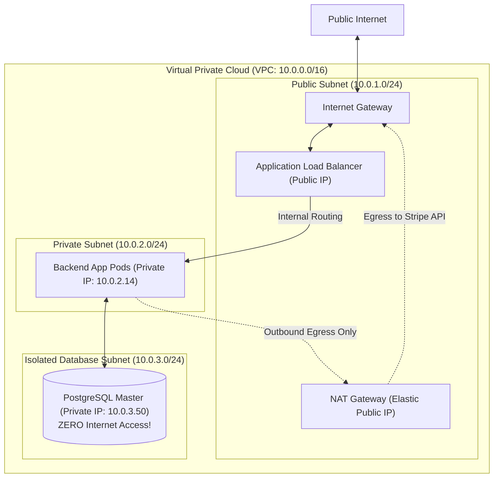

## Fast Revision (10-Second Recall)
- Public IP: Globally unique, routable across the public internet, assigned by IANA/ISPs.
- Private IP (RFC 1918): Non-routable on the public internet, reserved for internal networks: `10.0.0.0/8`, `172.16.0.0/12`, `192.168.0.0/16`.
- NAT Gateway (Network Address Translation): Translates private IPs into a single public elastic IP, allowing private servers to access internet egress (e.g., updates, APIs) while blocking inbound traffic.
- CIDR Notation (`/24`): `/24` = 256 IPs (32 - 24 = 8 host bits = $2^8 = 256$, minus 5 reserved cloud IPs = 251 usable).
- Security Golden Rule: Databases and backend application pods MUST live on private subnets with ZERO public IPs.

## The 30-Second Spoken Script
"In cloud and enterprise infrastructure, the distinction between Public and Private IPs is the foundation of network isolation and defense-in-depth.

A Public IP is globally routable across the public internet. Any machine with a public IP can be addressed directly by external traffic, making it a target for port scanning and DDoS attacks.

A Private IP belongs to RFC 1918 reserved address spaces?such as 10.0.0.0/8 or 172.16.0.0/12. These addresses are not routable on the public internet.

In modern cloud architecture (AWS VPC, GCP VPC), we enforce strict subnet segregation:

Public Subnets contain resources that must accept public incoming traffic?such as Application Load Balancers and Bastion Hosts?connected to an Internet Gateway.

Private Subnets contain all backend compute, microservices, and databases. These nodes possess private IPs only.

When a private backend server needs to make an outbound call?such as calling the Stripe API or pulling an Ubuntu security patch?it routes traffic through a Network Address Translation (NAT) Gateway. The NAT Gateway maps the private IP to its public IP, dispatches the request, and routes the response back, while completely blocking unauthorized inbound internet connections."

## Scenario / Problem Context
An architect reviews a proposed cloud deployment where all Kubernetes worker nodes and PostgreSQL databases have public IP addresses assigned with security group firewall rules. You are asked to explain why this violates compliance and design the proper VPC subnet architecture.

## Architectural Workflow / Sequence


## Deep-Dive Analysis & Root Causes
### CIDR Notation and Cloud Reserved IP Calculation
A CIDR block specifies the network prefix: `10.0.0.0/24` means the first 24 bits are fixed for the network, leaving 8 bits for host IPs ($2^8 = 256$). However, AWS and GCP reserve 5 IP addresses in every subnet: .0 (Network address), .1 (VPC router), .2 (DNS server), .3 (Future use), and .255 (Broadcast address). A `/24` subnet yields exactly 251 usable host IPs.

### Why Security Groups Are Not Enough for Public Databases
Relying exclusively on firewall rules (Security Groups) while assigning public IPs to database instances is dangerous. A single human error?such as a developer opening port 5432 to `0.0.0.0/0` during an emergency debugging session?exposes the database immediately to automated internet botnet brute-force scans. Keeping databases on private subnets without public IPs makes external penetration physically impossible at the routing layer.

### NAT Gateway Bandwidth & Port Exhaustion
When hundreds of microservices route high-throughput traffic through a single NAT Gateway, two bottlenecks emerge: 1) NAT Gateways have throughput limits (e.g., 45Gbps on AWS); 2) SNAT port exhaustion occurs if thousands of concurrent outbound connections are opened to the same external IP, exhausting the ~55,000 ephemeral ports on the NAT interface.

## Practical Debugging Commands & Code
### Subnet CIDR & Route Table Inspection CLI
```bash
# 1. Display local network interface IP configuration and CIDR
ip addr show eth0

# 2. View local kernel routing table and default gateway
ip route show

# 3. Test public outbound IP from inside a private subnet (verifies NAT gateway)
curl -s https://checkip.amazonaws.com

# 4. Inspect AWS VPC subnet route tables via AWS CLI
aws ec2 describe-route-tables --filters "Name=vpc-id,Values=vpc-12345678"
```

## Prevention & Senior Best Practices
- Strict Subnet Segregation: Deploy all databases and application compute nodes to private subnets with zero public IP allocations.
- Deploy AWS VPC Endpoints (PrivateLink): Route traffic to AWS S3, DynamoDB, and Secrets Manager via private VPC endpoints, bypassing NAT Gateway costs and bandwidth limits.
- Audit Public IP Allocations: Configure AWS Config or GCP Security Command Center rules to automatically flag and alert if a database or EC2 instance is assigned a public IP.
- Dual-AZ NAT Gateways: Deploy redundant NAT Gateways across at least two Availability Zones to prevent single-AZ egress outages.
