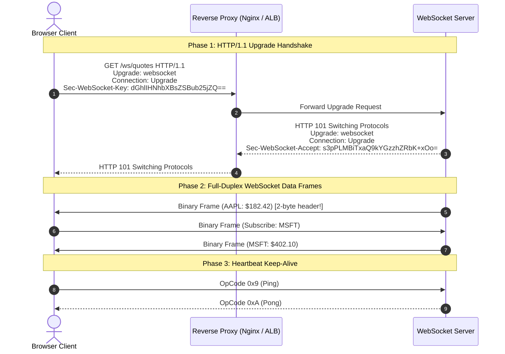

## Fast Revision (10-Second Recall)
- What is it? Full-duplex, bidirectional, persistent communication channel over a single TCP socket (RFC 6455).
- The Upgrade Handshake: Starts as an HTTP/1.1 request with `Upgrade: websocket` and `Connection: Upgrade`; server responds `HTTP 101 Switching Protocols`.
- Minimal Overhead: After the handshake, data frames have an overhead of only 2 to 10 bytes (compared to 1KB+ for HTTP request headers).
- Binary Framing: Frames contain OpCodes: `0x1` (Text), `0x2` (Binary), `0x8` (Close), `0x9` (Ping), `0xA` (Pong).
- Heartbeat & Keep-Alive: Ping/Pong frames sent every 30s prevent intermediate proxies and NAT firewalls from terminating idle TCP sockets.

## The 30-Second Spoken Script
"A WebSocket is a computer communications protocol that provides full-duplex, bidirectional communication channels over a single, persistent TCP connection.

Unlike traditional HTTP where communication is strictly request-response initiated by the client, WebSockets allow both client and server to push data at any time with minimal latency.

The connection begins with an HTTP/1.1 Upgrade Handshake: The client sends a standard GET request containing two special headers: Upgrade: websocket and Connection: Upgrade, alongside a cryptographically random Sec-WebSocket-Key.

If the server supports WebSockets, it hashes the key with a standard RFC GUID, encodes it in Base64, and returns HTTP 101 Switching Protocols.

At this exact instant, the HTTP protocol is discarded. The underlying TCP socket remains open, switching to the lightweight WebSocket binary framing protocol. Subsequent messages carry an overhead of just 2 to 6 bytes per frame?eliminating the massive 1KB header overhead of HTTP.

To prevent stateful cloud load balancers and cellular firewalls from silently dropping idle sockets, client and server exchange lightweight Ping/Pong control frames every 30 seconds."

## Scenario / Problem Context
A fintech trading platform requires real-time stock price updates streaming to 100,000 active web traders with sub-50ms latency. The engineering team needs to design the WebSocket upgrade pipeline and proxy routing.

## Architectural Workflow / Sequence


## Deep-Dive Analysis & Root Causes
### Nginx and Reverse Proxy WebSocket Configuration
By default, reverse proxies terminate HTTP connections after each response and close hop-by-hop headers. To allow WebSockets through Nginx, you must explicitly preserve the hop-by-hop upgrade headers: `proxy_set_header Upgrade $http_upgrade; proxy_set_header Connection "upgrade";` and increase `proxy_read_timeout` to prevent Nginx from severing idle chat streams.

### Client-Side Masking (Security Requirement)
RFC 6455 mandates that all frames sent from the client to the server MUST be masked with a random 32-bit key. This prevents Cache Poisoning attacks on intermediate proxy caches: an attacker cannot inject malicious HTTP byte sequences into a WebSocket stream that an intermediate proxy could confuse with a legitimate HTTP response.

### WebSocket Scaling & Ephemeral State
WebSockets are stateful: a socket is physically bound to a specific server memory space. If User A is connected to Node 1 and User B is connected to Node 2, Node 1 cannot push messages to User B directly. Scaling WebSocket architectures requires an external Pub/Sub message broker (like Redis Pub/Sub or Kafka) to route messages across cluster nodes.

## Practical Debugging Commands & Code
### Testing WebSocket Connection via wscat CLI
```bash
# 1. Connect to WebSocket server from terminal using wscat
wscat -c wss://api.example.com/ws/quotes

# 2. In Nginx: Enable WebSocket proxying directives
location /ws/ {
    proxy_pass http://websocket_backend;
    proxy_http_version 1.1;
    proxy_set_header Upgrade $http_upgrade;
    proxy_set_header Connection "Upgrade";
    proxy_set_header Host $host;
    proxy_read_timeout 3600s; # Keep socket open for 1 hour
    proxy_send_timeout 3600s;
}
```

## Prevention & Senior Best Practices
- Preserve Hop-by-Hop Headers: Ensure API gateways explicitly forward `Upgrade` and `Connection` headers to upstream servers.
- Implement Ping/Pong Heartbeats: Enforce periodic 30-second ping/pong cycles to prevent NAT firewalls from dropping idle TCP connections.
- Cap Frame Sizes: Configure `maxPayloadLength` (e.g., max 64KB) on WebSocket servers to prevent memory exhaustion from malicious oversized frames.
- Horizontal Fanout via Pub/Sub: Decouple WebSocket connections from message distribution using Redis Pub/Sub or Apache Pulsar.
