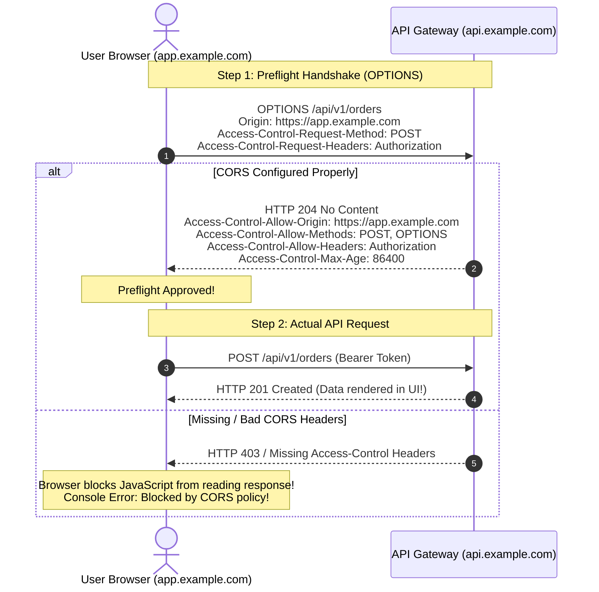

## Fast Revision (10-Second Recall)
- Same-Origin Policy (SOP): Browser security standard preventing scripts from `https://app.com` from reading responses from `https://api.com` unless explicitly permitted.
- An Origin consists of: Protocol + Domain + Port (e.g., `http://localhost:3000` vs `http://localhost:8000` are different origins).
- CORS is a Browser Feature: CORS is enforced ONLY by web browsers. Curl, Postman, and backend servers ignore CORS completely.
- Simple vs Preflight Requests: Simple requests (GET/POST with standard headers) skip preflight; Complex requests (PUT/DELETE, JSON content-type, custom headers) trigger an HTTP `OPTIONS` preflight request.
- The Cardinal Sin: Setting `Access-Control-Allow-Origin: *` alongside `Access-Control-Allow-Credentials: true` is forbidden by browsers.

## The 30-Second Spoken Script
"Cross-Origin Resource Sharing (CORS) is a browser-enforced security mechanism that relaxes the strict Same-Origin Policy, allowing a web application running on one origin to securely interact with an API hosted on a different origin.

The critical insight is that CORS is entirely a browser security control. When a CORS error occurs, your backend server actually received the request, processed the business logic, and returned a 200 OK. However, the browser inspected the response headers, saw that Access-Control-Allow-Origin was missing or mismatched, and blocked the client JavaScript code from reading the response.

For any non-simple request?such as requests with Content-Type: application/json, PUT/DELETE methods, or custom Authorization headers?the browser automatically sends an HTTP OPTIONS Preflight request before the actual request.

The preflight asks: "Does Origin A have permission to send a POST request with an Authorization header?"

If the server responds with:
Access-Control-Allow-Origin: https://app.example.com
Access-Control-Allow-Methods: GET, POST, PUT, DELETE, OPTIONS
Access-Control-Allow-Headers: Authorization, Content-Type
Access-Control-Max-Age: 86400

The browser caches the preflight permission and dispatches the real API payload."

## Scenario / Problem Context
A frontend team deploys a single-page React application to `https://app.example.com` connecting to a backend at `https://api.example.com`. The app works in local testing, but in production, every API call fails with: "Access to XMLHttpRequest has been blocked by CORS policy".

## Architectural Workflow / Sequence


## Deep-Dive Analysis & Root Causes
### Why Postman Works While the Browser Fails
Developers often protest: "The API works fine in Postman, so the bug must be in React!" Postman is an HTTP client, not a web browser. Postman does not enforce the Same-Origin Policy, does not execute preflight OPTIONS requests, and does not restrict reading cross-origin responses. Only browsers enforce CORS to protect authenticated user sessions from malicious third-party websites.

### The Danger of `Access-Control-Allow-Origin: *`
While wildcard `*` resolves CORS quickly, it introduces severe vulnerabilities: any malicious website on the internet can make fetch requests to your API. Furthermore, if your application uses cookies or `Authorization` headers (`withCredentials: true`), browsers explicitly reject responses containing `Access-Control-Allow-Origin: *` with an error.

### Optimizing Preflight Latency with `Access-Control-Max-Age`
Executing an OPTIONS preflight request before every single API call doubles API latency (each user click requires 2 sequential round-trips). Supplying `Access-Control-Max-Age: 86400` instructs the browser to cache preflight approval for 24 hours, eliminating preflight round-trips on subsequent requests.

## Practical Debugging Commands & Code
### Testing Preflight CORS Headers via cURL
```bash
# 1. Simulate an automated browser preflight OPTIONS request
curl -I -X OPTIONS https://api.example.com/api/v1/orders \
  -H "Origin: https://app.example.com" \
  -H "Access-Control-Request-Method: POST" \
  -H "Access-Control-Request-Headers: Authorization,Content-Type"

# 2. Verify returned CORS headers in response
# Expected Output:
# Access-Control-Allow-Origin: https://app.example.com
# Access-Control-Allow-Methods: GET, POST, PUT, DELETE, OPTIONS
# Access-Control-Allow-Headers: Authorization, Content-Type
# Access-Control-Max-Age: 86400
```

## Prevention & Senior Best Practices
- Handle OPTIONS at API Gateway / Reverse Proxy: Intercept and answer OPTIONS preflight requests directly at Nginx or Envoy to prevent application servers from processing preflights.
- Explicit Allowed Origin Whitelist: Dynamically check the `Origin` header against an approved domain whitelist rather than hardcoding static wildcards.
- Configure `Access-Control-Max-Age`: Set preflight cache duration to at least 2 hours (e.g., 7200 seconds) to cut network round-trips in half.
- Avoid Redundant Custom Headers: Use standard HTTP headers when possible to keep requests within the "Simple Request" classification and skip preflight entirely.
