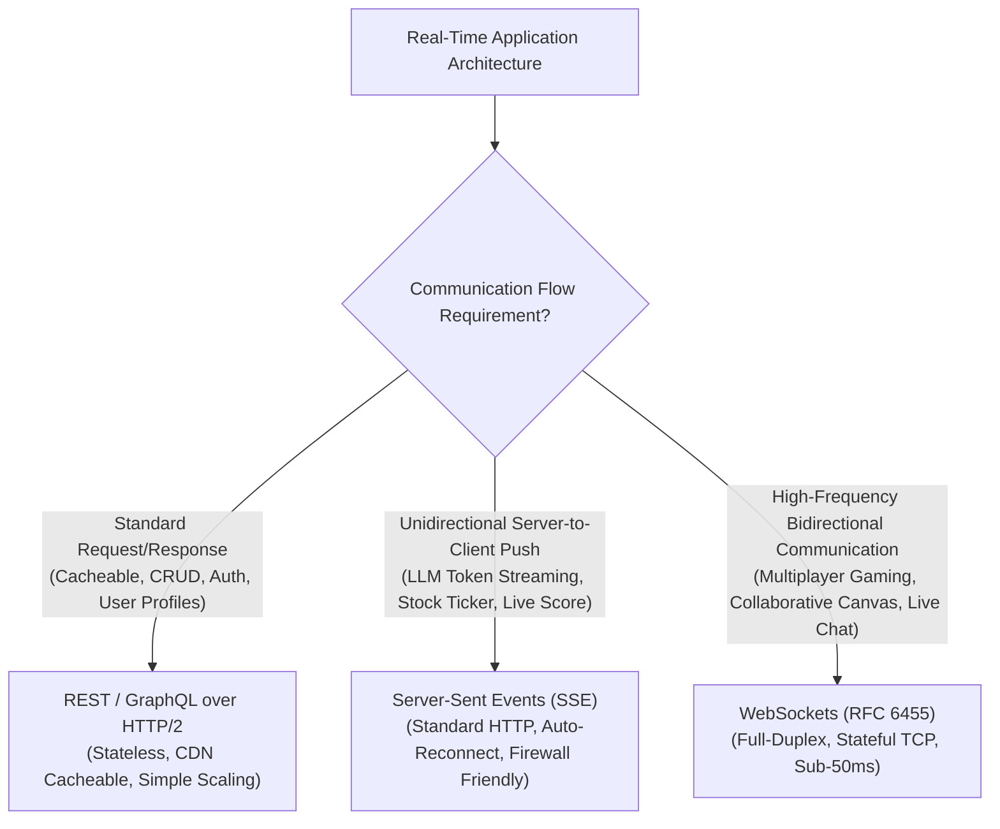

## Fast Revision (10-Second Recall)
- The 4 Communication Paradigms: 1) REST (Client-pull, stateless, request-response); 2) Short/Long Polling (Client repeatedly queries; high overhead); 3) Server-Sent Events (SSE: Server-push only over standard HTTP, unidirectional); 4) WebSockets (Full-duplex, bidirectional, stateful TCP).
- Use REST When: Operations are CRUD, cacheable, request-driven (90% of standard web applications).
- Use Server-Sent Events (SSE) When: Data flows in ONE direction (server to client) like stock tickers, live news feeds, or ChatGPT LLM streaming.
- Use WebSockets When: High-frequency bidirectional data is required (multiplayer gaming, collaborative whiteboards, live audio/chat).
- Stateful vs Stateless Cost: REST scales horizontally effortlessly behind standard load balancers; WebSockets hold open file descriptors and require Redis Pub/Sub clusters.

## The 30-Second Spoken Script
"Choosing between REST, Server-Sent Events (SSE), and WebSockets is an architectural decision based on data flow direction, latency sensitivity, and infrastructure complexity.

REST over HTTP is the gold standard for standard request-response operations. It is stateless, easily cacheable at edge CDNs, and scales horizontally with standard load balancers with zero connection management overhead.

However, when the server needs to push real-time updates to the client, REST polling creates massive bandwidth waste and latency.

If data flows strictly in ONE direction?from server to client?Server-Sent Events (SSE) is vastly superior to WebSockets. SSE runs over standard HTTP, supports automatic client reconnection out of the box, works seamlessly through corporate firewalls, and multiplexes over HTTP/2. This makes SSE the ideal architecture for AI chat streaming, live sports scores, and real-time dashboard metrics.

WebSockets should be reserved for true Bidirectional, High-Frequency communication where both client and server push messages with sub-50ms latency?such as multiplayer gaming, live collaborative editing (like Figma), and peer-to-peer chat. WebSockets introduce stateful connection complexity, require custom load balancing, and bypass CDN edge caching."

## Scenario / Problem Context
An engineering team is building a real-time collaborative document editor with live comments and status updates. A developer suggests using WebSockets for everything?including user authentication, profile fetching, and document saving.

## Architectural Workflow / Sequence


## Deep-Dive Analysis & Root Causes
### Why Server-Sent Events (SSE) is Often Better Than WebSockets
Engineers frequently reach for WebSockets when all they need is server push. WebSockets require establishing a separate protocol, custom load balancer configurations, and manual reconnection logic. SSE runs over standard HTTP/2 streams (`Content-Type: text/event-stream`), natively reconnects with event ID tracking, supports HTTP proxy caching, and requires zero special firewall exceptions.

### The Connection State Burden of WebSockets
With REST, 100,000 users making occasional requests can be handled by 5 web servers. With WebSockets, 100,000 connected users require maintaining 100,000 persistent TCP sockets in server memory 24/7, consuming file descriptors, kernel memory, and requiring a distributed session registry (Redis) to route messages across nodes.

### The Hybrid Architectural Pattern
Mature architectures combine protocols: REST is used for authentication, fetching initial document state, and metadata. WebSockets or SSE are used exclusively for the real-time operational transformation delta stream. Never use WebSockets for bulk data transfers or file uploads.

## Practical Debugging Commands & Code
### Server-Sent Events (SSE) Implementation in Node.js
```typescript
// Lightweight Server-Sent Events (SSE) Endpoint in Express / Node.js
app.get('/api/v1/stream/stock-prices', (req, res) => {
  res.setHeader('Content-Type', 'text/event-stream');
  res.setHeader('Cache-Control', 'no-cache');
  res.setHeader('Connection', 'keep-alive');
  res.flushHeaders();

  // Send periodic server-push updates over single HTTP stream
  const interval = setInterval(() => {
    const data = JSON.stringify({ symbol: 'GOOG', price: (180 + Math.random()).toFixed(2) });
    res.write(`data: ${data}\n\n`);
  }, 1000);

  req.on('close', () => {
    clearInterval(interval);
    res.end();
  });
});
```

## Prevention & Senior Best Practices
- Avoid Over-Engineering with WebSockets: Use SSE if real-time communication is strictly server-to-client (e.g., notifications, generative AI streaming).
- Use REST for Static & Cacheable Data: Never transmit cacheable assets or authentication transactions over WebSocket channels.
- Implement Reconnection Backoff: Ensure WebSocket and SSE clients use exponential backoff to prevent thundering herd crashes on reconnect.
- Graceful HTTP Fallback: Provide long-polling fallback for environments where restrictive corporate firewalls block non-HTTP protocols.
