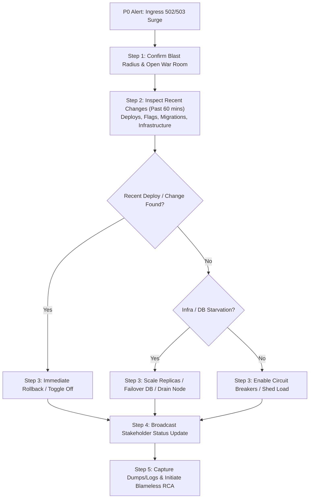

## Fast Revision (10-Second Recall)
- Step 1: Confirm blast radius & declare incident (verify monitoring, status page, create dedicated incident channel/war room).
- Step 2: Check recent changes (deployments, config/secret changes, feature flags, infrastructure updates in the last 60 minutes).
- Step 3: Mitigate immediately before root-causing (rollback deployment, toggle kill switch, drain bad nodes, scale up, or failover).
- Step 4: Communicate clearly and early (appoint an Incident Commander and Communications Lead; notify executive/support stakeholders every 15-30m).
- Step 5: Preserve forensic artifacts and isolate root cause (capture memory dumps, thread dumps, bad pod logs before killing/restarting everything).

## The 30-Second Spoken Script
"When a production outage strikes, my primary rule is to mitigate user impact first and debug second. I follow a disciplined 5-step framework:

First, I confirm and contain: I verify synthetic alarms and ingress telemetry to determine if this is a global outage, regional drop, or localized to a specific cohort, and immediately declare a P0 incident to assemble the war room.

Second, I check recent changes: Over 80% of production outages correlate with a recent commit, secret rotation, feature flag flip, or cloud config change within the preceding hour.

Third, I trigger immediate mitigation: If a recent deployment occurred, I execute an immediate canary or full rollback. If a dependent downstream is failing, I enable fallback caching or circuit breaking. If traffic spiked 5x, I shed non-critical load or scale replicas.

Fourth, I maintain continuous stakeholder communication: While engineers triage, an assigned communications lead posts regular cadence updates to our status page and customer-facing teams every 15 minutes.

Fifth, once restored, I preserve evidence and initiate RCA: I retain crash logs, heap dumps, and telemetry snapshots for the blameless post-mortem so permanent architectural safeguards can be implemented."

## Scenario / Problem Context
At 09:14 AM on Monday, the synthetic canary alerts ping the on-call engineer: HTTP 502/503 rates at the public ingress have surged to 94%, and active users are completely locked out of the core application. The executive team is asking for status updates, customer support is flooded with tickets, and multiple engineers are suggesting different actions.

## Architectural Workflow / Sequence


## Deep-Dive Analysis & Root Causes
### Anti-Pattern vs. Best Practice: Mitigate Before Debugging
Junior engineers frequently spend 45 minutes reading stack traces and attempting live hotfixes in production while users remain down. Senior engineers understand that mean time to recovery (MTTR) is minimized by reverting to the last known good state immediately. Debugging can safely proceed in staging once customer traffic is restored.

### The Incident Commander (IC) Model
During high-severity incidents, lack of coordination creates chaotic secondary outages (e.g., three engineers restarting the database cluster simultaneously). Designating an IC separates technical triaging from stakeholder management, ensuring only one person directs remediation commands.

### Preserving Ephemeral Forensic Evidence
When containers crash loop or are forcefully terminated by Kubernetes (OOMKilled), vital diagnostic data is lost. Always preserve at least one failing replica or export pod logs, core dumps, and heap dumps to persistent object storage before rolling back or scaling down.

## Practical Debugging Commands & Code
### Incident Triage & Rapid State Assessment CLI
```bash
# 1. Check recent deployments across all namespaces
kubectl rollout history deployment/order-service -n prod

# 2. Inspect active pods and recent restarts / crashes
kubectl get pods -n prod --sort-by='.status.startTime' -l app=order-service
kubectl get events -n prod --sort-by='.metadata.creationTimestamp' | tail -n 25

# 3. Fast rollback to the previous stable revision
kubectl rollout undo deployment/order-service -n prod

# 4. Check ingress controller / load balancer error logs
kubectl logs -n ingress-nginx -l app.kubernetes.io/name=ingress-nginx --tail=200 | grep -E "502|503|504"
```

## Prevention & Senior Best Practices
- Automated Canary Deployments: Implement Argo Rollouts or Flagger with automatic rollbacks driven by Prometheus error rate metrics.
- One-Click Rollbacks: Ensure the CI/CD pipeline supports a single-button rollback that executes within under 120 seconds.
- Immutable Runbooks: Maintain clear, tested on-call runbooks for ingress failures, database failovers, and cache evictions.
- Dedicated Incident Roles: Establish IC, Scribe, and Communications roles during on-call onboarding.
