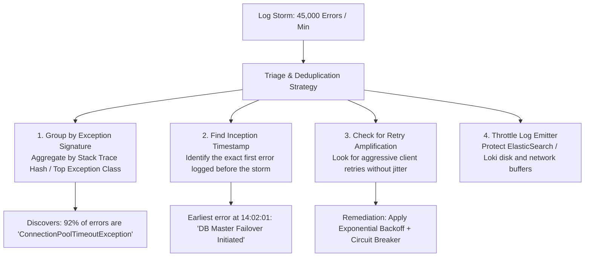

## Fast Revision (10-Second Recall)
- Identify Root vs Cascading Errors: A single root database failure generates 50,000 downstream timeout errors across 20 services.
- Deduplicate by Stack Trace Fingerprint: Group millions of log lines by exception class, message template, and caller file:line.
- Prevent Logging Pipeline Meltdown: ElasticSearch/Loki disk saturation, network buffer overflows, and app CPU burned on string formatting.
- Inspect Error Inception (Timestamp of First Error): Sort logs strictly chronologically to find the exact initial failure event.
- Check for Retry Storms: Are clients or worker jobs retrying failed requests indefinitely without exponential backoff and jitter?

## The 30-Second Spoken Script
"When application logs suddenly erupt with thousands of errors per minute, staring at a streaming log tail is useless. My priority is log aggregation, deduplication, and chronological tracing to find the root cause.

First, I group and deduplicate the logs by error signature. In Datadog or ELK, I aggregate by the top exception class and stack trace hash. What looks like 50 different errors is almost always 1 root cause generating 49 secondary cascading symptoms.

Second, I find the inception point: I look at the exact timestamp when error rates jumped from baseline to thousands. The first error logged at 14:02:01 is frequently the root cause?"such as a Database Connection Refused or Secret Decryption Error?"while the subsequent 50,000 errors are downstream NullPointerExceptions and timeouts.

Third, I check for retry storms: If an upstream service fails and 10,000 clients retry immediately without exponential backoff, they amplify load by 10x and sustain the error storm.

Fourth, I protect our logging infrastructure: If necessary, I enable log rate-limiting or sampling dynamically so our log collectors do not run out of disk space or consume 100% container CPU."

## Scenario / Problem Context
Centralized logging reports 45,000 errors per minute following an infrastructure change. The logging dashboard is overwhelmed, Kibana searches are timing out, and engineers are debating whether the issue is in the payment gateway, user service, or order service.

## Architectural Workflow / Sequence


## Deep-Dive Analysis & Root Causes
### Cascading Failures and Root vs Symptom
In distributed microservices, a failure in a foundational service (like DNS, Redis, or PostgreSQL) propagates upwards. The frontend logs "Failed to render user profile", the backend logs "User service unavailable", and the user service logs "Connection refused to database". The database connection failure is the single root cause; the rest are symptoms.

### The Danger of Synchronous Logging Overhead
When an application logs thousands of stack traces per second synchronously, string formatting, disk I/O, and socket writes block the application threads. Paradoxically, the overhead of logging the errors often degrades the application faster than the original bug itself.

### Retry Storms (Self-Inflicted DDoS)
When a downstream service experiences a brief 1-second hiccup, if 5,000 callers immediately retry with 0 backoff, the downstream service is hit with 10,000 requests on recovery, knocking it down again. This creates sustained cyclic log storms.

## Practical Debugging Commands & Code
### Fast Log Parsing & Deduplication CLI
```bash
# 1. Group and count top 10 error messages from live container logs
kubectl logs -l app=order-service -n prod --tail=10000 | \
  grep "ERROR" | sed -E 's/[0-9a-fA-F-]{36}/<UUID>/g' | \
  sort | uniq -c | sort -nr | head -n 10

# 2. Find the earliest error occurrence around the incident start time
kubectl logs -l app=order-service -n prod --since=30m | \
  grep "ERROR" | head -n 5

# 3. Count errors per second to measure storm trajectory
kubectl logs -l app=order-service -n prod --since=5m | \
  grep "ERROR" | cut -d' ' -f2 | cut -d':' -f1,2,3 | uniq -c
```

## Prevention & Senior Best Practices
- Log Rate Limiting: Configure logging appenders (e.g., Logback DuplicateMessageFilter or Log4j2 BurstFilter) to drop repeated identical stack traces.
- Structured Logging with Error Hashes: Tag every logged error with a deterministic fingerprint or hash of the normalized stack trace for instant aggregation.
- Exponential Backoff and Jitter: Enforce full-jitter exponential backoff on all network retries across microservices and client apps.
- Asynchronous Appenders: Ensure all logging frameworks use non-blocking asynchronous log appenders with bounded buffer queues.
