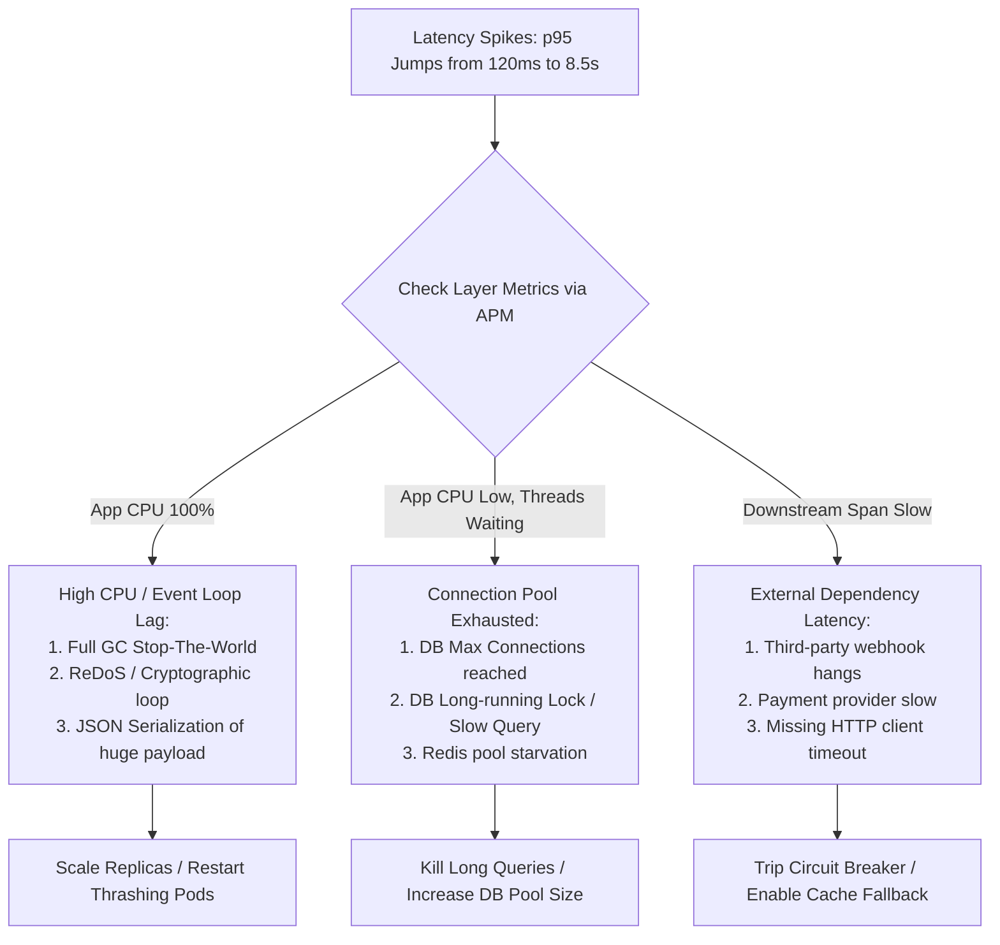

## Fast Revision (10-Second Recall)
- Identify latency tier: Gateway/Reverse Proxy, Application Runtime, Database/Cache, or External Third-Party APIs.
- Differentiate Throughput vs. Latency: Did request volume spike (load saturation), or did throughput drop while response times climbed (block/deadlock)?
- Inspect Host Saturation (USE Method): Check Utilization, Saturation, and Errors for CPU, Memory, Disk I/O, and Network sockets.
- Check Database Connection Pool Metrics: Are active connections at max limit with threads waiting in acquisition queues?
- Evaluate Garbage Collection (GC) & Event Loop Delay: Full GC stop-the-world pauses in JVM or blocked event loop in Node.js.

## The 30-Second Spoken Script
"When an application suddenly slows down, I immediately use a top-down layer-by-layer triage:

First, I examine the traffic volume: Did incoming RPS jump 300%? If so, this is capacity saturation requiring autoscaling or rate limiting. If traffic is constant but latency skyrocketed, the bottleneck is internal.

Second, I inspect the golden signals on the application layer: CPU utilization, memory consumption, active thread count, and event loop lag. If CPU is at 100%, we are either in a GC thrashing loop, unoptimized regex match, or runaway calculation.

Third, I check I/O dependencies: In 70% of sudden slow-downs, the application is blocked waiting on an I/O resource?"most commonly database connection pool starvation, unindexed queries holding row locks, or an external third-party API timing out without a fast circuit breaker.

Fourth, I check distributed traces: OpenTelemetry waterfall spans instantly pinpoint which hop went from 15 milliseconds to 10 seconds. Once identified, I either scale up the pool, kill blocking database queries, or open the circuit breaker on the failing dependency."

## Scenario / Problem Context
At 2:30 PM, the p95 latency of the core REST API jumps from 120ms to 8.5 seconds. Pods are not crashing, but the queue of pending HTTP requests at the ingress load balancer is growing rapidly, threatening a total cascade.

## Architectural Workflow / Sequence


## Deep-Dive Analysis & Root Causes
### Connection Pool Starvation and Queuing Theory
When an application connection pool (e.g., HikariCP, pgpool) has 20 connections and each query takes 100ms, the pool serves 200 queries/second. If a slow query takes 5 seconds, all 20 connections become occupied within seconds. Subsequent incoming requests block waiting for a free connection until the HTTP client times out, causing a massive latency cascade across the entire system.

### Missing Egress Client Timeouts
If an application makes a synchronous HTTP call to an external partner without setting `connectTimeout` and `readTimeout`, the default timeout in many libraries (like standard Java or Python requests) is infinite or 60 seconds. A slow partner holds the application thread captive, rapidly exhausting thread pools.

### Event Loop Blocking in Asynchronous Runtimes
In single-threaded event loop runtimes like Node.js, executing `JSON.parse()` on a 50MB payload or running a catastrophic regular expression freezes the entire event loop, stopping all concurrent requests from being processed.

## Practical Debugging Commands & Code
### Latency Investigation & Diagnostic Commands
```bash
# 1. Check top CPU and memory consumers inside running container
top -b -n 1 | head -n 20

# 2. Check for active PostgreSQL long-running queries holding locks
SELECT pid, now() - pg_stat_activity.query_start AS duration, query, state
FROM pg_stat_activity
WHERE state != 'idle' AND (now() - pg_stat_activity.query_start) > interval '5 seconds'
ORDER BY duration DESC;

# 3. Check TCP socket state (identifying TIME_WAIT or CLOSE_WAIT pileup)
ss -s

# 4. Generate instant JVM thread dump to detect blocked threads
jcmd <PID> Thread.print > /tmp/threaddump.txt
grep -c "BLOCKED" /tmp/threaddump.txt
```

## Prevention & Senior Best Practices
- Strict HTTP Client Timeouts: Mandate connect and read timeouts (e.g., max 2 seconds) on every outbound HTTP/gRPC client.
- Circuit Breakers: Implement Resilience4j, Polly, or Envoy circuit breakers with fallback modes for non-critical dependencies.
- Database Query Budgets: Configure `statement_timeout` (e.g., 3s) at the database layer to automatically terminate runaway queries.
- Autoscaling Triggers: Configure HPA based on custom metrics (like active HTTP concurrency or p95 latency) rather than CPU alone.
