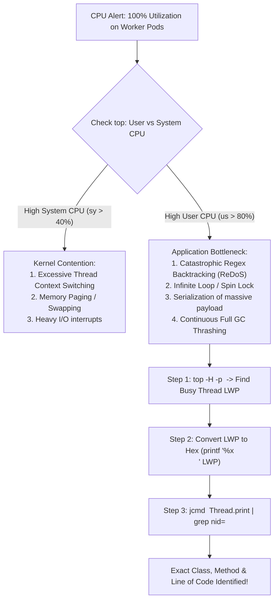

## Fast Revision (10-Second Recall)
- Differentiate User CPU (us) vs System CPU (sy): High `us` = application code, regex, loops, serialization. High `sy` = kernel context switching, page faults, disk/network I/O.
- Top Root Causes of 100% CPU: Catastrophic regex backtracking (ReDoS), unbounded while-loops, high-frequency JSON parsing of huge objects, excessive GC thrashing.
- Capture Thread Dumps and CPU Profiling: Map the high CPU OS thread ID (`LWP` in `top -H`) to the runtime thread stack trace.
- Generate Flame Graphs: Use `perf`, `async-profiler`, or continuous profiling (Pyroscope / Datadog Profiler) to visualize hot call paths.
- Mitigate with Immediate Autoscaling: Scale horizontally to distribute CPU load across more cores while debugging the algorithmic bottleneck.

## The 30-Second Spoken Script
"When CPU spikes to 100% in production, my diagnostic process moves from system metrics to thread-level profiling:

First, I check top or htop to distinguish between User CPU and System CPU. If System CPU is elevated, the application is suffering from excessive thread context switching, lock thrashing, or high socket I/O. If User CPU is 95%+, the runtime is stuck in an active algorithmic computation.

Second, I identify the exact thread consuming the CPU. Using `top -H -p <PID>`, I locate the OS Lightweight Process ID (LWP) burning the CPU. I convert that thread ID to hexadecimal.

Third, I take a thread dump using jcmd or stack profiler and search for that hexadecimal thread ID (nid). This maps the OS thread directly to the exact line of code and stack trace executing at that moment.

In most cases, the culprit is either a catastrophic regex match (ReDoS) validating a malicious input string, a while-loop whose exit condition failed due to a concurrent state mutation, or an aggressive JSON parser processing an unexpected 50MB payload.

Once identified, I either block the malicious input pattern at the WAF or deploy a targeted hotfix."

## Scenario / Problem Context
At 11:15 AM, CPU utilization on 4 out of 8 production worker nodes jumps to 100%. Node responsiveness collapses, response times jump to 15 seconds, and liveness probes begin failing across all containers.

## Architectural Workflow / Sequence


## Deep-Dive Analysis & Root Causes
### Regular Expression Catastrophic Backtracking (ReDoS)
An innocent-looking regex like `^([a-zA-Z0-9]+)+$` evaluated against a 50-character input string with a trailing special character causes exponential backtracking ($O(2^n)$ combinations). A single HTTP request with this payload will spin a CPU core at 100% for minutes or hours.

### Garbage Collection Thrashing (GC Loop of Death)
When an application heap is 98% full, the garbage collector runs continuously to free tiny amounts of memory. Full GC sweeps consume 100% of available CPU cores while making negligible progress, masquerading as a CPU spike when the underlying root cause is actually an unmitigated memory leak.

### Thread Contention and Context Switching
Creating thousands of OS threads (e.g., without thread pools or using unbounded thread pools) degrades performance. The Linux kernel spends more time saving and restoring CPU registers between threads (context switching) than executing actual business logic.

## Practical Debugging Commands & Code
### Thread-Level CPU Pinpointing Commands
```bash
# 1. Identify threads of the process sorted by CPU usage
top -H -b -n 1 -p <PID> | head -n 20

# 2. Convert high-CPU OS Thread ID (e.g., 18452) to Hexadecimal
printf "0x%x\n" 18452
# Output: 0x4814

# 3. Search thread dump for matching native thread ID (nid)
jcmd <PID> Thread.print | grep -A 30 "nid=0x4814"

# 4. Generate flame graph with async-profiler (Java)
./asprof -d 30 -f /tmp/flamegraph.html <PID>
```

## Prevention & Senior Best Practices
- Regex Timeouts: Never evaluate untrusted user input against regexes without execution timeouts (e.g., `RegexOptions.MatchTimeout` in .NET, Google RE2 engine which guarantees linear time complexity).
- Continuous Profiling: Implement continuous profilers like Datadog Continuous Profiler, Pyroscope, or Google Cloud Profiler to capture CPU flame graphs automatically during production spikes.
- Bounded Thread Pools: Enforce strictly bounded thread pools and use non-blocking asynchronous I/O or virtual threads to avoid context-switching saturation.
- Payload Size Limits: Enforce strict `Content-Length` limits (e.g., max 2MB) at the API Gateway to prevent parsing massive JSON/XML payloads in memory.
