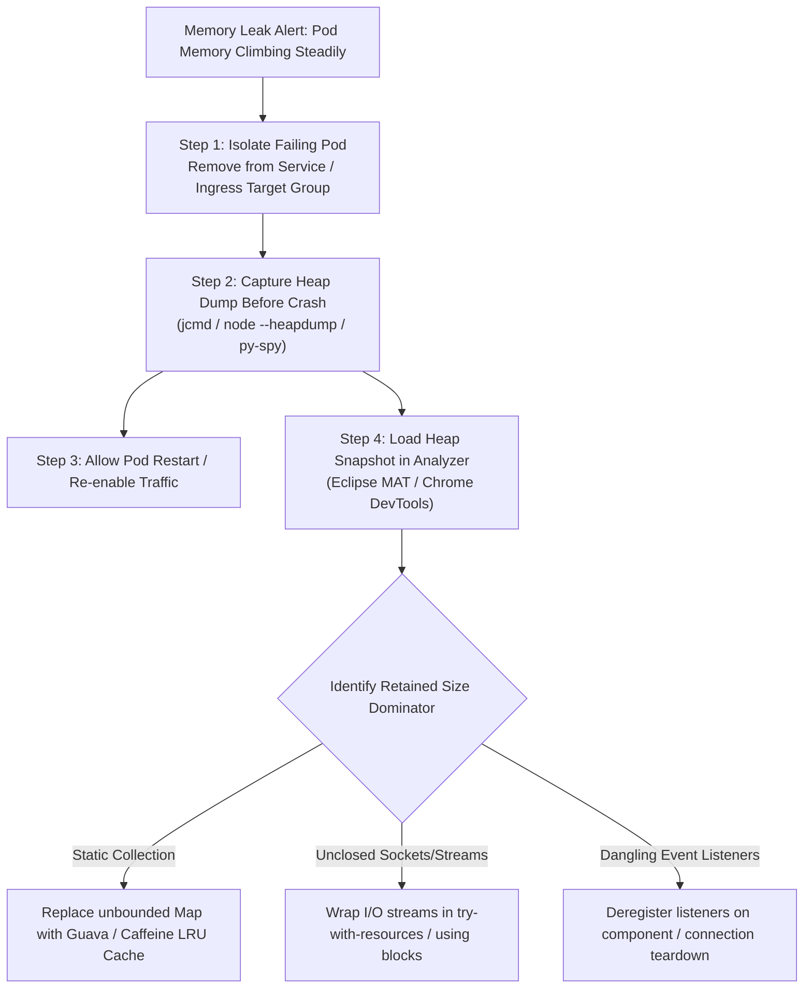

## Fast Revision (10-Second Recall)
- Differentiate Normal Growth vs Memory Leak: A leak is memory that is retained by active references long after it is no longer needed (sawtooth pattern fails to reclaim base memory).
- The "Sawtooth" Telemetry Pattern: Healthy runtimes show memory rising and dropping back to a baseline after GC; leaking runtimes show the baseline steadily climbing.
- Capture Heap Dump Before Restart: Restarting the container destroys all diagnostic evidence. Always dump heap or memory snapshot first.
- Top Memory Leak Culprits: Unbounded in-memory caches, static collections, unclosed streams/sockets, hanging event listeners, thread-local variables.
- Analyze Retained vs Shallow Size: Shallow size is the object itself; retained size is the total memory freed if that object is garbage collected.

## The 30-Second Spoken Script
"When investigating a production memory leak, my golden rule is never restart the container until I have captured a heap dump. A restart clears the symptom temporarily but destroys all forensic evidence.

First, I review APM memory graphs over a 24-to-72-hour window. A healthy application exhibits a classic sawtooth pattern: memory climbs as allocations occur, then drops sharply after full garbage collection. A leak shows the post-GC baseline steadily creeping upward until it hits the container limit.

Second, I take a production heap dump. If the environment is containerized, I isolate one failing pod by removing it from the load balancer target group so it receives no new customer traffic, and trigger a heap snapshot using jcmd for Java or v8-profiler for Node.js.

Third, I load the heap dump into Eclipse Memory Analyzer (MAT) or Chrome DevTools. I calculate the top dominators by Retained Size. In 90% of cases, the leak is caused by an unbounded static Map acting as an ad-hoc cache, unclosed database connection result sets, or event listeners attached to long-lived singleton instances.

Fourth, I deploy a targeted fix that replaces unbounded structures with LRU bounded caches and verifies cleanup in finalizers or lifecycle teardown hooks."

## Scenario / Problem Context
Over a 48-hour period, memory consumption in the catalog microservice climbs linearly from 800MB to 3.8GB, where it triggers an OOMKilled crash. The service restarts, recovers to 800MB, and begins the slow leak again.

## Architectural Workflow / Sequence


## Deep-Dive Analysis & Root Causes
### Shallow Size vs Retained Size
Shallow size is the memory consumed by the object itself (typically a few dozen bytes for references and primitives). Retained size is the sum of shallow sizes of all objects that are reachable exclusively from this object. A single `HashMap` instance might have a shallow size of 64 bytes, but a retained size of 2GB because it holds millions of objects.

### The Danger of Ad-Hoc In-Memory Caching
Developers frequently write `private static final Map<String, Object> cache = new ConcurrentHashMap<>()` without an eviction policy, max size, or expiration TTL. Over weeks in production, every unique request key adds a permanent entry, inevitably exhausting all heap memory.

### Off-Heap and Direct Memory Leaks
Frameworks like Netty, gRPC, and database drivers use direct byte buffers (`ByteBuffer.allocateDirect()`) for zero-copy I/O. These buffers exist in native memory outside the JVM/V8 heap. If native buffers are not freed, the Linux OOM-killer terminates the process even if the heap shows 60% free space.

## Practical Debugging Commands & Code
### Live Heap Capture & Memory Analysis CLI
```bash
# 1. Capture JVM live heap dump inside container
jcmd <PID> GC.heap_dump /tmp/heapdump.hprof

# 2. Inspect top 20 memory-consuming classes directly from terminal
jcmd <PID> GC.class_histogram | head -n 25

# 3. Capture Node.js heap snapshot using v8 inspect or clinic.js
node --inspect app.js
# Or in production with Node 12+:
kill -USR2 <PID> # (if configured to trigger heapdump)

# 4. Copy heapdump out of Kubernetes pod for local MAT inspection
kubectl cp <namespace>/<pod-name>:/tmp/heapdump.hprof ./local-heapdump.hprof
```

## Prevention & Senior Best Practices
- Bounded Cache Policies: Never use raw maps for caching. Always use production-grade libraries (Caffeine, Guava, node-cache) with strict `maximumSize` and `expireAfterWrite`.
- Automated Heap Dump on OOM: Always add `-XX:+HeapDumpOnOutOfMemoryError` to JVM container startup flags.
- Automated Leak Detection in CI/CD: Run endurance / soak load tests in staging for 4 to 8 hours to verify that memory plateaus rather than growing indefinitely.
- Lifecycle Resource Cleanup: Ensure all connections, file handles, and stream subscriptions implement automatic closure (`AutoCloseable` in Java, `.destroy()` in Node.js).
