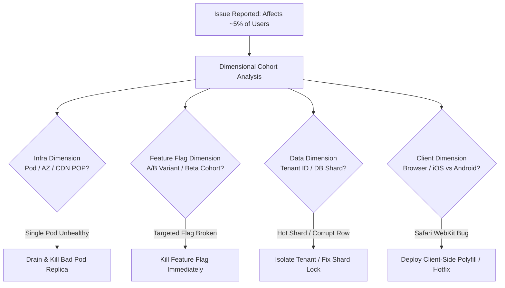

## Fast Revision (10-Second Recall)
- Segment by dimensions: Region / ISP, Browser / Device OS version, User Tenant / Account ID, Feature Flag variant, App Canary version.
- Inspect Load Balancer distribution: Is traffic hitting a single unhealthy server node or container replica?
- Check Database Sharding / Partition Hotspots: Is a specific tenant shard corrupted, locked, or running a slow query?
- Verify Token / Permission Scopes: Are affected users assigned a deprecated role or corrupted permissions profile?
- Leverage High-Cardinality Tracing: Filter OpenTelemetry spans by `user.tenant_id`, `http.user_agent`, and `k8s.pod.name`.

## The 30-Second Spoken Script
"When only a subset of users reports an issue, the key is dimensional cohort analysis. I resist the urge to randomly check code and instead isolate the common denominator across five vectors:

First, Infrastructure: I check if errors originate from a single canary pod, a specific availability zone, or a misconfigured edge CDN POP.

Second, Application State and Feature Flags: I check LaunchDarkly or Unleash to see if a rollout targeting a 10% percentage cohort or specific organization tiers is causing regressions.

Third, Tenant and Data Partitioning: In multi-tenant systems, I inspect whether all failing users belong to a specific database shard, organization ID, or account tier that has corrupt state or schema drift.

Fourth, Client Environment: I cross-reference error telemetry in Sentry or Datadog against browser engines, mobile app versions, and network providers to rule out iOS Safari webkit bugs or regional ISP ad-blockers.

Fifth, Account Permissions: I check if affected users share a specific role or token scope that lacks required grants. Once isolated to a vector, reproducing and mitigating becomes straightforward."

## Scenario / Problem Context
5% of active users report that clicking the "Checkout" button results in an infinite spinner. The remaining 95% of users complete transactions with zero issues. Standard aggregate APM dashboards show green metrics because aggregate error rates remain under 0.5%.

## Architectural Workflow / Sequence


## Deep-Dive Analysis & Root Causes
### The Aggregate Metric Masking Trap
Aggregate APM metrics (like average latency or overall HTTP 5xx error percentage) mask localized catastrophic failures. If 5% of users experience a 100% failure rate, the overall error rate may only tick from 0.05% to 0.4%, failing to trip standard aggregate thresholds. Senior engineers configure alerts based on high-cardinality facets and percentile distributions (p99 by tenant).

### Canary and Stale Replica Isolation
A frequent cause of partial failures is an incomplete deployment or sticky session pinning. If 1 out of 20 pods is running a deprecated schema or has a bad local cache, 5% of traffic hitting that pod will fail deterministically.

### Multi-Tenant Data Corruption
When an issue affects only specific enterprise tenants, the problem is frequently a heavy volume edge case (e.g., an enterprise organization with 500,000 members exceeding an in-memory buffer, while average tenants have only 10 members).

## Practical Debugging Commands & Code
### Cohort Isolation & Log Grouping Queries
```bash
# 1. Query logs to group errors by Kubernetes pod name
kubectl logs -l app=checkout-service -n prod --tail=1000 | \
  grep "ERROR" | awk '{print $3}' | sort | uniq -c | sort -nr

# 2. Extract error distribution by User-Agent (detect browser/OS cohort)
cat /var/log/nginx/access.log | grep ' 500 ' | \
  awk -F'"' '{print $6}' | sort | uniq -c | sort -nr | head -n 10

# 3. Filter structured logs with jq by tenant_id
kubectl logs -l app=checkout-service -n prod --tail=2000 | \
  jq -r 'select(.level=="error") | .tenant_id' | sort | uniq -c | sort -nr
```

## Prevention & Senior Best Practices
- High-Cardinality APM Tagging: Ensure OpenTelemetry traces and structured logs inject `tenant_id`, `version`, `client_type`, and `region` on every span.
- Per-Tenant SLOs: Set up alerts for enterprise tier tenants so single-customer outages cannot hide behind global averages.
- Automated Canary Analysis (ACA): Use Kayenta or Prometheus-based canary rules to compare error rates between new and old replica cohorts before 100% promotion.
- Feature Flag Auditing: Periodically sunset dead feature flags to prevent combinations of flags from causing unexpected emergent behavior.
