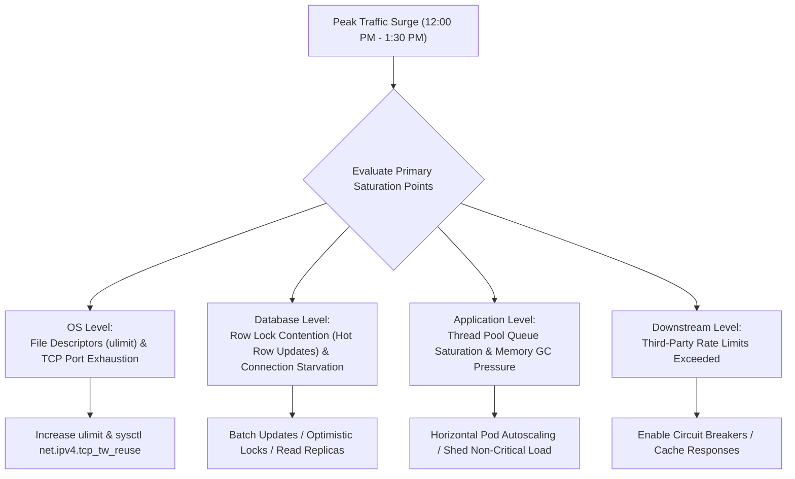

## Fast Revision (10-Second Recall)
- Symptoms: Timeouts, HTTP 503/504 errors, database deadlocks, socket exhaustion (`EADDRNOTAVAIL`), thread pool rejection (`RejectedExecutionException`).
- The Coordinated Omission Trap: Slow response times skew averages because queued requests are not measured until they complete.
- Check Ephemeral Port & File Descriptor Limits: Max open files (`ulimit -n`) and TCP `TIME_WAIT` socket exhaustion under heavy load.
- Database Row Contention: Simultaneous updates on a single row (e.g., inventory balance, global counter) serialize all database worker threads.
- Asymmetric Load on Downstream Services: Uncached read/write amplification (1 user request triggers 20 downstream database queries).

## The 30-Second Spoken Script
"When an incident occurs exclusively during peak traffic, it is almost never a traditional algorithmic bug?"it is an architectural resource exhaustion or lock contention problem.

First, I examine concurrency limits and saturation metrics. Under peak load, systems don't slow down linearly; they hit an inflection point where queuing delays cause response times to degrade exponentially. I check if our worker thread pools, database connection pools, or HTTP client connection pools are saturated.

Second, I look for lock contention and serialization points. If thousands of requests attempt to lock the exact same database row or shared cache key?"such as updating a merchant wallet or global inventory count?"concurrency collapses into single-threaded serialized execution, causing a massive backlog.

Third, I verify operating system limits: under 50,000 concurrent connections, containers frequently exhaust Linux file descriptors or ephemeral TCP ports, resulting in connection refused or socket timeout errors.

My mitigation during the peak is aggressive: I shed non-critical load (like recommendation engines or analytics trackers), enable stale-while-revalidate caching, scale horizontal replicas, and queue writes into Kafka rather than executing them synchronously."

## Scenario / Problem Context
Every weekday between 12:00 PM and 1:30 PM, the food delivery platform experiences a 4x traffic surge. The ordering service error rate jumps to 18%, and response times climb from 80ms to 12s. By 2:00 PM, without any code changes, error rates return to 0% and latency returns to normal.

## Architectural Workflow / Sequence


## Deep-Dive Analysis & Root Causes
### Lock Contention and Amdahl's Law in High Traffic
Even if 99% of your application code is perfectly parallelized, if 1% of the code requires an exclusive row lock (e.g., `SELECT ... FOR UPDATE` on an account balance), the maximum theoretical throughput is capped by the speed of that serialized transaction. Under peak load, 500 threads queue for that one lock, exhausting all connection pools.

### Linux Ephemeral Port Exhaustion (TIME_WAIT)
When an application makes high-frequency HTTP requests to microservices without connection pooling (HTTP Keep-Alive), each request opens a new TCP connection and closes it. Closed sockets linger in `TIME_WAIT` for 60 seconds. Once the ~28,000 ephemeral ports are exhausted, outbound calls fail with `Cannot assign requested address` (`EADDRNOTAVAIL`).

### Load Shedding vs Autoscaling Lag
Horizontal Pod Autoscalers (HPA) take 2 to 5 minutes to spin up new nodes and warm up containers. A rapid traffic spike crushes the existing pods before new pods become ready. Load shedding (rejecting non-essential traffic with HTTP 429/503 at the gateway) protects the core transaction engine while scaling takes place.

## Practical Debugging Commands & Code
### High-Load OS & Database Diagnostics
```bash
# 1. Check open file descriptors and limits for the application process
cat /proc/<PID>/limits | grep "Max open files"
lsof -p <PID> | wc -l

# 2. Check TCP socket allocation and TIME_WAIT counts
cat /proc/net/sockstat
netstat -an | grep TIME_WAIT | wc -l

# 3. Detect database lock waits and blocking transactions in PostgreSQL
SELECT blocked_locks.pid AS blocked_pid,
       blocking_locks.pid AS blocking_pid,
       blocked_activity.query AS blocked_statement,
       blocking_activity.query AS current_statement_in_blocking_process
FROM pg_catalog.pg_locks blocked_locks
JOIN pg_catalog.pg_stat_activity blocked_activity ON blocked_activity.pid = blocked_locks.pid
JOIN pg_catalog.pg_locks blocking_locks ON blocking_locks.locktype = blocked_locks.locktype
JOIN pg_catalog.pg_stat_activity blocking_activity ON blocking_activity.pid = blocking_locks.pid
WHERE NOT blocked_locks.granted;
```

## Prevention & Senior Best Practices
- Predictive Autoscaling: Schedule proactive scale-out 30 minutes before known recurring peak windows rather than waiting for reactive CPU alerts.
- HTTP Keep-Alive & Connection Pooling: Mandate persistent connection pools for all internal HTTP, gRPC, and database clients.
- Shed Non-Critical Work: Implement priority shed filters at the API Gateway so non-critical requests (recommendations, reviews) are dropped during peak load.
- Asynchronous Event-Driven Decoupling: Offload write operations to message queues (Kafka, SQS) to smooth out traffic spikes and protect the database.
