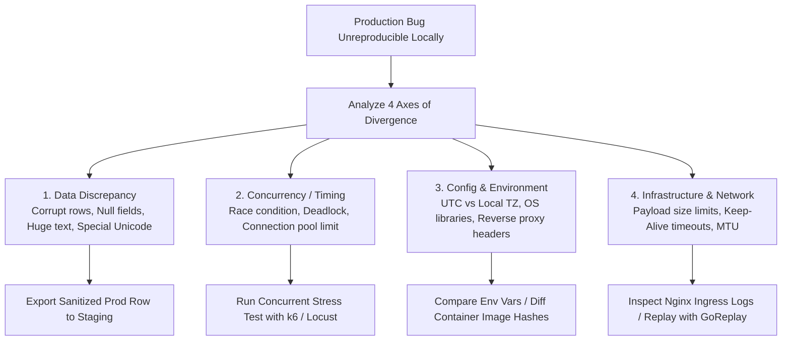

## Fast Revision (10-Second Recall)
- Identify Environmental Drift: Differences in DB versions, OS architecture, environment variables, feature flags, or network MTU.
- Check Data Volume & Shape: Production data has null characters, 100MB inputs, Unicode emojis, or legacy schema records missing in local seed data.
- Detect Concurrency & Race Conditions: Local tests run single-threaded; production runs thousands of concurrent requests causing race conditions.
- Capture Production Traces & Payloads: Replay sanitized production payloads using tools like GoReplay or ephemeral staging environments.
- Add Granular Dynamic Logging: Use dynamic log-level adjustment (adjust log level from INFO to DEBUG at runtime without restarts).

## The 30-Second Spoken Script
"When a bug occurs in production that cannot be reproduced locally, I systematically eliminate the four major axes of divergence: Environment, Data, Concurrency, and Infrastructure.

First, I examine data discrepancies: Production databases contain millions of historical records with null values, legacy formats, and edge-case Unicode strings that rarely exist in clean local mock databases. I inspect the exact payload and database rows of affected production transactions using sanitized read-only replicas.

Second, I check concurrency: Local development environments have zero concurrency. Many production bugs are race conditions, lock timeouts, or connection pool exhaustion that only manifest under concurrent load. I use load-testing tools like k6 to hit staging with concurrent traffic.

Third, I check configuration and environment drift: Differences in compiler flags, third-party library patch versions, timezone settings (UTC vs local), or reverse proxy headers (e.g., missing X-Forwarded-Proto) frequently account for local-vs-prod differences.

Fourth, if still unreproducible, I enable dynamic runtime DEBUG logging for that specific user or route without redeploying, or use OpenTelemetry distributed tracing to inspect the exact execution branch taken."

## Scenario / Problem Context
An invoice generation endpoint fails with a 500 error in production for 20 out of 10,000 customers. Developers test the exact same code locally with mock users and the endpoint returns 200 OK every single time.

## Architectural Workflow / Sequence


## Deep-Dive Analysis & Root Causes
### The "Clean Seed Data" Fallacy
Local development databases are seeded with fresh, perfectly validated fixtures. Production databases have survived five years of schema migrations, manual emergency SQL patches, third-party data imports, and legacy null fields. An unhandled null or empty string on an old record invariably crashes code that assumes modern validation.

### Proxy and Edge Header Stripping
In production, requests traverse Cloudflare, ALB/NLB, and Nginx Ingress before reaching the app. Proxies strip or mutate headers (e.g., `Host`, `Authorization`, `X-Forwarded-For`), enforce payload size limits (`client_max_body_size`), or terminate HTTP/2. Local development typically bypasses reverse proxies altogether.

### Dynamic Log Level Adjustment without Restart
Restarting a service to change log levels resets in-memory state and eliminates the bug. Modern frameworks (e.g., Spring Boot Actuator `/actuator/loggers`, Winston dynamic log level endpoints) allow changing log levels to `DEBUG` for a single logger class at runtime.

## Practical Debugging Commands & Code
### Diagnostic & Dynamic Tracing Commands
```bash
# 1. Dynamically update log level to DEBUG at runtime via HTTP actuator
curl -X POST http://localhost:8081/actuator/loggers/com.example.invoice \
  -H "Content-Type: application/json" \
  -d '{"configuredLevel": "DEBUG"}'

# 2. Compare container image hashes between Staging and Production
docker image inspect my-app:prod --format='{{.RepoDigests}}'
docker image inspect my-app:stage --format='{{.RepoDigests}}'

# 3. Simulate high-concurrency race condition against staging
k6 run --vus 50 --duration 30s - <<EOF
import http from 'k6/http';
export default function () {
  http.post('https://stage.example.com/api/v1/invoices/generate', 
    JSON.stringify({ userId: 1042 }), 
    { headers: { 'Content-Type': 'application/json' } }
  );
}
EOF
```

## Prevention & Senior Best Practices
- Sanitized Production Data Sync: Provide staging environments with sanitized, anonymized snapshots of real production data to expose edge-case data shapes.
- Container Parity: Ensure developers test against container images identical to production, including identical base OS, glibc versions, and runtime configurations.
- Ephemeral Debug Sandboxes: Use tools like Telepresence or Mirrord to connect local IDE debuggers directly into a staging Kubernetes cluster.
- Strict Zero-Drift Infrastructure: Manage all infrastructure and environment configurations through GitOps (Terraform, ArgoCD) to eliminate manual production drift.
