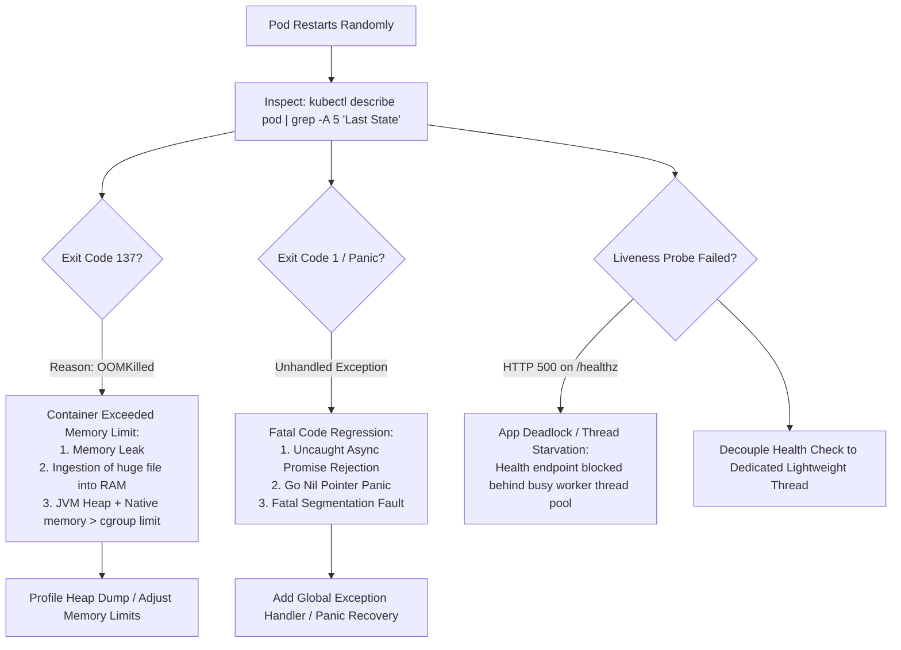

## Fast Revision (10-Second Recall)
- Identify the Exit Code: Exit 137 (SIGKILL / OOMKilled by Linux kernel), Exit 143 (SIGTERM graceful stop timed out), Exit 1 (Unhandled exception / panic), Exit 139 (SIGSEGV segfault).
- Check Kubernetes Pod Termination Reason: `kubectl describe pod` -> Look for `Last State: Terminated`, `Reason: OOMKilled` vs `Completed`.
- Differentiate Process Crash vs. Liveness Probe Failure: Did the app crash itself, or did kubelet kill it because `/healthz` stopped responding?
- Check Node-Level dmesg: Search for `Out of memory: Kill process` in host kernel logs.
- Analyze Heap and Core Dumps: Look for native memory leaks (cgo, JNI, OpenSSL) that bypass runtime GC.

## The 30-Second Spoken Script
"When a service crashes randomly in production, my first goal is to capture the exit code and termination reason. Services do not crash randomly?"they crash for deterministic system reasons.

First, I run kubectl describe pod and check the Last State: Terminated section. If the exit code is 137 and Reason is OOMKilled, the container exceeded its configured Kubernetes memory limit. The fix involves either analyzing memory leak allocations or tuning container cgroup limits.

Second, if the exit code is 137 or 143 without OOMKilled, I check the events for Liveness probe failed. This indicates the application was healthy enough to run, but became unresponsive on its health check endpoint due to an event loop freeze, deadlock, or thread starvation, prompting Kubernetes to restart it.

Third, if the exit code is 1, 2, or 139, the process crashed from an unhandled exception, Go panic, or native segmentation fault. I examine the container logs immediately preceding the termination.

Once I classify the crash into an OOM, probe timeout, or fatal exception, I reproduce the condition with targeted load testing or thread analysis."

## Scenario / Problem Context
A microservice restarts 15 to 30 times a day across a cluster of 12 pods. The restarts occur at unpredictable times, occasionally under low load, leading to transient 502 Bad Gateway spikes for clients.

## Architectural Workflow / Sequence


## Deep-Dive Analysis & Root Causes
### The Exit Code 137 Dissection (128 + 9 = SIGKILL)
Exit Code 137 means the process received SIGKILL (signal 9). A process cannot intercept SIGKILL. In container environments, SIGKILL is sent either by the Linux Kernel OOM-Killer when container cgroup memory limits are exceeded, or by Kubelet when a container fails to terminate within `terminationGracePeriodSeconds` after a SIGTERM.

### The Liveness Probe Death Spiral
A classic architectural anti-pattern is writing a liveness probe that queries the database or does heavy internal checks. When the database slows down, the liveness probe times out. Kubernetes assumes the container is dead and restarts it. Restarting puts more load on the database, causing other pods to fail liveness probes, destroying the entire cluster.

### Native vs Managed Heap Memory Leaks
In JVM, Node.js, and Go, garbage collectors manage heap memory. However, native libraries (e.g., libxml, snappy, image processing tools, gzip decompression) allocate memory outside the managed heap. If native memory leaks, the process crashes with OOMKilled even though JVM heap usage is reported at only 40%.

## Practical Debugging Commands & Code
### Crash & OOM Investigation Commands
```bash
# 1. Check pod termination state and previous container logs
kubectl get pod <pod-name> -n prod -o jsonpath='{.status.containerStatuses[0].lastState.terminated}'
kubectl logs <pod-name> -n prod --previous --tail=100

# 2. Check Kubernetes cluster events for OOMKilling
kubectl get events -n prod --field-selector reason=OOMKilled

# 3. Check host kernel dmesg for OOM-killer decisions
dmesg -T | grep -E -i "oom-killer|killed process"

# 4. Inspect memory usage vs limits in cgroup
cat /sys/fs/cgroup/memory/memory.usage_in_bytes
cat /sys/fs/cgroup/memory/memory.limit_in_bytes
```

## Prevention & Senior Best Practices
- Separate Liveness from Readiness: Liveness probes should ONLY verify that the local process is alive and not deadlocked (e.g., returning an in-memory boolean). Readiness probes should check downstream dependencies.
- Appropriate Memory Limits: Set container memory limits with at least 25% headroom above expected peak heap usage to accommodate off-heap and native allocations.
- Automated Heap Dump on OOM: Configure JVM flags `-XX:+HeapDumpOnOutOfMemoryError -XX:HeapDumpPath=/data/dumps` to capture memory state before termination.
- Global Panic Catchers: Implement global recovery middleware in Go (`recover()`), Node.js (`process.on("unhandledRejection")`), and Java to prevent unhandled errors from terminating the process.
