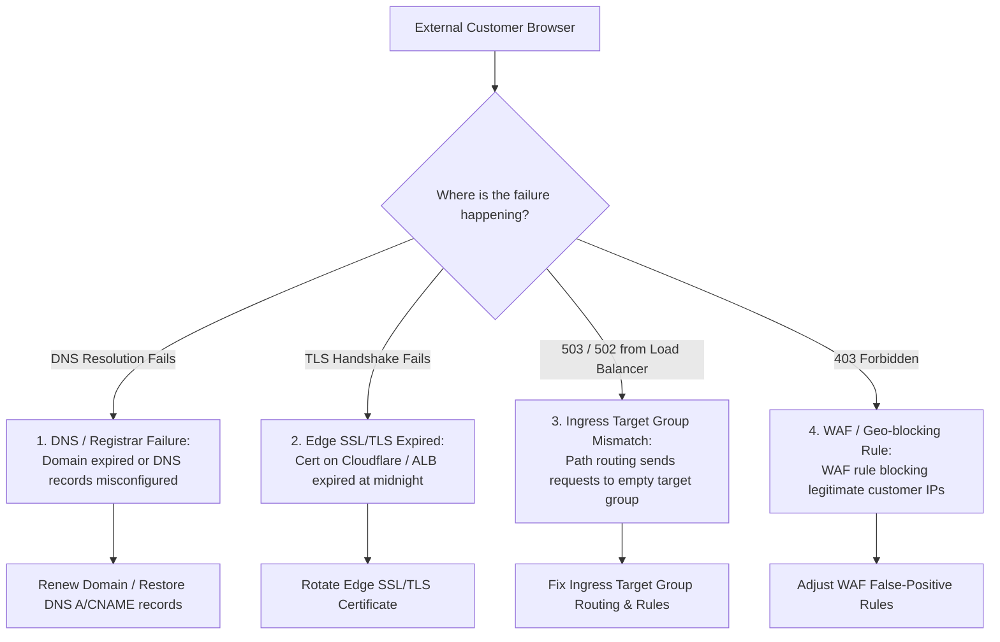

## Fast Revision (10-Second Recall)
- The "Liar" Health Check: The `/healthz` endpoint returns 200 OK because it only tests an in-memory boolean while ingress, CDN, or SSL is broken.
- Check Edge DNS & CDN Routing: Has domain registration expired, DNS records changed, or Cloudflare/CloudFront edge SSL cert expired?
- Check Ingress / Load Balancer Target Health: Are ingress proxies misrouted, returning 503 Service Unavailable before traffic ever reaches the pod?
- Verify External SSL/TLS Certificate Expiration: Internal pods use HTTP; the public-facing edge cert expired at midnight.
- External Synthetic Probing: Always rely on third-party external synthetics (from outside AWS/GCP) to verify real-world customer reachability.

## The 30-Second Spoken Script
"When our internal dashboards show 100% green health checks but customers report the service is completely unavailable, I immediately recognize an Edge or Ingress failure. The application is running fine, but traffic cannot reach it.

First, I test the service from outside our private cloud network using public mobile cellular networks or third-party synthetic probes. I run curl with verbose output to inspect DNS resolution, TLS handshake, and edge proxy response headers.

Second, I check SSL/TLS certificate validity: The most common cause of green backends with unreachable frontends is an expired public SSL certificate on Cloudflare or our AWS Application Load Balancer. The pods are healthy, but browsers block user connections with security warnings.

Third, I verify DNS propagation and registrar status: Did someone fail to renew the domain, or was a DNS record mutated during an unrelated infrastructure change?

Fourth, I check the Load Balancer target group: Sometimes a misconfigured ingress path routing rule sends traffic to an empty target group, returning 503 Bad Gateway before the request ever reaches our application pods.

Once identified, I fix the edge routing or certificate, and update our alerts so synthetic external probes page on-call engineers before customers do."

## Scenario / Problem Context
All Kubernetes pods are green, Prometheus shows 0 internal errors, and the backend team is relaxing. Suddenly, customer support escalates that thousands of users in Europe and the US receive "This site cannot be reached" or "503 Service Temporarily Unavailable".

## Architectural Workflow / Sequence


## Deep-Dive Analysis & Root Causes
### The Flaw of Internal-Only Health Checks
Internal health checks (like Kubernetes liveness/readiness probes or Prometheus scrapers inside the cluster) run within the VPC network. They do not traverse the public internet, CDN POPs, edge WAFs, DNS resolvers, or public SSL termination points. Relying exclusively on internal health metrics creates a massive blind spot.

### WAF False Positive Blocks
Web Application Firewalls (AWS WAF, Cloudflare) frequently update automated rule sets (e.g., OWASP top 10 rules). A new WAF rule might mistakenly classify a common user payload or cookie as an SQL injection, blocking 100% of user traffic at the edge with HTTP 403 Forbidden while the backend sees zero traffic.

### Public SSL Expiration vs Pod HTTP
Microservices in Kubernetes typically communicate via unencrypted HTTP or internal service mesh mTLS. Public clients connect via HTTPS terminated at the Load Balancer. If the public ACM certificate expires, internal pods remain completely healthy and idle, wondering why no requests are arriving.

## Practical Debugging Commands & Code
### External Edge Diagnostics CLI
```bash
# 1. Perform external curl with DNS, TLS and timing inspection
curl -Iv https://www.example.com/api/v1/health \
  --connect-timeout 5

# 2. Inspect SSL certificate expiration directly via OpenSSL
echo | openssl s_client -servername www.example.com -connect www.example.com:443 2>/dev/null | \
  openssl x509 -noout -dates

# 3. Check public DNS propagation across multiple global resolvers
dig www.example.com @8.8.8.8 +trace
dig www.example.com @1.1.1.1 +trace

# 4. Check AWS Application Load Balancer target group health state
aws elbv2 describe-target-health --target-group-arn <TARGET_GROUP_ARN>
```

## Prevention & Senior Best Practices
- Multi-Location External Synthetics: Deploy synthetic tests (e.g., Datadog, Pingdom, New Relic Synthetics) that probe public endpoints from 5+ global geographical locations every 60 seconds.
- Automated Certificate Renewal Alerts: Monitor SSL/TLS certificates and alert at 30, 14, and 7 days prior to expiration.
- Blackbox Exporter: Use Prometheus Blackbox Exporter to probe HTTP, HTTPS, DNS, and TCP endpoints externally from outside the private cluster.
- WAF Rule Staging: Deploy WAF rule updates in "Count/Monitor" mode for 48 hours before enabling "Block" mode.
