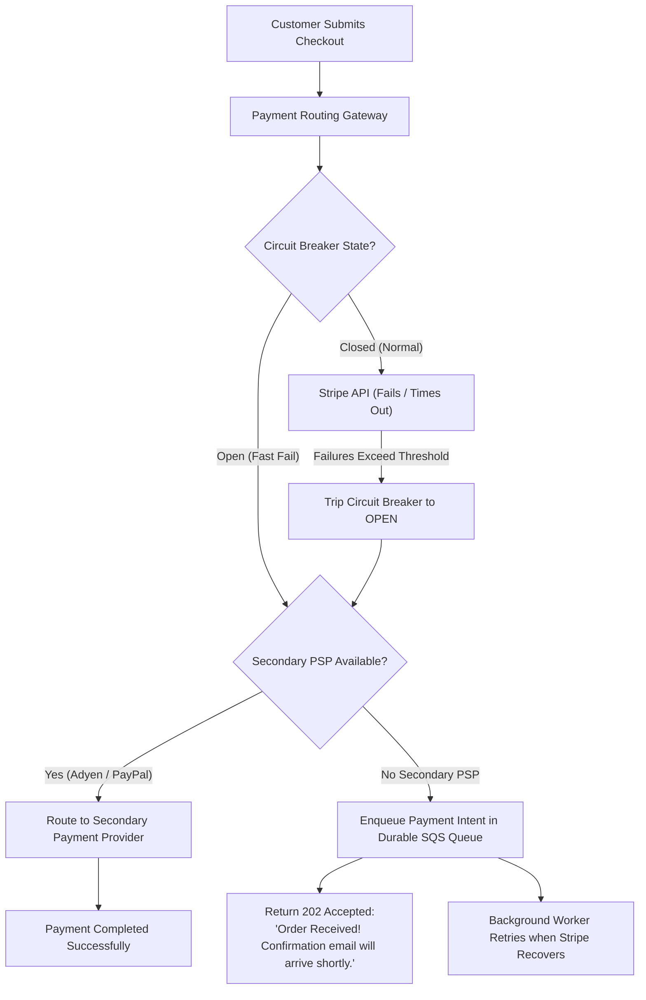

## Fast Revision (10-Second Recall)
- The Core Rule: Never let a third-party failure bring down your core application or lock user threads.
- Circuit Breaker Pattern: Automatically trip open after threshold failures (e.g., 50% errors over 10s) to fail fast and prevent thread pool starvation.
- Multi-PSP Active-Active Failover: Smart payment routing (e.g., if Stripe fails, route transactions automatically to Adyen or PayPal).
- Asynchronous Two-Phase Payment: Authorize intent synchronously, process capture asynchronously via durable queues.
- Customer Communication & UI Transparency: Display clear, transparent UI alerts ("Card processing is temporarily delayed") rather than generic cryptic errors.

## The 30-Second Spoken Script
"When a critical third-party payment provider like Stripe or Adyen goes down, my architectural priority is to prevent their outage from cascading into our core services while preserving revenue.

First, I ensure our circuit breaker has tripped: If Stripe is timing out at 30 seconds, 100 concurrent checkout requests will quickly exhaust our backend web server thread pool, bringing down the entire platform. A circuit breaker trips open after 5 failed attempts, instantly rejecting or rerouting calls in 2 milliseconds rather than 30 seconds.

Second, if multi-provider routing is implemented, our payment gateway automatically fails over to our secondary payment processor?"such as switching from Stripe to Adyen or PayPal.

Third, if no secondary processor exists or alternative methods fail, we activate asynchronous payment authorization: We store the order and payment intent securely in an encrypted durable queue, notify the customer that their order is received and being processed, and retry capture once the vendor recovers using exponential backoff.

Fourth, we update our status page and checkout UI transparently so users understand the delay is on the banking network rather than repeatedly clicking submit and double-billing themselves."

## Scenario / Problem Context
At 3:45 PM on Black Friday, Stripe experiences a major global API outage. Every checkout request hangs for 30 seconds before timing out, causing all checkout service worker threads to block, freezing the entire e-commerce store.

## Architectural Workflow / Sequence


## Deep-Dive Analysis & Root Causes
### The Catastrophic Cascading Thread Block
When an external API slows down, your application threads wait for the network socket. If the client timeout is 30 seconds and the application has 200 worker threads, an incoming rate of only 10 checkouts/second will exhaust every thread in 20 seconds. The entire application stops serving all other endpoints (including homepages and logins).

### Smart Payment Routing (Multi-Acquiring)
Enterprise payment systems integrate with at least two Payment Service Providers (PSPs). A routing layer tracks the rolling success rate of each provider. If Provider A drops below 85% success rate over a 60-second sliding window, traffic is dynamically shifted to Provider B with zero downtime.

### Asynchronous Capture and Idempotency
During third-party degradation, network calls may timeout even though the payment was actually charged on the provider end. Retrying without an `Idempotency-Key` risks double-charging the customer. Every payment attempt must pass a deterministic idempotency key derived from the unique order ID.

## Practical Debugging Commands & Code
### Resilient Payment Route & Circuit Breaker Code
```bash
// Resilient Circuit Breaker implementation using Resilience4j / Typescript pattern
import { CircuitBreaker } from 'opossum';

const stripeOptions = {
  timeout: 3000, // Trigger timeout after 3s (never wait 30s)
  errorThresholdPercentage: 50, // Trip open if 50% of requests fail
  resetTimeout: 30000 // Test recovery after 30s
};

const breaker = new CircuitBreaker(callStripeAPI, stripeOptions);

breaker.fallback(async (orderData, err) => {
  console.warn('Stripe circuit open or failed. Routing to secondary processor...', err.message);
  try {
    return await callAdyenAPI(orderData);
  } catch (secondaryErr) {
    // If both fail, enqueue for durable async processing
    await enqueueDurablePayment(orderData);
    return { status: 'PENDING_ASYNC', message: 'Order queued for processing' };
  }
});
```

## Prevention & Senior Best Practices
- Multi-PSP Architecture: Maintain active integrations with at least two distinct payment processors for mission-critical e-commerce.
- Mandatory Fast Client Timeouts: Set aggressive connection (1s) and read timeouts (3s) on all external HTTP payment clients.
- Deterministic Idempotency Keys: Always supply unique idempotency keys to payment APIs to prevent duplicate charges during network reconnects.
- Graceful Asynchronous Fallback: Design checkout workflows that can accept orders in a pending authorization state during vendor downtime.
