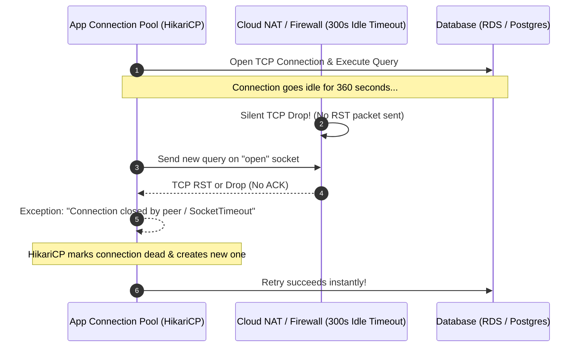

## Fast Revision (10-Second Recall)
- The Nature of "Intermittent": Sporadic drops usually point to network stateful devices (NAT/Firewall dropping idle TCP), pool exhaustion, or DB primary failovers.
- Firewall / NAT Idle TCP Timeout: Firewalls terminate stateful TCP connections after 5-15 minutes of inactivity; the app attempts to use the dead socket and throws connection reset.
- Database Connection Pool Sizing: Formula: `Pool Size = (Core Count * 2) + Effective Spindle Count`. Oversized pools crush database performance.
- DNS Flapping in Cloud Clusters: Internal service discovery (CoreDNS in Kubernetes) failing intermittently causing `UnknownHostException`.
- Test-On-Borrow & Keep-Alive: Configure pool validation queries (`SELECT 1`) or TCP keep-alive packets to prune dead sockets before handing them to threads.

## The 30-Second Spoken Script
"Intermittent database connectivity issues are among the most frustrating production problems because they rarely leave a persistent error trace. I investigate them across four specific layers:

First, I examine the connection pool settings in the application: Is the pool running out of connections during traffic spikes? If threads wait longer than connectionTimeout, the application throws connection acquisition errors.

Second, I check for silent firewall TCP drops: Stateful cloud firewalls, AWS NAT Gateways, and Azure load balancers silently drop idle TCP connections after 350 to 900 seconds without sending a TCP RST packet. If the application connection pool has an idle timeout longer than the network firewall, it attempts to send queries down a dead socket, causing sporadic connection reset errors. I fix this by setting the pool maxLifetime and idleTimeout lower than the cloud firewall timeout.

Third, I verify database server telemetry: Are maximum connections exceeded on PostgreSQL or MySQL? Is the primary database performing automatic failovers, causing 10-to-30-second connection blips?

Fourth, I check DNS resolution: In Kubernetes, overloaded CoreDNS pods intermittently drop DNS queries to the database endpoint, which I detect by reviewing CoreDNS error metrics."

## Scenario / Problem Context
The application runs smoothly for hours, but randomly throws `ConnectionResetException: Connection closed by peer` or `Cannot get a connection from the pool` on 0.2% of database queries throughout the day. Retrying the request immediately succeeds.

## Architectural Workflow / Sequence


## Deep-Dive Analysis & Root Causes
### The Firewall Idle TCP Drop Mechanism
Stateful firewalls and cloud NAT gateways maintain a connection tracking table. If no packets travel across a TCP socket within the idle timeout window (typically 350 seconds on AWS ALB/NAT), the firewall purges the entry from its state table. When the application later issues a query, the packet arrives at the firewall with no matching tracking entry and is dropped or rejected with RST.

### HikariCP / Connection Pool Lifecycle Best Practice
To prevent idle connection drops, `maxLifetime` in connection pools must be set at least 30 to 60 seconds shorter than any infrastructure timeout (e.g., set `maxLifetime = 1800000` (30 mins), and `idleTimeout = 600000` (10 mins)). Enable TCP keep-alive on the database driver.

### CoreDNS Dropping in Kubernetes
Kubernetes applications often experience intermittent DNS resolution failures when querying the database endpoint (`my-db.internal`). If CoreDNS pods are under-provisioned, UDP DNS packets are dropped, throwing intermittent `Name or service not known` errors. Enabling NodeLocal DNSCache eliminates 99% of these intermittent drops.

## Practical Debugging Commands & Code
### Connectivity & Connection Pool Triage CLI
```bash
# 1. Test continuous database connection stability and latency
pg_isready -h db-prod.internal -p 5432 -t 2

# 2. Inspect active vs max connections on PostgreSQL
SELECT count(*) FROM pg_stat_activity;
SHOW max_connections;

# 3. Check for dropped TCP packets and socket retransmissions
netstat -s | grep -i "retransmitted"

# 4. Check Kubernetes CoreDNS logs for dropped queries
kubectl logs -n kube-system -l k8s-app=kube-dns --tail=100 | grep -E "TIMEOUT|SERVFAIL"
```

## Prevention & Senior Best Practices
- Synchronize Pool Timeouts with Network Limits: Set pool `maxLifetime` shorter than cloud network load balancer and firewall idle timeouts.
- Deploy NodeLocal DNSCache: Run NodeLocal DNSCache as a DaemonSet in Kubernetes to cache DNS lookups locally on each node and avoid CoreDNS UDP dropouts.
- Enable Connection Validation (Test on Borrow): Configure connection pools to validate connections with a fast check (`SELECT 1`) or socket ping before handing them to a worker thread.
- Exponential Backoff on Reconnects: Implement intelligent retry logic at the data-access layer for transient connection failures.
