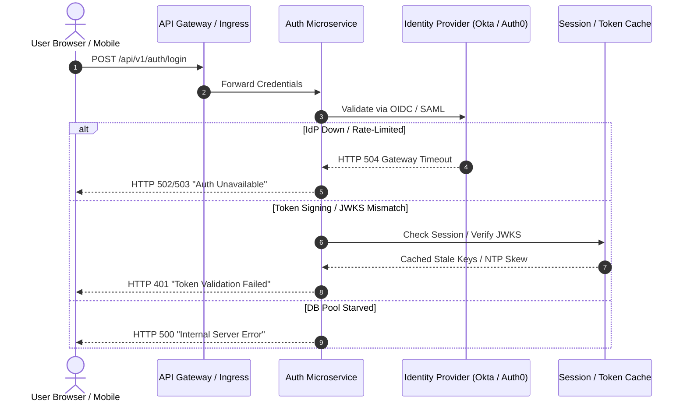

## Fast Revision (10-Second Recall)
- Determine failure symptoms: HTTP 401 (invalid credentials/signature), HTTP 403 (CORS/forbidden), HTTP 500 (auth server/DB error), or HTTP 504 (IdP timeout).
- Check external Identity Provider (IdP): Is Auth0, Okta, Firebase, or Google OAuth experiencing an ongoing partial outage?
- Verify Token Signing & JWKS Keys: Have public/private key pairs rotated unexpectedly or expired?
- Inspect Session Storage / Redis: Is the distributed session cache or rate-limiter out of memory or dropping TCP sockets?
- Check Clock Drift (NTP): Even a 60-second clock skew between app servers and IdP causes JWT `nbf` (not before) or `exp` validation failure.

## The 30-Second Spoken Script
"When users report they cannot log in, I avoid guessing and immediately correlate the HTTP status code at the gateway:

If the API returns 500 or 504, the issue is internal infrastructure?"typically our auth database connection pool is exhausted or our external IdP like Auth0 or Okta is experiencing latency. I check external provider status pages and verify our egress NAT gateways.

If the response is 401 Unauthorized, I check whether JWT signing keys were rotated recently without cache invalidation, or whether clock drift on our container nodes is causing incoming tokens to appear expired.

If the response is 403 Forbidden or fails in the browser before hitting the auth route, I inspect SSL certificate expiration on the auth domain, CORS preflight failures from a recent frontend deployment, or third-party cookie blocking policies in Safari/Chrome.

I reproduce the flow using curl with verbose headers to inspect the exact authorization response payload and trace IDs."

## Scenario / Problem Context
Customer support logs 45 tickets in 10 minutes stating: "We enter our credentials, click Log In, and get redirected back to the login page with an ambiguous error banner." The homepage loads cleanly, but authentication fails across both web and mobile clients.

## Architectural Workflow / Sequence


## Deep-Dive Analysis & Root Causes
### NTP Clock Drift and JWT Validation
JWT standard validation checks `iat` (issued at), `nbf` (not before), and `exp` (expires at). If a host VM suffers clock drift of even 120 seconds ahead of the issuing server, all valid newly issued tokens are immediately rejected with "Token not yet valid" errors. Always configure `systemd-timesyncd` or chrony with a leeway allowance (e.g., 30s) in JWT verification libraries.

### JWKS Caching and Key Rotation Traps
Modern architectures fetch JSON Web Key Sets (JWKS) from an OIDC provider. If the IdP rotates its signing key and the application caches keys forever without a cache-control TTL or on-demand fetch on unknown `kid`, all new logins fail with "Invalid Key Identifier".

### Redis Session Eviction and Thundering Herd
When Redis reaches `maxmemory` without a valid eviction policy (`volatile-lru` vs `noeviction`), login writes fail immediately with `OOM command not allowed when used memory > maxmemory`. Ensure alerts trigger at 75% memory utilization.

## Practical Debugging Commands & Code
### Auth Pipeline Triage Commands
```bash
# 1. Test the login endpoint with full HTTP header inspection
curl -vk -X POST https://api.example.com/api/v1/auth/login \
  -H "Content-Type: application/json" \
  -d '{"email":"test-probe@example.com","password":"dummy"}'

# 2. Check system time synchronization across cluster nodes
timedatectl status
chronyc tracking

# 3. Verify external IdP JWKS endpoint accessibility from pod
kubectl exec -it deployment/auth-service -n prod -- \
  curl -sS https://auth.example.com/.well-known/openid-configuration

# 4. Check Redis memory and client connections
redis-cli -h redis-prod.internal info memory
redis-cli -h redis-prod.internal info clients
```

## Prevention & Senior Best Practices
- Synthetic Login Monitoring: Run an automated browser synthetic probe (Datadog Synthetics / Playwright) that logs in every 60 seconds and pages on failure.
- JWKS Leeway & Stale Key Fallbacks: Allow a 60-second clock skew window and dynamic refetching when encountering an unrecognized `kid`.
- Circuit Breaker on External IdP: Provide graceful messaging or temporary degraded guest sessions when third-party IdPs degrade.
- Redis Memory Isolation: Separate ephemeral session caches from persistent database caches onto dedicated Redis instances.
