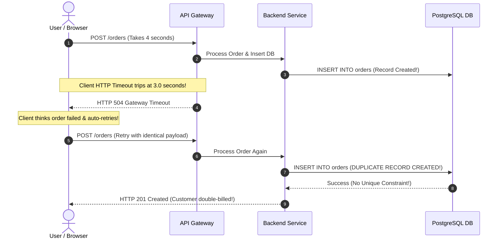

## Fast Revision (10-Second Recall)
- The Primary Trigger: Network timeouts on successful operations cause clients or proxies to retry non-idempotent requests.
- Missing Database Unique Constraints: Application-level "check-then-act" (`if (!exists) create()`) fails under concurrent load due to race conditions.
- At-Least-Once Queue Delivery: SQS, RabbitMQ, and Kafka guarantee at-least-once delivery; consumers must be strictly idempotent.
- Remediation Hierarchy: 1) Mitigate via DB unique indexes / Redis locks; 2) Stop runaway retry storms; 3) Write deduplication script to clean corrupt data.
- Idempotency Keys: Enforce unique `Idempotency-Key` headers on all POST/mutation endpoints stored with distributed atomic locks.

## The 30-Second Spoken Script
"When an application begins creating duplicate records in production, it is almost always a combination of network retries and a lack of transactional idempotency.

First, I identify the duplicate creation mechanism: Are duplicates created milliseconds apart with identical timestamps? If so, this is a concurrent race condition where two threads passed an application-level existence check simultaneously. If duplicates are created 5 to 30 seconds apart, it is a network retry storm where a client timed out waiting for a slow backend, assumed failure, and retried.

Second, I apply immediate containment: I check whether the database has a unique constraint on natural keys (e.g., user_id + invoice_reference). If missing, I deploy a composite unique index or activate a distributed Redis lock on the mutation key to physically prevent duplicate writes at the data layer.

Third, I inspect message consumers: If background queue workers are generating duplicate orders, I check if the consumer processing time exceeded the queue visibility timeout. If a worker takes 40 seconds on a 30-second visibility queue, the message is redelivered to a second worker while the first is still finishing.

Fourth, once contained, I write a safe, audited SQL migration script to reconcile and deduplicate the corrupted records, prioritizing the original transaction."

## Scenario / Problem Context
Customers complain that submitting an order once created two identical charges on their credit card and two distinct order records in the database with timestamps 3.2 seconds apart.

## Architectural Workflow / Sequence


## Deep-Dive Analysis & Root Causes
### The "Check-Then-Act" Race Condition
Writing `SELECT id FROM orders WHERE user_id = 5 AND ref = 100; if (notFound) INSERT INTO orders...` is fundamentally broken in concurrent systems. Two simultaneous requests both execute the `SELECT`, both receive empty sets, and both execute the `INSERT`. The only reliable defense is an atomic database unique index: `CREATE UNIQUE INDEX idx_orders_user_ref ON orders(user_id, ref);`.

### Queue Visibility Timeout Mismatch
In AWS SQS, when a consumer pulls a message, the message becomes invisible for `VisibilityTimeout` (e.g., 30s). If downstream processing takes 35 seconds, SQS assumes the worker died and makes the message visible again. Worker B pulls the message and creates a duplicate order while Worker A is completing its database transaction.

### Distributed Idempotency Keys Pattern
Clients generate a UUID v4 `Idempotency-Key` header. The server acquires an atomic lock in Redis (`SET key payload NX PX 120000`). If the key already exists and processing is in progress, the server returns HTTP 409 or waits; if completed, it returns the cached response of the initial execution.

## Practical Debugging Commands & Code
### Duplicate Detection & Database Containment Queries
```bash
# 1. Detect duplicate records created within 10 minutes of each other
SELECT user_id, order_ref, COUNT(*), MIN(created_at), MAX(created_at)
FROM orders
GROUP BY user_id, order_ref
HAVING COUNT(*) > 1
ORDER BY COUNT(*) DESC;

# 2. Add immediate unique index with deduplication constraint
CREATE UNIQUE INDEX CONCURRENTLY uq_orders_user_ref 
ON orders (user_id, order_ref);

# 3. Check SQS visibility timeout vs actual worker processing duration
aws sqs get-queue-attributes --queue-url <QUEUE_URL> \
  --attribute-names VisibilityTimeout
```

## Prevention & Senior Best Practices
- Database Unique Constraints: Enforce unique constraints and composite indexes at the schema level for all business-critical entities.
- API Idempotency Standard: Require `Idempotency-Key` headers on all mutating POST and PATCH endpoints with automated Redis caching.
- Align Queue Visibility Timeouts: Set message visibility timeouts to at least 3x the p99 worker processing time or implement dynamic heartbeat extension.
- Optimistic Locking with Versioning: Include a `version` integer column on mutable records to prevent lost updates and duplicate overwrites.
