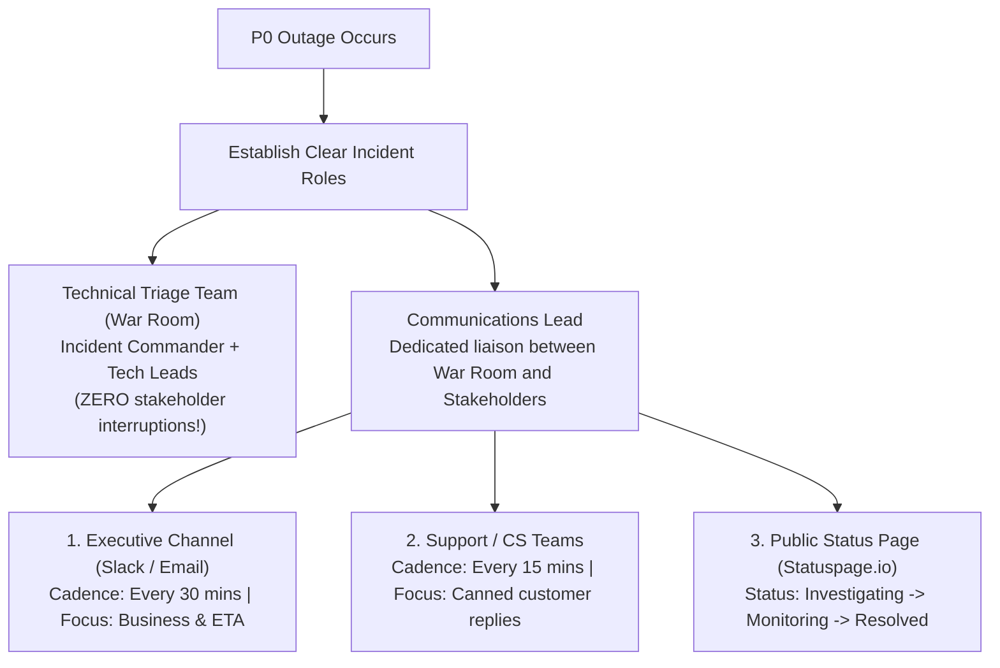

## Fast Revision (10-Second Recall)
- Separate Technical Triage from Communications: Engineers focus on fixing; an assigned Communications Lead handles external stakeholders.
- Set Predictable Update Cadences: Promise updates every 15 to 30 minutes, even if the status is "investigation still in progress".
- The Communication Triangle: What is the impact? What are we doing right now? When will the next update arrive?
- Avoid Speculative Timelines: Never promise "it will be fixed in 10 minutes"; give transparent status without false commitments.
- Public Status Page Hygiene: Use standardized phrasing (Investigating -> Identified -> Monitoring -> Resolved).

## The 30-Second Spoken Script
"During a major production outage, poor communication can cause more chaos than the technical failure itself. My rule is to isolate engineers from stakeholder interruption by designating an incident Communications Lead.

The Communications Lead establishes three parallel communication channels:

First, Executive Channel: A dedicated Slack channel or bridge providing high-level business impact, current mitigation strategy, and next update times to leadership every 30 minutes.

Second, Customer Support & Sales: Equipping customer-facing teams with canned responses, known workarounds, and clear status updates every 15 minutes so they can handle incoming customer inquiries consistently.

Third, Public Status Page: Updating our public status page using industry-standard stages: Investigating, Identified, Monitoring, and Resolved.

I strictly enforce the rule: Never speculate or promise an estimated time of recovery (ETR) unless the fix is actively compiling or rolling out. Missing an ETR destroys credibility; providing predictable update cadences builds confidence."

## Scenario / Problem Context
During a high-visibility P0 payment outage, the CEO, VP of Sales, and head of Customer Support are directly messaging triage engineers on Slack asking: "What's broken? When will it be back up? What should I tell our enterprise clients?"

## Architectural Workflow / Sequence


## Deep-Dive Analysis & Root Causes
### The Interruption Cost on Incident Responders
When engineers are interrupted every 4 minutes by executives asking for updates, mental context is broken, and troubleshooting slows down by 50%. Establishing a dedicated Communications Lead creates an emotional and operational firewall around the technical team.

### The Golden Template for Stakeholder Updates
Every internal and external message must answer three questions: 1) What is the user impact? 2) What technical mitigation is currently underway? 3) When will the next update be provided? Setting a firm time for the next update stops stakeholders from pinging repeatedly.

### Public Status Page Transparency vs Liability
Public status updates should be honest but avoid sharing proprietary internal architecture or speculating on third-party blame before facts are established. Acknowledge the issue, confirm engineers are actively resolving it, and provide updates regularly.

## Practical Debugging Commands & Code
### Standard Stakeholder Communication Templates
```bash
/* Template: Internal Executive Update (Send every 30m) */
Subject: [P0 UPDATE #2] Core Payment Gateway Latency
Time: 14:30 UTC | Incident Commander: Jane Doe

1. Current Impact:
- Checkout API error rate is currently at 45%.
- Core search, catalog browsing, and user logins remain unaffected.

2. Actions Taken in Last 30 Mins:
- Root cause isolated to a connection pool exhaustion in the billing database.
- Database read replicas scaled up to relieve load on master.

3. Next Steps:
- Rolling out configuration patch v2.41.2 to increase connection limits.
- Estimated deployment completion: 14:45 UTC.

4. Next Update: 15:00 UTC (or immediately upon status change).
```

## Prevention & Senior Best Practices
- Pre-Written Incident Templates: Store pre-approved status page and customer support communication macros for common failure scenarios.
- Role Training for Incident Comms: Train product managers and engineering managers to fulfill the Communications Lead role.
- Automated Statuspage Integrations: Integrate monitoring tools (Datadog, PagerDuty) with Statuspage for automated status updates.
- Customer-Facing Transparency Culture: Build customer trust by publishing thorough, transparent public post-mortems for major outages.
