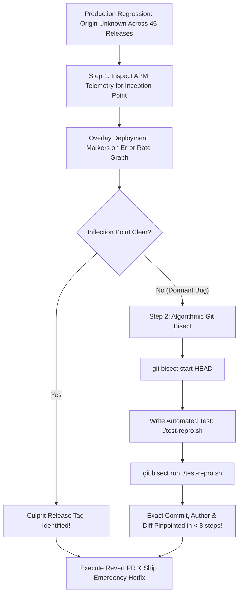

## Fast Revision (10-Second Recall)
- Binary Search Efficiency: `git bisect` finds the culprit commit in $O(\log n)$ steps (e.g., 100 commits tested in only 7 steps).
- Correlate Metrics with Release Timestamps: Overlay deployment markers on Datadog/Prometheus latency and error charts.
- Check CI/CD Image Digests: Map the running Kubernetes container SHA directly to the Git commit hash: `kubectl get pod -o yaml | grep imageID`.
- Automated Bisect Scripts: Run `git bisect run ./test-script.sh` to execute the regression test automatically across commits without manual intervention.
- Feature Flag vs Commit Bug: Determine whether the regression was activated by a code deployment or a detached feature flag change.

## The 30-Second Spoken Script
"When a subtle bug appears in production and we don't know when it was introduced, I find the exact commit and deployment using a two-tier approach: observability correlation followed by git bisect.

First, I correlate our APM error graphs with deployment markers: In Datadog or Grafana, deployment events are overlaid as vertical dashed lines on latency and 5xx error rate graphs. In 80% of cases, the inflection point where errors began aligns precisely with a specific release tag.

Second, I map the deployed container image to the exact Git SHA: By inspecting the Kubernetes container imageID or deployment metadata, I extract the exact commit hash currently running in production.

Third, if the bug has been dormant across multiple releases, I use git bisect: I mark the current production SHA as bad and the last known stable release from two weeks ago as good. Git bisect performs a binary search through the commit history. I provide an automated reproduction script using git bisect run, which checks out commits and runs the test automatically, finding the exact faulty commit in minutes.

Once identified, I review the author, the PR context, and deploy an immediate targeted revert."

## Scenario / Problem Context
A memory leak in the billing service causes containers to crash every 6 hours. The issue started approximately 10 days ago across 45 deployments and 320 commits. Nobody knows which commit introduced the regression.

## Architectural Workflow / Sequence


## Deep-Dive Analysis & Root Causes
### Git Bisect Mathematical Efficiency
Testing 500 commits linearly takes hours or days. With binary search ($O(\log_2 n)$), testing 512 commits requires at most 9 verification steps ($2^9 = 512$). Writing an automated headless CLI script that returns exit code 0 for good and 1 for bad allows git to isolate the broken commit in under 3 minutes.

### The Feature Flag vs Code Deploy Trap
A common source of confusion occurs when a bug appears at 3:00 PM, but the last code deployment was at 10:00 AM. Engineers assume the morning deployment is innocent. In reality, the bad code was deployed dark behind a feature flag in the morning, and the feature flag was toggled to 100% at 3:00 PM. Always check feature flag audit logs alongside deployment logs.

### Artifact Provenance and Container Digest Pinning
Tagging Docker images with `:latest` or mutable branch names destroys traceability. Production deployments must strictly use immutable image tags containing the Git SHA and verify the container `imageID` (SHA256 digest) against the CI build logs.

## Practical Debugging Commands & Code
### Git Bisect & Image Provenance CLI
```bash
# 1. Extract exact Git commit SHA from running Kubernetes deployment
kubectl get deployment order-service -n prod -o jsonpath='{.spec.template.spec.containers[0].image}'

# 2. Start automated git bisect
git bisect start HEAD v2.14.0 # (HEAD is bad, v2.14.0 was good)

# 3. Run automated bisect with reproduction script
git bisect run npm test -- --testPathPattern="billing-leak.test.ts"

# 4. View commit details once bisect locates culprit
git show bisect/bad
git bisect reset
```

## Prevention & Senior Best Practices
- Immutable Deployment Tags: Never use mutable tags (`latest`); always tag container images with `vX.Y.Z-<git-sha>`.
- APM Deployment Annotations: Automate CI/CD pipelines to send deployment markers via API to Datadog, New Relic, and Prometheus.
- Feature Flag Change Auditing: Send real-time audit notifications to the engineering Slack channel whenever a feature flag is modified.
- Comprehensive Regression Tests: Add the reproduction test into the permanent CI test suite to prevent the bug from ever resurfacing.
