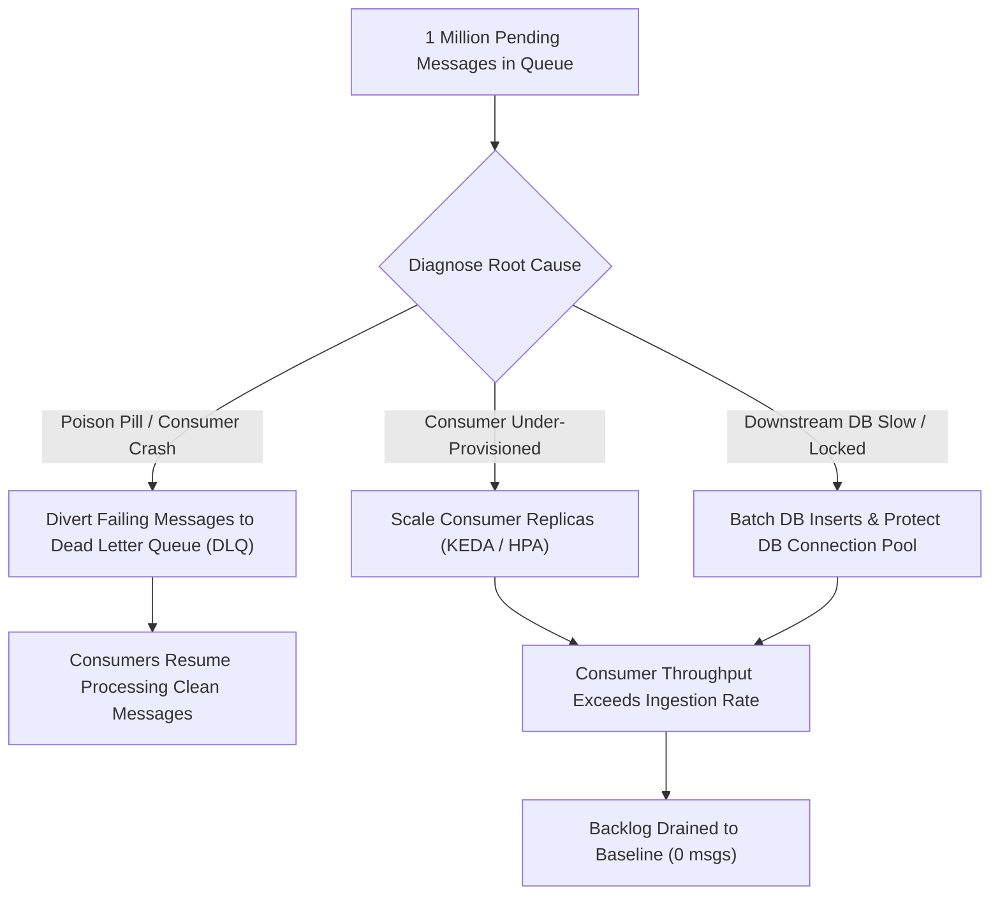

## Fast Revision (10-Second Recall)
- Assess Lag vs Consumption Rate: Calculate drain time: `Drain Time = Backlog / (Consumer Throughput - Ingestion Rate)`.
- Check for Poison Pills: A single malformed message failing continuously and blocking the queue partition.
- Scale Consumers Horizontally: Add consumer pods up to the partition limit (Kafka) or prefetch/worker limit (RabbitMQ/SQS).
- Protect Downstream Dependencies: Rapid consumption can crush the primary database; use batch inserts, read-only replicas, or bulk endpoints.
- Triage by Message TTL / Priority: Separate time-sensitive events (alerts, SMS) from background batch events (analytics, syncs).

## The 30-Second Spoken Script
"When a queue accumulates 1 million pending messages, my priority is to stop the bleeding, protect downstream databases, and safely scale consumption.

First, I identify why the backlog formed: Did producer throughput spike, did consumers crash, or is a single poison pill message failing repeatedly and blocking partition processing? If consumers are in a crash loop due to a bad payload, I immediately divert failed messages to a Dead Letter Queue (DLQ).

Second, I scale consumer capacity: In Kafka, I scale consumer pods up to the total number of topic partitions, or increase concurrent worker threads per consumer pod. In SQS or RabbitMQ, I scale worker pods horizontally using KEDA autoscaling driven by queue depth.

Third, I guard downstream systems: Consuming 1 million messages in 5 minutes will instantly exhaust database connection pools or trigger third-party API rate limits. I tune consumers to use bulk batching (e.g., multi-row SQL inserts) and rate-limit write concurrency.

Fourth, if messages are time-sensitive and already expired, I evaluate routing obsolete non-critical messages to cold storage so current real-time transactions can resume immediately."

## Scenario / Problem Context
On Monday morning, alerts fire indicating that the order processing SQS queue has surged to 1,200,000 pending messages. Order processing latency has jumped from 200ms to 4 hours, and customer delivery confirmations are severely delayed.

## Architectural Workflow / Sequence


## Deep-Dive Analysis & Root Causes
### Kafka Partition vs Consumer Concurrency Limits
In Apache Kafka, a single partition can only be consumed by one consumer instance within a consumer group. If your topic has 12 partitions and you scale to 50 consumer pods, 38 pods will sit completely idle. To scale beyond 12 workers, consumers must implement internal in-memory worker pools or the topic partitions must be expanded.

### The Poison Pill Phenomenon
A poison pill is a message that cannot be deserialized or processed due to a corrupt schema or null field. If the consumer does not catch the exception and acknowledges the message, the message is returned to the queue and re-delivered infinitely, completely halting consumption of all subsequent messages.

### Downstream Database Protection During Draining
When 200 scaled consumers drain 5,000 messages/second, each executing individual `INSERT` and `UPDATE` statements, the database CPU hits 100% and connection pools exhaust. Consumers must switch to micro-batching (buffering 500 records or 100ms and executing a single bulk insert).

## Practical Debugging Commands & Code
### Queue Depth & Consumer Lag CLI
```bash
# 1. Check Kafka consumer group lag across all partitions
kafka-consumer-groups.sh --bootstrap-server localhost:9092 \
  --describe --group order-processing-group

# 2. Inspect RabbitMQ queue depth and consumer count
rabbitmqctl list_queues name messages_ready messages_unacknowledged consumers

# 3. Check AWS SQS approximate message count via AWS CLI
aws sqs get-queue-attributes --queue-url https://sqs.us-east-1.amazonaws.com/123/orders-queue \
  --attribute-names ApproximateNumberOfMessages ApproximateNumberOfMessagesNotVisible

# 4. Scale consumer deployment immediately in Kubernetes
kubectl scale deployment/order-consumer --replicas=30 -n prod
```

## Prevention & Senior Best Practices
- Dead Letter Queues (DLQ): Configure DLQ with a max receive count of 3 to automatically eject poison pills.
- KEDA Event-Driven Autoscaling: Use KEDA (Kubernetes Event-driven Autoscaling) to automatically scale pods based on queue depth metrics.
- Consumer Micro-Batching: Process messages in batches of 50 to 500 to optimize database round-trips.
- Message Expiration (TTL): Define TTL headers on transient messages so stale notifications do not overwhelm recovery pipelines.
