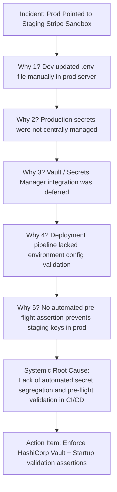

## Fast Revision (10-Second Recall)
- Superficial Cause vs Systemic Root Cause: "A developer made a typo" is not an RCA; the root cause is why the CI/CD pipeline allowed a typo to reach production.
- The 5 Whys Technique: Ask "Why?" at least five successive times to move from symptom to process/architectural failure.
- Fishbone (Ishikawa) Diagram: Categorize root causes across People, Process, Technology, Environment, and Management.
- Blameless Culture: Focus on system guardrails and safety nets rather than human culpability (bad systems allow good engineers to make fatal errors).
- Actionable Remediation (Preventative > Detective): Prioritize automated compile-time or pipeline blocks over documentation.

## The 30-Second Spoken Script
"When performing a Root Cause Analysis (RCA), my goal is not to find who made a mistake, but to understand why our systems allowed a human error to impact customers. I use the 5 Whys and Fishbone frameworks.

I start from the incident symptom and drill down five layers:
Why did the site go down? Because the database connection pool was exhausted.
Why was it exhausted? Because a new query ran without an index and held connections open for 15 seconds.
Why was the query unindexed? Because the migration adding the index failed silently during deployment.
Why did it fail silently? Because the deployment script ignored non-zero exit codes from the database CLI.
Why did it ignore exit codes? Because we lacked a standardized, linted CI/CD deployment template with strict error handling.

Notice how we went from a slow query to a systemic CI/CD pipeline deficiency.

I synthesize these findings into a blameless post-mortem document featuring a strict timeline, blast radius metrics, and preventative action items with assigned owners and deadlines."

## Scenario / Problem Context
A major payment outage occurred because a developer pushed a config change that pointed the production billing service to the staging Stripe sandbox. The superficial reaction is to blame the developer. The senior engineering task is to run a rigorous RCA.

## Architectural Workflow / Sequence


## Deep-Dive Analysis & Root Causes
### The Flaw of "Human Error" as a Root Cause
Attributing an outage to "human error" is an organizational failure. Humans are biologically prone to fatigue, distraction, and typos. If an engineer can drop a production table or misconfigure an environment variable with a single keystroke, the root cause is the lack of authorization controls, peer review gates, and automated validation.

### The Fishbone (Ishikawa) Dimensional Breakdown
When an incident has multi-faceted causes, the Fishbone diagram organizes contributing factors into: Technology (missing index, timeout too high), Process (no staging load test, emergency deploy bypassed review), People (engineer on-call for 14 straight hours), and Environment (drift between staging and prod).

### Action Item Prioritization Matrix
Post-mortem action items must be classified: 1) Preventative (automated safeguards that make recurrence mathematically impossible); 2) Detective (alarms that catch the issue within 60s); 3) Mitigative (runbooks that reduce MTTR from 30m to 2m). Never accept "remind team to be careful" as an action item.

## Practical Debugging Commands & Code
### Pre-Flight Config Assertion to Prevent Human Error
```bash
// Startup assertion in Node.js / TypeScript preventing staging keys in production
export function validateEnvironmentSafety() {
  const env = process.env.NODE_ENV;
  const stripeKey = process.env.STRIPE_SECRET_KEY || '';

  if (env === 'production') {
    if (stripeKey.startsWith('sk_test_')) {
      console.error('FATAL: Production runtime initialized with Stripe TEST key!');
      process.exit(1); // Hard crash on boot before accepting traffic
    }
    if (!process.env.DATABASE_URL?.includes('prod-db.internal')) {
      console.error('FATAL: Production runtime connected to non-prod database!');
      process.exit(1);
    }
  }
}
```

## Prevention & Senior Best Practices
- Pre-Flight Startup Assertions: Hard-crash application boot during initialization if invalid configuration or staging keys are detected in production.
- Role-Based Secret Isolation: Segregate production secrets in Vault or AWS Secrets Manager so developers cannot manually alter production credentials.
- Blameless Post-Mortem Policy: Reward transparent disclosure of operational failures to foster an open engineering safety culture.
- Track Action Item SLA: Mandate that P0/P1 post-mortem action items must be resolved within 14 calendar days.
