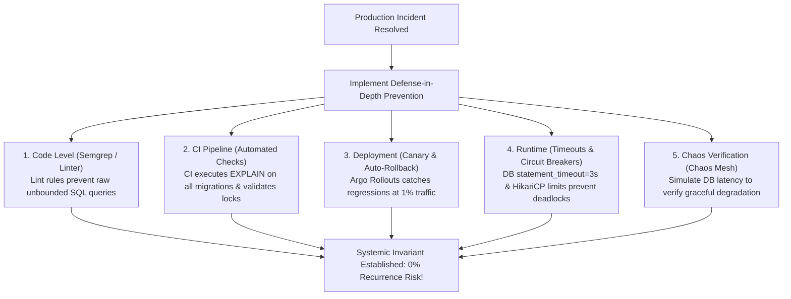

## Fast Revision (10-Second Recall)
- Defense in Depth: Layered prevention: 1) Static Analysis/Linter; 2) Automated Unit/Integration Tests; 3) CI/CD Pre-flight Checks; 4) Canary Deployments; 5) Runtime Circuit Breakers.
- Never Rely on Human Discipline: If the prevention is "tell developers not to do X", the incident WILL happen again. Enforce prevention with code and pipelines.
- Architectural Invariants: Design APIs and data models so invalid states are unrepresentable (type safety, db constraints).
- Automated Chaos Engineering: Write a chaos test simulating the exact failure mode to verify the system self-heals.
- Error Budget Accountability: If a service exhausts its SLO error budget, pause new feature shipping to prioritize reliability.

## The 30-Second Spoken Script
"To guarantee that a production incident never happens again, I follow a strict hierarchy of prevention: I never rely on documentation or reminders, because human discipline does not scale. I enforce prevention through automated guardrails across five defensive layers:

First, Static and Compile-Time Guardrails: If an incident was caused by an unvalidated regex or insecure SQL pattern, I add custom AST linting rules (ESLint, Semgrep, or SonarQube) that break the build at commit time.

Second, Automated Pipeline Verification: If an issue was caused by an unindexed query or missing environment secret, our CI/CD pipeline runs automated migration explain-plan tests and secret assertions before code can be merged.

Third, Progressive Delivery & Automated Rollbacks: We deploy via Argo Rollouts or Flagger with canary stages (1%, 10%, 50%, 100%). If latency or 5xx error rates tick upward at the 1% canary stage, the deployment rolls back automatically in 30 seconds with zero human intervention.

Fourth, Chaos Engineering: Once the fix is merged, we codify the outage into a Chaos Mesh or Chaos Toolkit experiment to prove that if the underlying resource fails again, circuit breakers and fallbacks protect user traffic."

## Scenario / Problem Context
A major database deadlock brought down the shopping cart service for 2 hours. Management is determined that this specific deadlock scenario must never repeat under any circumstances.

## Architectural Workflow / Sequence


## Deep-Dive Analysis & Root Causes
### The Hierarchy of Preventative Controls
From weakest to strongest: 1) Training/Reminders (weakest, 100% failure rate over time); 2) Documentation/Runbooks; 3) Monitoring/Alerting (detects failure but does not prevent); 4) Automated CI/CD Gates (blocks bad changes); 5) Architectural Invariants (strongest, impossible to represent error state in code or schema).

### Semgrep and Custom AST Linters
When an engineer introduces a bug via a subtle API anti-pattern (e.g., using `String.format` inside an SQL query or calling `JSON.parse` on unbounded streams), write a custom Semgrep rule. Semgrep parses the Abstract Syntax Tree and blocks any future PR across the entire engineering organization containing that pattern.

### Error Budget Policy as an Organizational Lever
Without an Error Budget Policy, product managers pressure engineering to prioritize features over reliability tech debt. A formal SLO agreement dictates: if a service burns 100% of its error budget in a quarter, all feature releases are halted and the team works exclusively on reliability and post-mortem action items.

## Practical Debugging Commands & Code
### Automated CI/CD Guardrail Configuration
```bash
# 1. Example Semgrep rule to block unindexed raw queries in PRs
rules:
  - id: ban-unbounded-raw-sql
    languages: [typescript, javascript]
    message: "Raw SQL query detected without parameterized statement timeout."
    severity: ERROR
    pattern: db.query(...)

# 2. Automated PostgreSQL migration linter in CI (Squawk)
squawk migrations/*.sql

# 3. Chaos test verification using Chaos Mesh to validate DB timeout
apiVersion: chaos-mesh.org/v1alpha1
kind: NetworkChaos
metadata:
  name: database-latency-chaos
spec:
  action: delay
  mode: all
  selector:
    namespaces: [prod]
    labelSelectors: { "app": "order-service" }
  delay: { latency: "3000ms" }
  duration: "5m"
```

## Prevention & Senior Best Practices
- AST Linter Rules (Semgrep / ESLint): Automate the detection of dangerous coding patterns in pull request CI pipelines.
- Automated Database Migration Linter: Run Squawk or Atlas in CI to catch locks, missing indexes, and un-backfilled columns before deploy.
- Canary Deployments with Automated Rollback: Never ship changes directly to 100% of users; always use metric-driven progressive delivery.
- Enforce Error Budget Policies: Formalize operational agreements where reliability work takes absolute priority when SLOs are breached.
