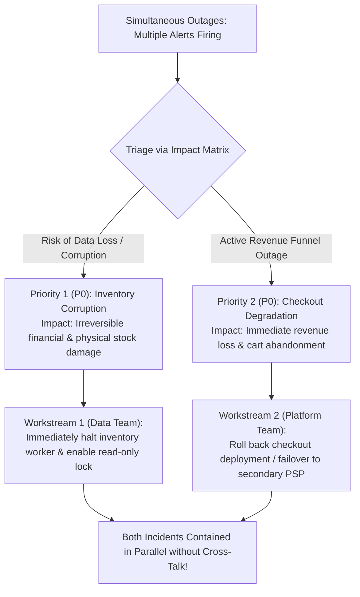

## Fast Revision (10-Second Recall)
- The Golden Rule of Triage: When everything is on fire, prioritize by Blast Radius, Revenue Impact, and Data Integrity.
- Data Corruption Trumps Latency: An active bug corrupting bank balances or customer records (P0) always takes precedence over an API outage.
- Severity Classification Matrix: P0 (Total outage/data loss) -> P1 (Core feature degraded for all) -> P2 (Intermittent or workaround available) -> P3 (Cosmetic).
- Divide and Conquer: Assign separate Incident Commanders to independent incidents; never let a single engineer context-switch between two active outages.
- Stop the Bleeding Before Fixing: Apply blunt mitigations (maintenance page, circuit breaker, read-only mode) to lower-priority incidents while focusing on P0.

## The 30-Second Spoken Script
"When multiple critical incidents hit simultaneously, engineering leadership must prevent panic and establish ruthless prioritization based on business impact and data integrity.

My prioritization hierarchy follows three strict rules:

First, Data Integrity and Compliance trumps availability: If Incident A is causing financial double-billing or database record corruption, while Incident B is an API outage returning 500 errors, Incident A is my absolute top priority. You can recover from temporary downtime; recovering from corrupted or leaked data can destroy a company.

Second, Core Revenue Funnel over peripheral features: If Checkout is degraded alongside Customer Profile Photo Uploads, 100% of available resources pivot to Checkout.

Third, Divide and Conquer: Context switching destroys engineering velocity. I appoint two distinct Incident Commanders and assign technical teams to work parallel workstreams without cross-talk.

If engineering capacity is overwhelmed, I execute fast blunt containment on the secondary incident?"such as toggling maintenance mode or returning a cached fallback?"to stabilize it while the primary team resolves the P0 crisis."

## Scenario / Problem Context
On Cyber Monday at 10:00 AM, two high-severity alerts fire simultaneously: Alert 1 shows the Checkout service dropping 60% of credit card transactions. Alert 2 shows the inventory management worker creating negative stock levels and corrupting catalog data.

## Architectural Workflow / Sequence


## Deep-Dive Analysis & Root Causes
### Data Corruption vs Availability Outage
An availability outage means users get an error screen; their data remains intact. A data corruption bug means invalid transactions, incorrect account balances, or corrupted inventory are being committed to disk. Every second a corruption bug runs, remediation complexity scales exponentially because retroactive data repair scripts must untangle thousands of corrupt rows.

### The Fallacy of Swarming a Single Problem
Putting 30 engineers on a single Zoom call creates noise and paralysis. Effective incident management splits personnel into focused squads: Squad 1 investigates checkout rollback; Squad 2 isolates the inventory database lock; a single Communications Lead updates executives and support teams.

### Blunt Mitigation (Shedding / Degraded Mode)
When engineers are outnumbered by incidents, use architectural blunt instruments. Put non-critical features into read-only maintenance mode, shed 50% of traffic at the API gateway, or enable static fallback pages. Stabilizing the blast radius buys time for deep investigation.

## Practical Debugging Commands & Code
### Emergency Containment Commands
```bash
# 1. Emergency freeze of rogue background worker pods
kubectl scale deployment/inventory-worker --replicas=0 -n prod

# 2. Put database into read-only mode to prevent further data corruption
ALTER DATABASE production_db SET default_transaction_read_only = true;

# 3. Emergency traffic shedding at Nginx Ingress (return 503 for non-critical paths)
kubectl patch ingress/api-ingress -n prod --type='json' -p='[
  {"op": "add", "path": "/metadata/annotations/nginx.ingress.kubernetes.io~1configuration-snippet", 
   "value": "if ($request_uri ~* ^/api/v1/reviews) { return 503; }"}
]'
```

## Prevention & Senior Best Practices
- Pre-Assigned On-Call Escalation Ladders: Maintain primary, secondary, and tertiary on-call schedules in PagerDuty.
- Emergency Feature Toggles (Kill Switches): Implement remote kill switches for every major asynchronous worker and feature.
- Automated Circuit Breakers: Ensure downstream failures trip automated circuit breakers without requiring manual developer intervention.
- Incident Triage Runbooks: Train all on-call engineers on severity definitions and priority matrices during onboarding.
