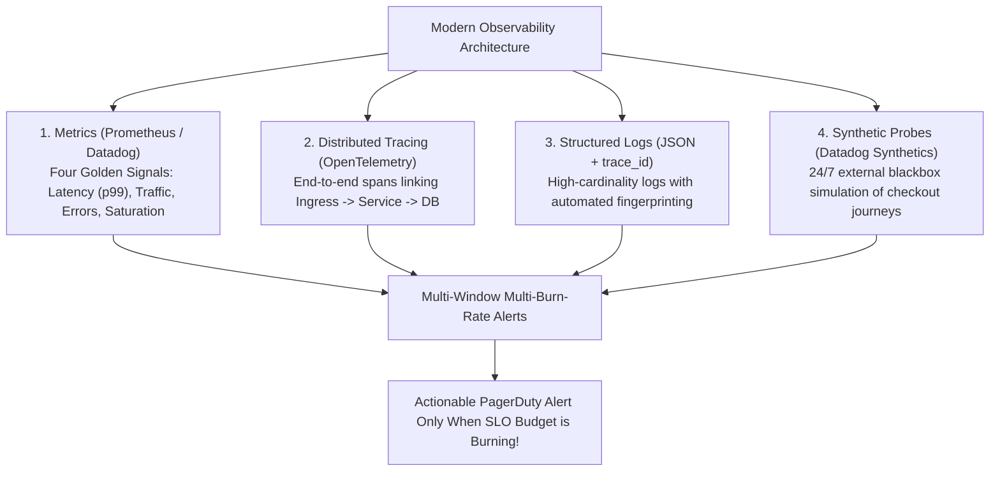

## Fast Revision (10-Second Recall)
- The 4 Golden Signals (Google SRE): Latency, Traffic (RPS), Errors (5xx), and Saturation (CPU, memory, pool limits).
- The RED Method for Microservices: Rate (requests/sec), Errors (failed requests/sec), Duration (time per request).
- Multi-Window Multi-Burn-Rate Alerts: Replace simplistic CPU alerts with SLO error budget burn rate alerts to prevent alert fatigue.
- High-Cardinality Structured Logging: Include `trace_id`, `user_id`, `tenant_id`, and `git_sha` on every log event.
- Synthetic Canary Probes: Continuous end-to-end blackbox tests that execute real user workflows (login -> add to cart -> checkout) every 60s.

## The 30-Second Spoken Script
"Proactive monitoring means detecting and mitigating an incident before a single customer files a support ticket. I build observability on top of Google SRE's Four Golden Signals and Multi-Window Burn Rate alerting.

First, I focus on customer-centric metrics rather than infrastructure noise: Alerting on 'CPU > 80%' is broken because modern apps can run happily at 85% CPU without user impact. Instead, I alert on our Service Level Objectives (SLOs) using Error Budget Burn Rates. If an error surge is consuming 2% of our monthly error budget in 1 hour, that triggers an immediate page to the on-call engineer.

Second, I instrument the RED method across every microservice: Rate (throughput), Errors (error count), and Duration (p95 and p99 latency).

Third, I mandate distributed tracing with OpenTelemetry: When latency spikes, an engineer should not guess which service is slow. Distributed traces immediately pinpoint the exact database query or downstream microservice hop responsible.

Fourth, I deploy 24/7 synthetic browser canaries: Synthetic bots simulate customer journeys every 60 seconds from external global networks, ensuring we catch DNS, edge SSL, and authentication regressions before real users notice."

## Scenario / Problem Context
The engineering team suffers from severe alert fatigue: on-call engineers receive 40 PagerDuty pages a night for harmless CPU blips, yet a catastrophic 30-minute checkout outage went completely undetected until the VP of Sales noticed dropped revenue.

## Architectural Workflow / Sequence


## Deep-Dive Analysis & Root Causes
### The Fallacy of Raw Threshold Alerting
Alerting on static thresholds (e.g., `CPU > 85% for 5 mins` or `Disk > 90%`) is the primary driver of alert fatigue. Most CPU spikes are harmless batch jobs. Meanwhile, an application can fail completely with 0% CPU if threads are deadlocked. Alerting must focus on SLIs: the percentage of successful requests meeting latency objectives.

### Multi-Window Multi-Burn-Rate Alerting (Google SRE)
Burn rate alerting calculates how fast your 30-day error budget is being consumed. A 14.4x burn rate will consume 100% of your monthly budget in 2 days. SRE best practice uses two overlapping time windows (e.g., 1-hour window for fast detection, 6-hour window to eliminate false positive spikes) before paging.

### Distributed Tracing Context Propagation
Without W3C TraceContext propagation across HTTP and gRPC headers (`traceparent`), debugging distributed systems requires matching timestamps across 20 disconnected log files. Context propagation links every downstream call to a single parent trace ID.

## Practical Debugging Commands & Code
### Prometheus AlertManager SLO Burn Rate Rule
```bash
# Prometheus alert rule for 14.4x Error Budget Burn Rate (Pages immediately)
- alert: HighErrorBudgetBurnRate
  expr: (
      sum(rate(http_requests_total{status=~"5.."}[1h]))
      /
      sum(rate(http_requests_total[1h]))
    ) > (1 - 0.999) * 14.4
    and
    (
      sum(rate(http_requests_total{status=~"5.."}[5m]))
      /
      sum(rate(http_requests_total[5m]))
    ) > (1 - 0.999) * 14.4
  for: 2m
  labels:
    severity: page
  annotations:
    summary: "High Error Budget Burn Rate on Checkout Service"
    description: "Consuming >2% of 30-day error budget in under 1 hour."
```

## Prevention & Senior Best Practices
- Implement SLO-Based Alerting: Replace static infrastructure alerts with multi-window error budget burn rate alerts.
- Enforce OpenTelemetry W3C Trace Propagation: Guarantee end-to-end trace context is passed across all internal RPCs and queues.
- Aggressive Alert Hygiene: Delete or tune any alert that fires more than twice a week without requiring technical intervention.
- Automated Synthetic Monitoring: Run multi-step synthetic user transactions continuously from at least 3 distinct geographic regions.
