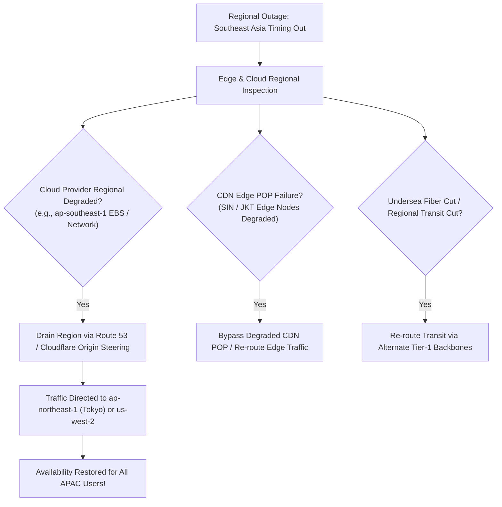

## Fast Revision (10-Second Recall)
- Check Cloud Provider Health: Inspect AWS/GCP/Azure regional status dashboards and personal health dashboard (e.g., `us-west-2` vs `eu-central-1`).
- Verify Anycast & CDN Edge Routing: Is a specific Cloudflare or CloudFront POP node experiencing 100% packet loss?
- Check Regional Third-Party Dependencies: Local payment gateways (PIX in Brazil, iDEAL in Netherlands) or local SMS aggregators.
- Verify GeoDNS Resolution: Is route 53 Geo-Location routing misdirecting users to a decommissioned origin server?
- Mitigate with Traffic Drainage: Drain traffic away from the failing region to a neighboring healthy region using DNS or CDN weighted routing.

## The 30-Second Spoken Script
"When a production issue impacts only a single geographic region, my first goal is to determine whether the fault is in our infrastructure or the regional internet transit network, and mitigate by draining regional traffic.

First, I review edge telemetry: In Cloudflare, CloudFront, or Fastly, I inspect HTTP error rates and origin latency partitioned by edge POP and country code. If errors originate exclusively from European edge locations, I check European cloud regions (e.g., eu-central-1).

Second, I check cloud provider health: Cloud providers frequently experience silent degraded network routing or EBS latency before updating their public status pages. I check our internal cross-region latency metrics and AWS Personal Health Dashboard.

Third, I check regional external dependencies: Regional outages are frequently caused by localized compliance or third-party gateways?"such as a regional banking network or localized SMS gateway failing in that specific jurisdiction.

Fourth, my mitigation is immediate regional drainage: Using Route 53 latency/geo routing or CDN origin failover, I drain 100% of user traffic away from the degraded region and steer it to the nearest healthy region. Users may experience 50ms of additional network latency, but 100% of functionality is restored."

## Scenario / Problem Context
Users in Southeast Asia (Singapore, Indonesia, Vietnam) report that API requests time out with 504 Gateway Timeout. Users across North America, Europe, and Australia experience sub-100ms response times with zero errors.

## Architectural Workflow / Sequence


## Deep-Dive Analysis & Root Causes
### The Silent Cloud Outage Pattern
Major cloud providers rarely turn their global status dashboard red during the first hour of an incident. A subtle degradation in an availability zone's network virtualization layer (e.g., AWS Hyperplane or VPC Peering) causes packet drops while the overall region is technically "operational". Looking at cross-region ping telemetry confirms localized transit degradation.

### Undersea Fiber Cable Cuts and BGP Flapping
Intercontinental internet traffic relies on physical undersea cables (e.g., AAG, SEA-ME-WE). A physical cable cut causes regional ISPs to reroute through saturated backup lines, causing packet loss to jump from 0.1% to 25% and latency to increase by 300ms. Multi-region architectures with local endpoints protect user access.

### Active-Active Multi-Region Traffic Evacuation
To safely drain a geographic region in under 5 minutes, backend databases must support multi-region replication (e.g., CockroachDB, Spanner, or DynamoDB Global Tables) or the application must support cross-region read routing with clear write-forwarding semantics.

## Practical Debugging Commands & Code
### Regional Network & Edge Diagnostic CLI
```bash
# 1. Perform MTR (My Traceroute) from regional probe to detect transit packet loss
mtr -rw -c 50 api.example.com

# 2. Query DNS resolution from specific regional public resolvers
dig @1.0.0.1 api.example.com +nsid # Cloudflare AP POP
dig @8.8.4.4 api.example.com +nsid # Google DNS

# 3. Drain regional traffic in AWS Route 53 (set weight to 0)
aws route53 change-resource-record-sets --hosted-zone-id Z123456 \
  --change-batch '{
    "Changes": [{
      "Action": "UPSERT",
      "ResourceRecordSet": {
        "Name": "api.example.com",
        "Type": "A",
        "SetIdentifier": "APAC-Primary",
        "Weight": 0,
        "TTL": 60,
        "ResourceRecords": [{"Value": "13.250.0.1"}]
      }
    }]
  }'
```

## Prevention & Senior Best Practices
- Automated Regional Failover: Configure Route 53 DNS Health Checks with automatic failover to healthy regions.
- Active-Active Multi-Region Architecture: Maintain compute capacity in at least two geographic regions with pre-warmed headroom.
- Regional Canary Probes: Run continuous synthetic probes from regional vantage points (Singapore, Frankfurt, Virginia, Tokyo) every 30 seconds.
- Edge CDN Origin Shielding: Implement Cloudflare Argo Smart Routing or AWS CloudFront Origin Shield to navigate around intermediate internet transit congestion.
