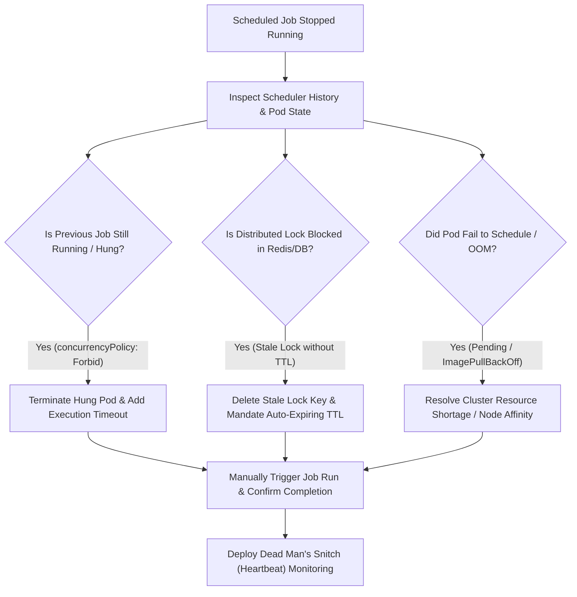

## Fast Revision (10-Second Recall)
- Silent Failure Pattern: Cron jobs frequently fail silently because no incoming HTTP request triggers an APM alert.
- Previous Instance Still Running (Overlap Deadlock): A job scheduled every 10 minutes takes 15 minutes; the next run is blocked or skipped.
- Distributed Lock Stale / Not Released: Redis/DB lock acquired by a crashed instance never expired due to a missing TTL.
- Kubernetes CronJob Concurrency Policy: `concurrencyPolicy: Forbid` silently skips runs if the previous pod is hung.
- Timezone & Daylight Savings Shift: Scheduler UTC vs server local timezone mismatch or cron syntax error.

## The 30-Second Spoken Script
"When a scheduled background job stops executing, the biggest risk is that it failed silently without tripping user-facing alerts. I investigate using four systematic steps:

First, I check execution history and concurrency locks: In Kubernetes CronJobs or distributed schedulers like Quartz/Temporal, I check if the previous run is still active. If concurrencyPolicy is set to Forbid and the previous pod hung on an unclosed socket or database lock, all subsequent executions are skipped.

Second, I inspect distributed locks: If the scheduler uses Redis or database locks to prevent multi-instance runs (e.g., ShedLock or Redlock), I check if an earlier crashed container left an unexpired lock with no TTL, permanently blocking future executions.

Third, I verify scheduler health and cron syntax: Did a recent deployment change the crontab expression, or did a Daylight Savings Time shift alter the UTC trigger hour? I check the scheduler logs to confirm it evaluated the schedule.

Fourth, I check resource constraints and admission webhooks: In containerized environments, CronJobs create new pods on schedule. If the cluster is out of CPU/memory or image pull fails, the pod remains in Pending status indefinitely.

Once isolated, I release the lock or terminate the hanging pod, and immediately configure Dead Man's Snitch monitoring."

## Scenario / Problem Context
The daily billing reconciliation job scheduled to run at 02:00 AM UTC did not execute for the last two nights. No error alerts were triggered, and the finance team discovered the failure manually during month-end reporting.

## Architectural Workflow / Sequence


## Deep-Dive Analysis & Root Causes
### The Danger of Missing Execution Timeouts
If a scheduled job invokes an external API or database query without a socket timeout, the worker process can hang indefinitely in `TCP ESTABLISHED` state. In Kubernetes, a CronJob with `concurrencyPolicy: Forbid` or `Replace` will cease starting new jobs or spawn zombie pods forever.

### Distributed Lock Deadlocks (ShedLock / Redis)
To prevent duplicate runs in multi-instance clusters, frameworks acquire a distributed lock: `SET lock:billing-job worker-1 NX PX 3600000`. If the node crashes or the JVM is terminated via SIGKILL before the release block, and the TTL was set to 24 hours or infinite, all subsequent runs are rejected.

### Dead Man's Snitch (Inverted Monitoring)
Standard alerts trigger when an error occurs. But when a cron job stops running, zero logs and zero errors are generated. The only reliable monitoring for scheduled jobs is an inverted heartbeat (Dead Man's Snitch): the job pings an external monitor upon completion; if no ping arrives by 02:15 AM, an alert fires.

## Practical Debugging Commands & Code
### CronJob & Scheduler Diagnostic Commands
```bash
# 1. Check Kubernetes CronJob status and recent job runs
kubectl get cronjob -n prod
kubectl get jobs -n prod --sort-by='.metadata.creationTimestamp' | tail -n 10

# 2. Inspect pods created by the CronJob and check for Pending / CrashLoop
kubectl get pods -n prod -l job-name=<job-name>
kubectl describe pod <cron-pod-name> -n prod

# 3. Check for stale ShedLock entries in PostgreSQL
SELECT * FROM shedlock WHERE name = 'dailyBillingReconciliation';

# 4. Check Redis distributed lock key and remaining TTL
redis-cli -h redis.internal TTL lock:cron:dailyBilling
```

## Prevention & Senior Best Practices
- Dead Man's Snitch / Heartbeat Pings: Use Healthchecks.io, Cronitor, or Opsgenie Heartbeats to alert when a scheduled job fails to ping within its expected window.
- Mandatory Pod Deadlines: Set `activeDeadlineSeconds: 1800` in Kubernetes Job specs to automatically terminate hung pods after 30 minutes.
- Strict Distributed Lock TTLs: Configure distributed locks with short, bounded TTLs (`lockAtMostFor: 15m`) so crashed workers cannot permanently block schedules.
- Idempotent Job Design: Structure cron jobs to be safely rerunnable so manual backfills can be executed with zero risk of duplicate billing.
