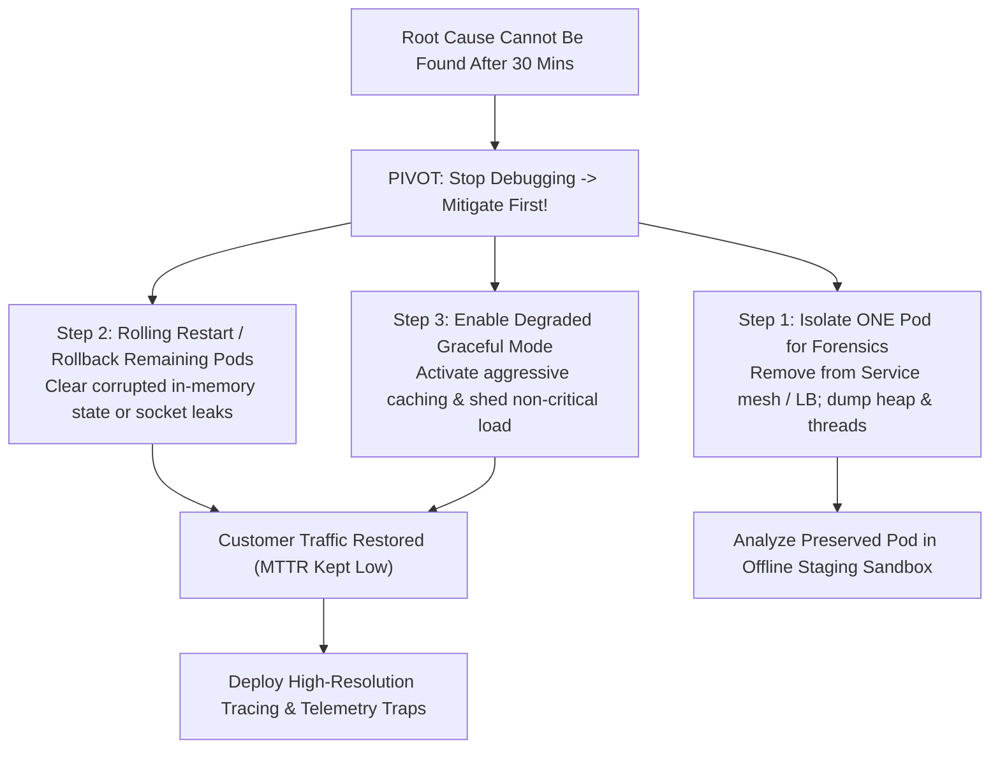

## Fast Revision (10-Second Recall)
- Shift Focus: Never keep production down while debugging. Your mandate is to Restore Service, not Prove a Hypothesis.
- Execute Safe State Reset: Roll back recent deployments, restart degraded nodes/pods sequentially, flush caches with care.
- Re-route / Degrade Gracefully: Fail over to secondary region or enable degraded read-only / cached fallback mode.
- Preserve Forensic Artifacts: Capture heap dumps, thread dumps, and system logs from at least one node BEFORE resetting.
- Establish Observability Traps: Add high-resolution logging, OpenTelemetry tracing, and canary probes to catch the next recurrence.

## The 30-Second Spoken Script
"When production is degraded and 30 minutes of deep triage fails to uncover the root cause, I do not let the system stay down while we theorize. I transition immediately from 'root-cause debugging' to 'defensive service restoration'.

First, I preserve one failing instance for forensics: If 10 pods are misbehaving, I isolate one pod by removing it from the load balancer target group so it retains its in-memory state, and capture thread dumps, heap dumps, and system logs.

Second, I execute a safe restart or rollback: I trigger a rolling restart of the remaining nodes or roll back to yesterday's stable release artifact. In cloud environments, recreation of ephemeral compute instances often resolves hidden kernel leaks, socket exhaustion, or zombie locks.

Third, if restarts fail, I enable graceful degradation: I switch non-critical systems to read-only mode, enable aggressive CDN caching, or shed non-essential background traffic to reduce system strain.

Fourth, once customer traffic is restored, I treat the unknown issue as a critical latent risk: I instrument the codebase with targeted tracing, dynamic logging, and assertions so that if the condition recurs, the system automatically captures exact forensic breadcrumbs."

## Scenario / Problem Context
The checkout service has experienced an intermittent 35% error rate for the past 45 minutes. The team has checked recent deployments, database locks, CPU, and third-party APIs, but found no obvious anomaly. The executive team is demanding restoration.

## Architectural Workflow / Sequence


## Deep-Dive Analysis & Root Causes
### The "Just 5 More Minutes" Debugging Trap
Engineers fall into the sunk cost fallacy during outages: "I'm close to finding the bug, give me 5 more minutes." Meanwhile, 30 minutes pass and thousands of users are impacted. Senior leadership enforces a strict 20-minute triage cap: if the root cause is not identified within 20 minutes, mandatory mitigation (restart, rollback, failover) is executed.

### Isolating a "Canary Victim" Node
If you restart all servers at once, the issue goes away temporarily, but you have zero clues why it happened and it will inevitably recur tomorrow. Removing one failing container from ingress routing keeps it alive in its corrupted state, giving you hours to run profilers, inspect file descriptors, and examine memory.

### Instrumenting Telemetry Traps
When an unknown bug disappears after a restart, deploy "observability traps". Add custom metrics that track suspicious internal data structures, thread pool queue sizes, and connection pool checkout times with alerts that trigger at 50% capacity before user-facing errors appear.

## Practical Debugging Commands & Code
### Isolate Pod for Forensics & Safe Rolling Restart
```bash
# 1. Remove failing pod from Kubernetes Service endpoints by removing label
kubectl label pod order-service-79bc6-x8z91 app=order-service-debug --overwrite -n prod

# 2. Capture thread dump and logs from isolated pod
kubectl exec order-service-79bc6-x8z91 -n prod -- jstack 1 > /tmp/forensic-jstack.txt
kubectl logs order-service-79bc6-x8z91 -n prod > /tmp/forensic-logs.txt

# 3. Perform graceful rolling restart of the remaining deployment
kubectl rollout restart deployment/order-service -n prod

# 4. Watch rollout completion
kubectl rollout status deployment/order-service -n prod
```

## Prevention & Senior Best Practices
- Strict Triage Time Limits: Enforce a policy where triage switches to mitigation if root cause is unverified after 20 minutes.
- Comprehensive Core and Heap Dumps: Automate capture of memory dumps and pod logs before automated restarts.
- Circuit Breakers and Degraded Fallbacks: Build degraded operational modes into all critical microservices.
- Soak and Chaos Testing: Use Chaos Mesh or Gremlin in staging to recreate obscure race conditions and resource leaks.
