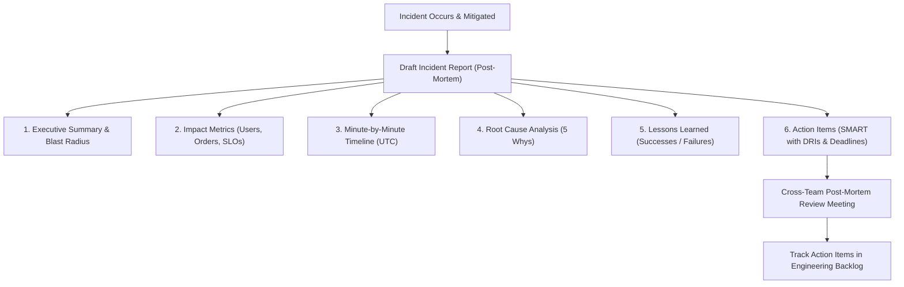

## Fast Revision (10-Second Recall)
- Key Sections: Summary, Impact (User/Financial), Timeline (UTC), Root Cause, Trigger, Resolution/Mitigation, Lessons Learned, Action Items.
- Quantify Impact Accurately: Total downtime in minutes, number of affected users, dropped orders, financial revenue lost, SLA/SLO error budget consumed.
- Strict Chronological Timeline: Record exact timestamps in UTC from change introduced -> alert fired -> triage started -> mitigated -> resolved.
- Action Items SMART Criteria: Specific, Measurable, Achievable, Relevant, and Time-bound with designated single DRI (Directly Responsible Individual).
- Share Widely: Publish internally to foster organizational learning and cross-team architectural resilience.

## The 30-Second Spoken Script
"A great production incident report serves two audiences: leadership who needs to understand business impact and risk, and engineers who need technical clarity to prevent recurrence.

I structure every post-mortem with six core sections:

First, Executive Summary: A one-paragraph, jargon-free summary outlining what happened, why, the customer impact, and how it was resolved.

Second, Impact Metrics: Quantitative data?"such as 42 minutes of downtime, 14,200 failed checkout attempts, and 12% of our monthly SLO error budget consumed.

Third, Chronological Timeline in UTC: From the initial commit deployment to the first synthetic alert, the war room formation, mitigation action, and full recovery.

Fourth, Root Cause Analysis: Using the 5 Whys to articulate both the immediate trigger (e.g., an unindexed query) and the underlying systemic failure (e.g., lack of automated query plan checks in CI).

Fifth, Lessons Learned: What went well, what went poorly, and where we got lucky.

Sixth, Action Items: A prioritized checklist of preventative engineering tasks, each assigned to a single DRI with a firm completion deadline."

## Scenario / Problem Context
Following a 45-minute outage on the core authentication service, the VP of Engineering requests an official incident post-mortem report before tomorrow morning's executive leadership meeting.

## Architectural Workflow / Sequence


## Deep-Dive Analysis & Root Causes
### Timeline Precision and UTC Standardization
During an incident, engineers operate across multiple timezones. Writing "at 2:15 PM" creates chaos when analyzing logs. Every entry in the incident report must use UTC timestamps with standardized format (`YYYY-MM-DD HH:MM:SS UTC`) and link directly to relevant APM dashboard snapshots or log queries.

### The "Where We Got Lucky" Section
A mature post-mortem includes an honest assessment of good fortune. For example: "We got lucky that this occurred on Tuesday morning during working hours rather than Saturday midnight, and that an engineer with deep database knowledge happened to be online." Identifying reliance on luck exposes fragile processes that need automation.

### Tracking Action Items to Completion
The most common post-mortem failure is writing a brilliant document whose action items are forgotten in a Jira backlog. Leading engineering organizations review open post-mortem action items weekly in leadership meetings and block new feature development if P0 reliability action items exceed their SLA.

## Practical Debugging Commands & Code
### Standard Post-Mortem Markdown Template
```bash
# Production Incident Post-Mortem: [INC-2026-104]
**Date:** 2026-10-31 | **Severity:** P0 | **Incident Commander:** Jane Doe

## 1. Executive Summary
On October 31, 2026 at 14:12 UTC, our primary authentication API experienced a 42-minute outage.
Customers were unable to log in, resulting in 18,400 failed authentication requests.
Service was restored at 14:54 UTC by rolling back release v2.41.1.

## 2. Impact
- **Total Downtime:** 42 minutes (14:12 - 14:54 UTC)
- **User Impact:** 18,400 login failures (~14% of daily active users)
- **SLO Impact:** Consumed 34% of monthly 99.9% Availability Error Budget

## 3. Timeline (All times in UTC)
- 14:05 - Deployment of v2.41.1 initiated by CI/CD pipeline.
- 14:12 - Automated synthetic canary alerts fire (500 Error Rate > 5%).
- 14:15 - Incident Commander declares P0; war room opened.
- 14:24 - Root cause isolated to missing environment secret in Vault.
- 14:48 - Rollback command issued via kubectl.
- 14:54 - Error rates return to 0%; incident resolved.

## 4. Action Items
- [ ] Add pre-flight secret validation to deployment script. (Owner: John | Due: Nov 7)
- [ ] Lower synthetic alert notification threshold from 5% to 1%. (Owner: Alice | Due: Nov 4)
```

## Prevention & Senior Best Practices
- Mandatory Post-Mortem for all P0/P1 Incidents: Convene the post-mortem review within 72 hours of incident resolution.
- Public Post-Mortem Repository: Store all incident reports in a searchable, company-wide repository (Confluence / GitHub repo) for cross-team visibility.
- Customer-Facing Summary: Translate internal post-mortems into transparent customer-facing status reports for enterprise trust.
- SLA on Action Item Completion: Enforce strict resolution windows (P0 action items: 14 days, P1 action items: 30 days).
