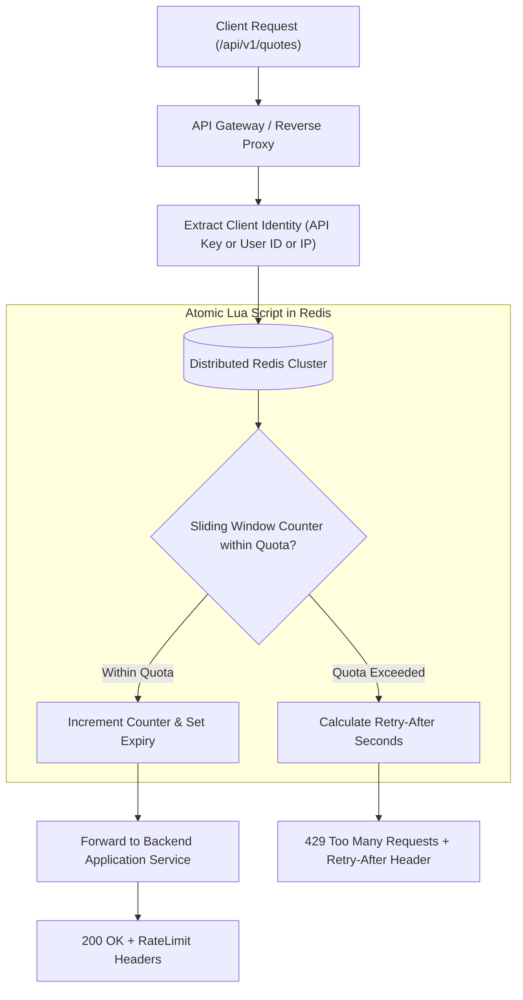

## Fast Revision (10-Second Recall)
Implement rate limiting using the Sliding Window Counter algorithm backed by Redis and executed atomically via Lua scripts. Identify clients by authenticated User ID (or API key/IP for public routes) and return standard RateLimit headers with 429 Too Many Requests when limits are exceeded.

## The 30-Second Spoken Script
> "Rate limiting is essential for protecting APIs against brute-force attacks, scraping, and noisy-neighbor service degradation. We evaluate algorithms based on accuracy and memory efficiency. While Fixed Window counters suffer from traffic spikes at window boundaries and Sliding Window Logs consume excessive memory, the Sliding Window Counter provides the ideal balance—calculating weighted averages between the current and previous window with low memory overhead. In a distributed microservice environment, local in-memory limits fail because requests distribute across multiple nodes. Therefore, we back our rate limiters with Redis, executing atomic Lua scripts to eliminate race conditions between reading and updating counters. When clients exceed quotas, we respond with HTTP status `429 Too Many Requests`, accompanied by `RateLimit-Limit`, `RateLimit-Remaining`, and `Retry-After` headers."

## Scenario / Problem Context
A public developer API allows third parties to query market prices. An aggressive customer ran concurrent multithreaded web scrapers sending 2,000 requests per second, exhausting backend database connection pools and causing cascading outages for other users. The team must implement a distributed, tamper-proof rate limiter across the API gateway.

## Architectural Workflow / Sequence


## Deep-Dive Analysis & Root Causes

### 1. Comparison of Rate Limiting Algorithms
| Algorithm | Pros | Cons | Ideal Use Case |
|---|---|---|---|
| **Fixed Window Counter** | Extremely low memory (single integer), fast | Burst vulnerability: double limit at window boundary | Basic tier throttling |
| **Sliding Window Log** | 100% accurate, no burst boundary issues | High memory: stores timestamp per request | Low-volume, high-security APIs |
| **Token Bucket** | Accommodates controlled bursts, smooth replenishment | Requires tracking tokens and last refill timestamp | General API traffic shaping (AWS style) |
| **Leaky Bucket** | Guarantees constant output rate | Bursts queue up; packets dropped if queue full | Egress traffic shaping to third parties |
| **Sliding Window Counter** | High accuracy, constant memory | Approximation during window transitions | Production high-scale API Gateways |

### 2. The Sliding Window Counter Approximation Formula
Instead of logging every request timestamp, track counters in discrete windows (e.g., 1 minute).
When a request arrives at 30% through the current window:
- Estimated Count = (Previous Window Count $\times$ 70%) + Current Window Count.
If Estimated Count is below the limit, allow the request; otherwise drop it.

### 3. Distributed Concurrency: Why Lua Scripts Are Mandatory
In a distributed architecture with multiple gateway instances:
1. Thread A: `GET counter` (reads 99).
2. Thread B: `GET counter` (reads 99).
3. Thread A: `INCR` (writes 100).
4. Thread B: `INCR` (writes 100).
Both threads passed the limit of 100 due to a classic race condition.
Executing the logic inside a **Redis Lua script** guarantees single-threaded atomic execution on the Redis server, preventing race conditions without needing distributed locks.

## Practical Debugging Commands & Code

#### Distributed Sliding Window Counter in Redis (Lua Script)
```lua
-- KEYS[1]: Current window key (e.g. rate:user123:1700000060)
-- KEYS[2]: Previous window key (e.g. rate:user123:1700000000)
-- ARGV[1]: Max limit
-- ARGV[2]: Current window weight (e.g. 0.40)
-- ARGV[3]: Window duration in seconds (e.g. 60)

local current_count = tonumber(redis.call('get', KEYS[1]) or "0")
local prev_count = tonumber(redis.call('get', KEYS[2]) or "0")

local estimated_count = math.floor(prev_count * (1.0 - tonumber(ARGV[2])) + current_count)

if estimated_count < tonumber(ARGV[1]) then
    -- Increment current window
    redis.call('incr', KEYS[1])
    if current_count == 0 then
        -- Set TTL to 2x window duration so it acts as prev_window later
        redis.call('expire', KEYS[1], tonumber(ARGV[3]) * 2)
    end
    return {1, tonumber(ARGV[1]) - estimated_count - 1} -- Allowed, Remaining
else
    return {0, 0} -- Blocked
end
```

#### Node.js Rate Limiting Middleware
```typescript
import { Request, Response, NextFunction } from 'express';
import Redis from 'ioredis';

const redis = new Redis();
const WINDOW_SIZE_SEC = 60;
const MAX_REQUESTS = 100;

const RATE_LIMIT_LUA = `
local current_count = tonumber(redis.call('get', KEYS[1]) or "0")
local prev_count = tonumber(redis.call('get', KEYS[2]) or "0")
local estimated_count = math.floor(prev_count * (1.0 - tonumber(ARGV[2])) + current_count)
if estimated_count < tonumber(ARGV[1]) then
    redis.call('incr', KEYS[1])
    if current_count == 0 then
        redis.call('expire', KEYS[1], tonumber(ARGV[3]) * 2)
    end
    return {1, tonumber(ARGV[1]) - estimated_count - 1}
else
    return {0, 0}
end
`;

export async function slidingWindowRateLimiter(req: Request, res: Response, next: NextFunction) {
  // Client identification priority: Authenticated User > API Key > IP
  const clientId = (req as any).user?.id || req.headers['x-api-key'] || req.ip;
  const now = Math.floor(Date.now() / 1000);
  
  const currentWindow = Math.floor(now / WINDOW_SIZE_SEC) * WINDOW_SIZE_SEC;
  const prevWindow = currentWindow - WINDOW_SIZE_SEC;
  const weight = (now % WINDOW_SIZE_SEC) / WINDOW_SIZE_SEC;

  const currentKey = `rate:${clientId}:${currentWindow}`;
  const prevKey = `rate:${clientId}:${prevWindow}`;

  const [allowed, remaining] = (await redis.eval(
    RATE_LIMIT_LUA,
    2,
    currentKey,
    prevKey,
    MAX_REQUESTS,
    weight,
    WINDOW_SIZE_SEC
  )) as [number, number];

  res.setHeader('X-RateLimit-Limit', MAX_REQUESTS);
  res.setHeader('X-RateLimit-Remaining', Math.max(0, remaining));

  if (allowed === 0) {
    const retryAfter = WINDOW_SIZE_SEC - (now % WINDOW_SIZE_SEC);
    res.setHeader('Retry-After', retryAfter);
    return res.status(429).json({
      error: 'Too Many Requests',
      message: `Rate limit exceeded. Try again in ${retryAfter} seconds.`,
    });
  }

  next();
}
```

## Prevention & Senior Best Practices

### 1. Architectural Guardrails
- **Multi-Tiered Quotas**: Implement tiered rate limits: per-second limits to prevent spikes (burst protection) combined with per-hour/per-day limits to prevent resource draining.
- **Fail-Open vs Fail-Closed Strategy**: Determine resilience policy if Redis goes down. For non-critical APIs, fail-open with local memory throttling to prevent rate limiting infrastructure from becoming a single point of failure.

### 2. Operational Hardening
- **Standardized Response Headers**: Always return RFC 6585 and IETF standardized headers (`RateLimit-Limit`, `RateLimit-Remaining`, `RateLimit-Reset`, `Retry-After`) to allow well-behaved SDKs to back off automatically.
- **Exempt Health Check Endpoints**: Never apply rate limits to internal health check probes (`/healthz`, `/readyz`), which would trigger false container restarts.

